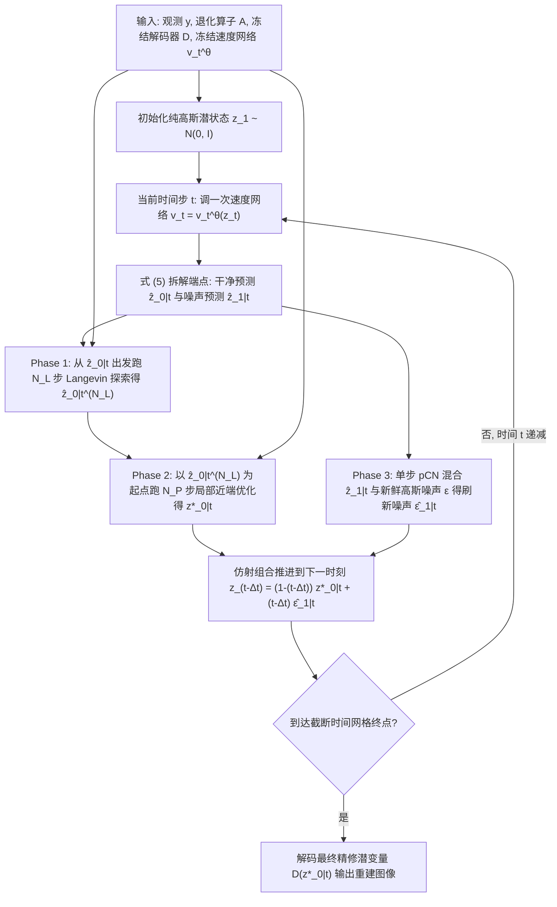

# FlowLPS: Langevin-Proximal Sampling for Flow-based Inverse Problem Solvers

# First Time

## 1.Title & Authors
论文原标题：FlowLPS: Langevin-Proximal Sampling for Flow-based Inverse Problem Solvers。
自然中文译法：FlowLPS：面向流模型逆问题求解器的朗之万—近端采样。
把标题里的关键词拆开，整篇论文的骨架立刻一目了然：
- Inverse Problem Solvers（逆问题求解器）：手里只有一张被“拍坏”的观测图（例如重度模糊、12 倍降采样马赛克、中间挖掉一大块或随机丢掉 70% 像素），任务是把原本清晰的图像推回原样。因为退化丢掉了大量信息，满足同一张观测图的合理原图不止一张，求解器必须同时抓住“像自然照片（先验）”和“对得上观测（测量一致性）”两头。
- Flow-based（基于流模型）：本文直接调用预训练的潜空间流匹配大模型（实验主骨干为 Stable Diffusion 3.5-Medium），零重新训练，把大模型的速度场当成现成的强图像先验。
- Langevin-Proximal Sampling（朗之万—近端采样）：标题最核心的主张是把“带噪声的朗之万探索（Langevin）”和“确定性的局部近端优化（Proximal）”串成接力赛——每一步先用少量 Langevin 迭代把起点晃进更好的候选谷底，再用近端优化快速沉底拉紧观测一致性，同时保留采样随机性。
作者按原文顺序列出：Jonghyun Park、Jong Chul Ye，两人均来自韩国科学技术院（KAIST），原文未标注共同第一作者或贡献分工。从论文参考文献 [6]、[10]、[14]、[23] 可知，Jong Chul Ye 团队正是扩散/流模型逆问题求解领域的核心主力之一，先后提出过经典的 DPS、MCG、DDS 与 FlowDPS；本篇 FlowLPS 正是该团队将有限步求解思路推进到潜空间流匹配（SD3）上的最新力作。

## 2.Abstract
摘要的逻辑非常紧扣工程痛点，按“大模型落地困境 → 两派极端的短板 → FlowLPS 三步组合拳 → 实验成绩”四拍推进，下面按语义单元逐句拆解：
1. 背景与现实约束：深度生成模型为成像逆问题提供了极强的图像先验，但在潜空间流模型上做免训练（training-free）推理时，实际面临一个棘手的有限步数权衡（finite-step trade-off）。
   这里“免训练”指不微调预训练大模型权重，只在推理阶段靠计算梯度反复更新潜变量；而现实推理只能给有限的步数预算（本文主实验固定 40 NFE、每步 15 次内部更新），算法好不好用，全看这有限的预算怎么花。
2. 偏重优化派（optimization-heavy）的痛点：这类方法靠反复最小化测量误差，能很快让重建图贴合观测；但在高度非线性的 VAE 潜空间里，优化地形布满局部山谷，结果严重依赖局部细化的起点，容易掉进过平滑或带伪影的谷底，拉低感知真实感。
3. 偏重随机采样派（stochastic sampling）的痛点：这类方法靠持续注入随机噪声保留了后验探索能力，不容易被固定起点锁死；但代价是收敛慢，在有限迭代步数内还没来得及收敛出清晰锐利、严格符合观测的图像，预算就已经花完了。
4. 提出主方案（FlowLPS）：为打通这两派之间的断层，作者提出基于 Langevin-Proximal Sampling 的免训练潜空间流逆问题求解器 FlowLPS。
5. 第一招——少量 Langevin 初始化（Phase 1）：在每个逆向时间步里，先对流模型预测出的干净潜估计施加少量 Langevin 更新，沿后验方向施加带随机性的扰动，为接下来的局部细化提供多样且受观测引导的随机起点。
   全篇最巧的观念转换就在这里：FlowLPS 不指望 Langevin 跑几百步去严格收敛到真实后验，而是把它当成一个轻巧的“探路器 / 随机初始化器”，花 4–6 步把优化起点从平庸的默认预测里晃出来。
6. 第二招——局部 MAP 风格近端细化（Phase 2）：紧接着从 Langevin 探出来的这个新起点出发，做局部最大后验（MAP）风格的近端优化，关掉随机噪声、专心把测量一致性快速拉到位。
   一探一收，把每一步 15 次内部更新分成“先探索找好谷底、再优化快速沉底”两段接力。
7. 第三招——受控 pCN 风格重新加噪（Phase 3）：把干净估计修好后，还要重新混回噪声推进到下一时间步。作者引入受控的 pCN（preconditioned Crank-Nicolson）风格噪声刷新，在注入适量随机探索的同时保留流模型原有的噪声方向，稳住整条逆向生成轨迹的连贯性。
8. 实验范围与结论：在 FFHQ（人脸）和 DIV2K（自然场景）两大数据集、五种线性成像逆问题（高斯去模糊、运动去模糊、12 倍超分、块状修补、随机修补）上，FlowLPS 在测量保真度与感知质量之间取得了强平衡；附录进一步将方法扩展到了像素空间流模型和非线性的相位恢复（phase retrieval）任务。
把摘要浓缩为四要素总览：

| 要素 | 本文核心内容 |
|---|---|
| 问题 | 潜空间流模型做免训练逆问题求解时，有限计算预算下“偏重优化（易受起点困住、纹理发糊）”与“偏重采样（探索够但收敛慢、难聚焦）”存在尖锐矛盾。 |
| 方法 | 提出 FlowLPS：每个逆向步先跑少量 Langevin 更新做后验引导的随机初始化，再做局部 MAP 风格近端细化快速拉齐测量一致性，最后用受控 pCN 风格刷新噪声推进轨迹。 |
| 结果 | 在 FFHQ 1k 和 DIV2K 0.8k 的五种线性逆问题上（40 NFE、15 次内部更新），10 组评测中全部拿下 LPIPS 最优、8 组拿下 FID 最优，同时保持有竞争力的 PSNR/SSIM，并在像素空间和相位恢复上保持同样优势。 |
| 意义 | 跳出“非采样即优化”的二选一思维，把 Langevin 探索重新定位为局部近端优化的随机初始化，在有限推理预算下实现了探索与聚焦的高效分工。 |

## 3.Conclusion
原文第 6 节是独立的 Conclusion，精炼地由一段工作总结和一段 Limitations 组成：
1. 工作总结段——完整收束全篇证据链：
   - 方法定性：FlowLPS 是一个免训练的潜空间流逆问题求解器，把后验引导的 Langevin 初始化与局部测量一致的近端细化组合进每个逆向步骤。
   - 机制与证据：这一设计直指随机探索与确定性细化在有限步数下的预算权衡，正文既给出了局部分析（Proposition 2 与 Lemma 1，对比进入同一局部邻域后确定性收缩与持续加噪的方差差异），又通过固定总步数的 $N_L$ 消融实验（Fig4、Fig5）验证了中间配比的优势。
   - 轨迹衔接与总效果：配合受控 pCN 风格重新加噪稳住生成轨迹，方法在多类逆问题上取得了测量保真度与感知真实感之间的良好平衡。
2. Limitations 段——作者直白交代的关键应用边界：
   - 依赖预训练先验的风险：FlowLPS 高度依赖预训练骨干模型（SD3.5）的图像先验。面对远离训练分布（out-of-distribution）的输入，模型可能产生伪影，或者“脑补”出观测数据本身并未支持的虚假细节（hallucinated details）。
   - 高风险场景警示：因此，在医学成像、司法取证、科学成像等要求每个细节都有严格物理依据的高风险领域使用时必须格外谨慎。
原文结论部分未单独列出未来研究路线，整体陈述与摘要和实验结论严丝合缝。

## 4.Analogy
可以把潜空间逆问题求解想象成“蒙着半层雾，在一片连绵起伏的山谷里找最像原图的那处宝藏洼地”：
- 整片地形是 VAE 解码器撑起来的非线性潜空间，海拔越低代表图像越同时满足“像自然照片”和“对得上模糊观测 $\mathbf{y}$”。你在每个推理时间步只有 15 分钟的固定体力预算（对应 $N_T=15$ 次内部更新），流模型先用空投把你扔在一个大概靠谱的落点（$\hat{\mathbf{z}}_{0\mid t}$）。
- 偏重优化派（如 Flower、DDS）：一落地就埋头顺着下坡狂奔 15 分钟。它确实能飞快冲到脚下那个小坑的最底端（测量误差降得很快、PSNR 很高），但如果空投落点恰好掉进了一个平庸、发糊的浅坑里，再怎么埋头冲刺也跳不出这个坑，修出来的脸容易像磨皮过度的假人。
- 偏重采样派（如 DAPS）：全程 15 分钟都在一边看下坡指南针、一边随机乱跳探索周围地形（每步都加 Langevin 噪声）。它不容易被死坑困住，但直到第 15 分钟闹钟响了，脚下还在晃荡着没踩稳，最后交出来的画总带着未收敛的毛躁与噪点。
- FlowLPS 的接力打法：把 15 分钟劈成两半——前 5 分钟带着随机跳跃大胆探路（Langevin 初始化），趁机跳出平庸浅坑、闯进旁边更深更清晰的优质山谷；闹钟一到立刻关掉随机跳跃，后 10 分钟稳扎稳打沿着坡度一路滑到新山谷的最深处（局部近端细化），既找对了好谷底又踩得严严实实！
- pCN 风格重新加噪像什么？每轮修完准备进入下一关时，你得重新蒙上一层薄雾继续演化。如果把上一关好不容易摸清的风向（模型预测噪声 $\hat{\mathbf{z}}_{1\mid t}$）全扔掉重抽（$\rho_t=0$），下一关连贯的发丝和轮廓容易断档；FlowLPS 用 $\rho_t=\sqrt{1-t}$ 精巧地“保留一部分旧风向 + 吹入一部分新风”——早期雾浓时多吹新风放手探索，后期快成图时紧守旧风向稳住细节。
这个类比的边界很明确：真实算法是在高维连续潜空间里用梯度和 SGD 迭代完成的，并不会显式列出或比较多个山谷；同时地形本身由预训练流模型和解码器定死，如果真实图像超出了模型见过的数据分布，再好的搜索策略也找不到地形之外的细节。

# Second Time

## 1.Notation & Parameters
全文公式围绕四件事展开：“观测退化 → 潜流端点分解 → Langevin 探路与近端细化 → 局部收敛界与 pCN 噪声刷新”。下表汇总读懂主线必需的核心记号，完全保留论文原写法。

| 符号/参数 | 含义与作用 | 关键设定/约束 |
|---|---|---|
| $\mathbf{x}_0$、$\mathbf{y}$ | 待恢复的真实清晰图像、拿到的含噪退化观测 | 满足式（1）$\mathbf{y}=\mathcal{A}(\mathbf{x}_0)+\mathbf{n}$；主实验分辨率 $768\times 768$ |
| $\mathcal{A}$、$\mathcal{D}$ | 已知正向退化算子、预训练 VAE 解码器 | 主实验为五类线性退化；潜空间求解中测量残差经 $\mathcal{A}(\mathcal{D}(\mathbf{z}))$ 计算 |
| $\mathbf{n}$、$\sigma_n$ | 观测加性高斯噪声及其标准差 | $\mathbf{n}\sim\mathcal{N}(\mathbf{0},\sigma_n^2\mathbf{I})$；全篇主实验与像素扩展均设 $\sigma_n=0.03$ |
| $\mathbf{z}_0$、$\mathbf{z}_t$、$\mathbf{z}_1$ | 干净潜端点、时刻 $t$ 的中间带噪潜状态、源高斯噪声端点 | 逆向生成从 $t=1$（纯噪声）走向 $t=0$（干净图）；$\mathbf{z}_t\in\mathbb{R}^d$ |
| $t$、$\Delta t$ | 当前连续时间、离散逆向步长 | 一步推进至 $t-\Delta t$；实际推理采用截断时间网格，不走到 $t=0$ |
| $p_1=p$、$p_0=q$、$p_t$ | 源噪声分布、目标数据分布、中间边缘分布 | 注意这里的 $q$ 是目标分布名，与第 10 节局部收缩因子 $q=1-\tau\mu$ 同形异义 |
| $\mathbf{v}_t(\mathbf{z}_t)$、$\mathbf{v}_t^\theta$ | 理想边缘速度场、预训练参数化速度场网络 | 推理全程冻结 $\theta$；主实验采用 Stable Diffusion 3.5-Medium |
| $\hat{\mathbf{z}}_{0\mid t}$、$\hat{\mathbf{z}}_{1\mid t}$ | 由流速度一步推算出的干净端点预测与噪声端点预测 | 式（5）：$\hat{\mathbf{z}}_{0\mid t}=\mathbf{z}_t-t\mathbf{v}_t(\mathbf{z}_t)$，$\hat{\mathbf{z}}_{1\mid t}=\mathbf{z}_t+(1-t)\mathbf{v}_t(\mathbf{z}_t)$ |
| $p(\mathbf{z}_0\mid\mathbf{z}_t,\mathbf{y})$ | 给定当前带噪状态与观测后的干净潜变量条件后验 | 借助式（9）的局部高斯近似 $p(\mathbf{z}_0\mid\mathbf{z}_t)\approx\mathcal{N}(\hat{\mathbf{z}}_{0\mid t},s_t^2\mathbf{I})$ 实现可计算 |
| $s_t^2$ | 条件干净先验分布的启发式近似方差 | 决定近端正则权重 $\sigma_n^2/s_t^2$；Appendix B.1 统一设为 $s_t^2=t$ |
| $\eta_t$、$\zeta_t$ | Langevin 阶段步长（正文与附录两种记号） | 正文式（11）与 Algorithm 1 记作 $\eta_t$，Appendix B.1 与 Table 4 记作 $\zeta_t=10^{-4}$ |
| $N_L$、$N_P$、$N_T$ | Langevin 更新步数、近端优化步数、两者总预算 | 满足 $N_T=N_L+N_P$；主实验固定 $N_T=15$，按任务分配（$N_L\in\{4,5,6\}$） |
| $\hat{\mathbf{z}}_{0\mid t}^{(j)}$、$\mathbf{z}_{0\mid t}^*$ | 第 $j$ 步 Langevin 后的干净潜估计、近端细化后的干净潜估计 | 从 $\hat{\mathbf{z}}_{0\mid t}^{(0)}=\hat{\mathbf{z}}_{0\mid t}$ 跑 $N_L$ 步得 $\hat{\mathbf{z}}_{0\mid t}^{(N_L)}$，再跑 $N_P$ 步 SGD 逼近 $\mathbf{z}_{0\mid t}^*$ |
| $\rho_t$、$\hat{\boldsymbol{\epsilon}}_{1\mid t}$ | pCN 刷新中的旧噪声保留系数、Algorithm 1 刷新后的噪声端点 | 正文第 4.4 节设 $\rho_t=\sqrt{1-t}$；Algorithm 1 在 $t-\Delta t$ 处取值 |
| $\Phi$、$\mathbf{z}_B^\star$、$\Omega_B$ | 负对数条件后验、局部极小点及其凸邻域 | $\Phi(\mathbf{z}_0):=-\log p(\mathbf{z}_0\mid\mathbf{z}_t,\mathbf{y})$；仅用于局部光滑强凸分析 |
| $\mu$、$L$、$\tau$ | 局部强凸下界、光滑上界、理论分析步长 | 满足 $0<\mu\le L$ 与 $0<\tau\le 1/L$ |
| $q$、$R_N$ | 局部单步收缩因子、连续 $N$ 步确定性梯度细化映射 | $q=1-\tau\mu<1$；与前述数据分布符号 $q$ 按上下文区分 |

三处原文细节差异先拎在台面上，后文逐一对照：一是正文式（12）的近端锚点写在 $\hat{\mathbf{z}}_{0\mid t}$，而 Algorithm 1 改写成了 Langevin 末值 $\hat{\mathbf{z}}_{0\mid t}^{(N_L)}$；二是正文 pCN 系数用当前时刻 $\rho_t=\sqrt{1-t}$，而 Algorithm 1 用了下一时刻 $\sqrt{1-(t-\Delta t)}$；三是 Langevin 步长正文写 $\eta_t$、附录写 $\zeta_t$。阅读时顺着各自原式区分，就不会被绊倒。

## 2.Introduction
对应原文 Section 1。引言直奔主题：今天大家手里的生成先验（SD3 这类潜空间流模型）已经很强了，那为什么用它解逆问题还是顾此失彼？作者顺着四步把病灶点透：
1. 写清任务起点——公式（1）：
$$
\mathbf{y}=\mathcal{A}(\mathbf{x}_0)+\mathbf{n},
\qquad
\mathbf{n}\sim\mathcal{N}(\mathbf{0},\sigma_n^2\mathbf{I}).
$$
真实清晰图像 $\mathbf{x}_0$ 经已知正向退化算子 $\mathcal{A}$（如模糊卷积、12 倍降采样、区域遮挡）并叠加各向同性高斯噪声 $\mathbf{n}$ 后，得到手里仅有的观测 $\mathbf{y}$。由于退化不可逆，同一张 $\mathbf{y}$ 对应无数张可能原图，因此必须引入预训练扩散或流模型作为先验，去寻找同时契合数据分布与观测的解。
2. 打破老分类，换用“有限步运行状态”看问题：
   传统文献常把生成式逆问题求解器分成“后验引导派（posterior-guided）”和“优化校正派（optimization-based）”。作者敏锐指出：在潜空间大模型（如 Stable Diffusion）与有限推理预算下，真正决定画质的不是名义上的派别标签，而是算法把宝贵的计算预算如何分配在“随机后验探索”和“测量驱动的局部细化”之间。尤其经过高度非线性的 VAE 解码器后，每步只做一次轻飘飘的测量修正根本不够（因此 ReSample、FlowDPS、FLAIR 纷纷强化每步的多步测量优化）。
3. 精准画出两大极端运行状态（对应 [Fig2 精读](#fig2)）：
   - 细化占优状态（Refinement-dominant，如 DDS、FLAIR、Flower）：把预算全砸在反复局部测量校正上。好处是观测残差掉得飞快；坏处是在高度非凸的潜空间里严重依赖初始落点，而且强行大力拉扯容易偏离先验流形，导致局部过平滑、假纹理或伪影。
   - 采样占优状态（Sampling-dominant，如基于 Langevin 的 DAPS）：把预算全花在随机后验探索上。好处是多样性好、不死板；坏处是在有限步数预算内还没来得及收束到清晰、严丝合缝的测量一致解，预算就烧光了。
4. 亮出 FlowLPS 的破局思路：
   借鉴经典的 Langevin+correction 视角，把 Langevin 更新从“漫长的全后验采样器”重新定位为局部细化的随机初始化机制：每步先跑少量 Langevin 迭代沿后验方向探出更好的随机起点，再切入局部 MAP 风格近端细化快速拉紧测量一致性，最后用受控 pCN 风格重新加噪把轨迹平稳送进下一时间步。
引言末尾的四个贡献正好对应后文四根支柱：混合推理框架、局部有限步理论分析与 $N_L$ 消融、受控 pCN 重新加噪、以及覆盖 FFHQ/DIV2K 五种线性任务（[Fig1 精读](#fig1) 展示直观效果）外加像素空间与相位恢复的实验验证。

## 3.Related Work
对应原文 Section 2，按“方法构造轴”和“有限步运行状态轴”两条线索梳理相关工作：
1. 方法构造轴（Diffusion and Flow-Based Inverse Solvers）：
   - 后验引导路线：从贝叶斯定理直接写出中间状态的后验 score 分解（原文无编号核心式）：
$$
\nabla_{\mathbf{z}_t}\log p(\mathbf{z}_t\mid\mathbf{y})
=\nabla_{\mathbf{z}_t}\log p(\mathbf{z}_t)
+\nabla_{\mathbf{z}_t}\log p(\mathbf{y}\mid\mathbf{z}_t).
$$
   推导一步到位：由 $p(\mathbf{z}_t\mid\mathbf{y})=p(\mathbf{y}\mid\mathbf{z}_t)p(\mathbf{z}_t)/p(\mathbf{y})$ 两边取对数并对 $\mathbf{z}_t$ 求梯度，分母 $\log p(\mathbf{y})$ 与 $\mathbf{z}_t$ 无关自动消去。第一项是预训练生成模型的先验 score，第二项是把轨迹拉向观测的似然 score。真正的拦路虎在于 $\mathbf{z}_t$ 还是带噪状态，似然 $p(\mathbf{y}\mid\mathbf{z}_t)$ 没法直接算。于是 DPS 等方法用去噪预测或高斯假设近似它；后续工作（如 DDS、DAPS、FlowChef、FlowDPS）更进一步，直接围绕当前预测出的干净估计 $\hat{\mathbf{z}}_{0\mid t}$ 施加后验更新，省去了反复对整个速度网络求导的沉重开销。
   - 优化校正路线：通过显式优化、变分目标或近端更新（如 PnP-Flow、RLSD、FLAIR、Flower）直接把测量误差按下去，每步多跑几次迭代就能快速收紧残差；但在潜空间里，解码器带来的剧烈非凸性让强优化极易陷入糟糕的局部极小，损伤自然纹理。
2. 有限步运行状态轴（Operating Regimes in Latent-Space Solvers）：
   这才是真正把 FlowLPS 放到地图正中央的坐标系（对应 [Fig2 精读](#fig2)）：
   - 细化占优端：DDS（多步共轭梯度细化）、FLAIR（解耦精确一致性优化）、Flower（强近端更新）——速度快、失真低，但对起点敏感、易偏离自然细节。
   - 采样占优端：DAPS（用 Langevin 动力学从 $p(\mathbf{z}_0\mid\mathbf{z}_t,\mathbf{y})$ 采样）——随机探索足、保真先验强，但相同预算下难快速聚拢出锐利细节。
   - 混合中间带（FlowLPS）：让少量 Langevin 探索专门服务于随后的局部近端细化，把两端的长处拼在同一个有限步预算里。

## 4.Preliminaries
对应原文 Section 3，由两块简洁的数学基石组成：第一块把 Flow Matching 的速度场翻成“干净端点 + 噪声端点”的直观接口（直接决定 FlowLPS 怎么改图、怎么加噪）；第二块介绍经典的 Langevin+correction 算子分解思想，交代 FlowLPS 的灵感来源。

## 5.Flow Matching
对应原文 Section 3 的 Flow Matching 部分。这一节所有推导的目标只有一个：证明“在 Rectified Flow 里，只要调一次速度网络，就能同时抠出当前时刻对干净图 $\hat{\mathbf{z}}_{0\mid t}$ 和纯噪声 $\hat{\mathbf{z}}_{1\mid t}$ 的预测，而且下一步状态恰好是两者的直线加权！”
1. 生成常微分方程——公式（2）：
   流模型沿着时间依赖的边缘分布路径 $p_t$，把易采样的源噪声分布 $p_1=p$ 搬运到目标数据分布 $p_0=q$，由逆向时间 ODE 驱动：
$$
d\mathbf{z}_t=\mathbf{v}_t(\mathbf{z}_t)dt,
\qquad
\mathbf{z}_1\sim p_1=p,
$$
   其中 $\mathbf{v}_t:[0,1]\times\mathbb{R}^d\to\mathbb{R}^d$ 是边缘速度场。生成时时间从 $t=1$ 倒走到 $t=0$，离散时间步增量为负，因此微分方程本身保持正号即可。
2. 线性插值路径——公式（3）与边缘速度场——公式（4）：
   对于 Rectified Flow，给定按独立耦合 $\pi(\mathbf{z}_0,\mathbf{z}_1)=q(\mathbf{z}_0)p(\mathbf{z}_1)$ 抽取的数据端点 $\mathbf{z}_0$ 与噪声端点 $\mathbf{z}_1$，中间状态直接拉直线插值（式 3）：
$$
\mathbf{z}_t=t\mathbf{z}_1+(1-t)\mathbf{z}_0.
$$
   对式（3）关于时间 $t$ 求导，单条直线路径的瞬时速度恒为 $\mathbf{z}_1-\mathbf{z}_0$。由于很多条不同端点对的直线都可能穿过同一个中间点 $\mathbf{z}_t$，边缘速度场就是所有经过 $\mathbf{z}_t$ 的路径速度的条件期望（式 4）：
$$
\mathbf{v}_t(\mathbf{z}_t)
=\mathbb{E}[\mathbf{z}_1-\mathbf{z}_0\mid\mathbf{z}_t]
=\mathbb{E}[\mathbf{z}_1\mid\mathbf{z}_t]-\mathbb{E}[\mathbf{z}_0\mid\mathbf{z}_t].
$$
   第二步仅用到条件期望的线性性，但它把速度场精准拆成了“噪声期望减干净图期望”。
3. 一步反解两大端点预测——公式（5）：
   这是整个 FlowLPS 的核心接口。把式（3）两边对 $\mathbf{z}_t$ 取条件期望，立刻得到关于两个未知期望的二元一次方程组：
$$
\begin{cases}
\mathbf{z}_t = t\mathbb{E}[\mathbf{z}_1\mid\mathbf{z}_t]+(1-t)\mathbb{E}[\mathbf{z}_0\mid\mathbf{z}_t], \\
\mathbf{v}_t(\mathbf{z}_t) = \mathbb{E}[\mathbf{z}_1\mid\mathbf{z}_t]-\mathbb{E}[\mathbf{z}_0\mid\mathbf{z}_t].
\end{cases}
$$
   消元只需两行中学代数：
   - 用第一式减去 $t$ 倍第二式，正好消掉 $\mathbb{E}[\mathbf{z}_1\mid\mathbf{z}_t]$，剩下 $(1-t+t)\mathbb{E}[\mathbf{z}_0\mid\mathbf{z}_t]=\mathbb{E}[\mathbf{z}_0\mid\mathbf{z}_t]$；
   - 用第一式加上 $(1-t)$ 倍第二式，正好消掉 $\mathbb{E}[\mathbf{z}_0\mid\mathbf{z}_t]$，剩下 $(t+1-t)\mathbb{E}[\mathbf{z}_1\mid\mathbf{z}_t]=\mathbb{E}[\mathbf{z}_1\mid\mathbf{z}_t]$。
   于是直接得到干净图条件均值预测 $\hat{\mathbf{z}}_{0\mid t}$ 和噪声条件均值预测 $\hat{\mathbf{z}}_{1\mid t}$（式 5）：
$$
\hat{\mathbf{z}}_{0\mid t}:=\mathbb{E}[\mathbf{z}_0\mid\mathbf{z}_t]=\mathbf{z}_t-t\mathbf{v}_t(\mathbf{z}_t),
\qquad
\hat{\mathbf{z}}_{1\mid t}:=\mathbb{E}[\mathbf{z}_1\mid\mathbf{z}_t]=\mathbf{z}_t+(1-t)\mathbf{v}_t(\mathbf{z}_t).
$$
   这两个式子的妙处在于没有任何除以时间步的分母（不含 $1/t$ 或 $1/(1-t)$），数值极其稳健；而且一次前向调用速度网络，干净端和噪声端一箭双雕全拿到了！
4. 把 Euler 步改写成端点加权——公式（6）：
   从 $t$ 倒退一步 $\Delta t$ 到 $t-\Delta t$，式（2）的显式 Euler 步是 $\mathbf{z}_{t-\Delta t}=\mathbf{z}_t-\Delta t\,\mathbf{v}_t(\mathbf{z}_t)$。把式（4）代入，再把其中的 $\mathbf{z}_t$ 换成上面的条件期望插值 $t\mathbb{E}[\mathbf{z}_1\mid\mathbf{z}_t]+(1-t)\mathbb{E}[\mathbf{z}_0\mid\mathbf{z}_t]$，合并同类项：
$$
\begin{aligned}
\mathbf{z}_{t-\Delta t}
&=\mathbf{z}_t-\Delta t\bigl(\mathbb{E}[\mathbf{z}_1\mid\mathbf{z}_t]-\mathbb{E}[\mathbf{z}_0\mid\mathbf{z}_t]\bigr) \\
&=t\mathbb{E}[\mathbf{z}_1\mid\mathbf{z}_t]+(1-t)\mathbb{E}[\mathbf{z}_0\mid\mathbf{z}_t]-\Delta t\mathbb{E}[\mathbf{z}_1\mid\mathbf{z}_t]+\Delta t\mathbb{E}[\mathbf{z}_0\mid\mathbf{z}_t] \\
&=\bigl(1-(t-\Delta t)\bigr)\mathbb{E}[\mathbf{z}_0\mid\mathbf{z}_t]+(t-\Delta t)\mathbb{E}[\mathbf{z}_1\mid\mathbf{z}_t].
\end{aligned}
$$
   看这最终形态（式 6）：往回走一步 Euler，本质上就是把“当前预测的干净图”和“当前预测的噪声”按新时间 $t-\Delta t$ 重新按比例混合！这就为 FlowLPS 打开了一扇极清爽的大门——只要把这里的干净端 $\mathbb{E}[\mathbf{z}_0\mid\mathbf{z}_t]$ 替换成经观测精修后的 $\mathbf{z}_{0\mid t}^*$，再把噪声端 $\mathbb{E}[\mathbf{z}_1\mid\mathbf{z}_t]$ 做一次受控刷新，就能丝滑推进整条条件生成轨迹。

## 6.Langevin+correction viewpoint
对应原文 Section 3 的同名部分。在进入 FlowLPS 具体公式前，作者先给出一个统摄全局的二步算子抽象——“先朗之万随机走一步，再加一个确定性校正算子”：
1. 朗之万随机探索步——公式（7）：
$$
\tilde{\mathbf{z}}^{k+1}=\mathbf{z}^k-\gamma\nabla f(\mathbf{z}^k)+\sqrt{2\gamma}\,\epsilon^k,
\qquad
\epsilon^k\sim\mathcal{N}(\mathbf{0},\mathbf{I}).
$$
   其中 $f$ 是势函数（对应负对数目标密度），$\gamma>0$ 是离散步长，$k$ 是迭代编号。负梯度 $-\gamma\nabla f(\mathbf{z}^k)$ 把点往低势能（高概率密度）拉，随机项 $\sqrt{2\gamma}\,\epsilon^k$ 注入协方差为 $2\gamma\mathbf{I}$ 的布朗扰动防止卡死在局部极小，这正是经典未调整朗之万算法（ULA）的离散形式。
2. 确定性校正步——公式（8）：
$$
\mathbf{z}^{k+1}=\mathcal{C}_\gamma(\tilde{\mathbf{z}}^{k+1}).
$$
   换上不同的校正算子 $\mathcal{C}_\gamma$，就能统领一整族经典采样算法：
   - $\mathcal{C}_\gamma=\mathrm{Id}$（恒等映射）：探索完原样不动，退化为普通 ULA；
   - $\mathcal{C}_\gamma=\Pi_{\mathcal{C}}$（投影算子）：把跑出可行域的点投影回约束集合，对应投影朗之万（Projected Langevin）；
   - $\mathcal{C}_\gamma=\operatorname{prox}_{\gamma g}$（近端算子）：把随机点 $\tilde{\mathbf{z}}^{k+1}$ 当作局部锚点，求解带距离惩罚的局部优化问题，对应近端朗之万（Proximal Langevin）。按近端算子的标准定义展开即为：
$$
\operatorname{prox}_{\gamma g}(\tilde{\mathbf{z}}^{k+1})
=\arg\min_{\mathbf{z}}\left\{g(\mathbf{z})+\frac{1}{2\gamma}\|\mathbf{z}-\tilde{\mathbf{z}}^{k+1}\|^2\right\}.
$$
作者把定位说得很直白：经典的近端朗之万理论追求的是无限步后的渐近后验收敛，而 FlowLPS 借用的是这套“探索 → 校正”的实战骨架，服务于潜空间流模型的有限步推理——先用少量 Langevin 步找到好起点，再用近端优化快速集中出清晰且贴合观测的图像。

## 7.Method
对应原文 Section 4 总述。FlowLPS 全程冻结预训练速度场网络 $\mathbf{v}_t^\theta$ 和 VAE 解码器 $\mathcal{D}$，不做任何模型微调。在每个逆向时间步 $t$ 里，它沿着清晰的三步接力推进：
1. 端点拆解：调用一次预训练速度模型 $\mathbf{v}_t^\theta(\mathbf{z}_t)$，用式（5）同时抠出干净潜预测 $\hat{\mathbf{z}}_{0\mid t}$ 和噪声预测 $\hat{\mathbf{z}}_{1\mid t}$。
2. Phase 1 + Phase 2（精修干净端）：从 $\hat{\mathbf{z}}_{0\mid t}$ 出发，先跑 $N_L$ 步后验引导的 Langevin 更新得到随机起点 $\hat{\mathbf{z}}_{0\mid t}^{(N_L)}$，再从这个起点跑 $N_P$ 步局部 MAP 风格近端细化得到测量一致的干净估计 $\mathbf{z}_{0\mid t}^*$。
3. Phase 3（刷新噪声端并前进）：用单步受控 pCN 风格更新把模型预测噪声 $\hat{\mathbf{z}}_{1\mid t}$ 与独立高斯噪声 $\boldsymbol{\epsilon}$ 按 $\rho_t$ 混合，再把精修好的 $\mathbf{z}_{0\mid t}^*$ 和刷新后的噪声端按式（6）的仿射权重拼成下一时刻状态 $\mathbf{z}_{t-\Delta t}$。
下面用 Mermaid 流程图把完整的数据流画清（省略具体截断时间数组、CFG 负向提示词与 SGD 学习率衰减细节；图中并行画出了 pCN 刷新分支与干净端精修分支的真实数据依赖，这与 Algorithm 1 把 pCN 提前放在 Langevin 循环之前的写法完全一致）：

算法全貌对比见 [Fig2 精读](#fig2)，完整逐行伪代码见 [Algorithm1 精读](#algorithm1)。接下来第 8–11 节把每个模块和公式逐一讲透。

## 8.Phase 1: Posterior-Oriented Langevin Initialization
对应原文 Section 4.1。这一步的任务很纯粹：别直接拿着流模型猜出来的粗糙起点 $\hat{\mathbf{z}}_{0\mid t}$ 死磕优化，先用几步带观测指引的 Langevin 随机更新在附近“晃一晃”，把它送进更有希望的局部吸引域。
1. 条件干净先验的局部高斯近似——公式（9）：
   给定当前带噪状态 $\mathbf{z}_t$，真实的干净潜变量条件分布 $p(\mathbf{z}_0\mid\mathbf{z}_t)$ 往往是多峰且复杂的，没法直接写解析式。沿用 $\Pi$GDM、DAPS 等经典做法，作者用围绕当前干净均值预测 $\hat{\mathbf{z}}_{0\mid t}$ 的各向同性高斯分布来近似它：
$$
p(\mathbf{z}_0\mid\mathbf{z}_t)\approx\mathcal{N}(\hat{\mathbf{z}}_{0\mid t},s_t^2\mathbf{I}),
$$
   其中方差 $s_t^2$ 启发式设定（Appendix B.1 简单而直接地取 $s_t^2=t$：早期噪声大时容许干净估计在更宽的范围里活动，后期靠近成图时收紧在 $\hat{\mathbf{z}}_{0\mid t}$ 周围）。
2. 条件后验梯度分解——公式（10）：
   想在给定当前状态 $\mathbf{z}_t$ 和观测 $\mathbf{y}$ 的条件下采样干净潜变量 $\mathbf{z}_0$，利用贝叶斯定理和马尔可夫条件独立性（一旦真实干净图 $\mathbf{z}_0$ 确定，观测 $\mathbf{y}$ 就只取决于 $\mathbf{z}_0$ 而不再额外依赖带噪状态 $\mathbf{z}_t$，即 $p(\mathbf{y}\mid\mathbf{z}_0,\mathbf{z}_t)=p(\mathbf{y}\mid\mathbf{z}_0)$）：
$$
p(\mathbf{z}_0\mid\mathbf{z}_t,\mathbf{y})
=\frac{p(\mathbf{y}\mid\mathbf{z}_0,\mathbf{z}_t)p(\mathbf{z}_0\mid\mathbf{z}_t)}{p(\mathbf{y}\mid\mathbf{z}_t)}
\propto p(\mathbf{y}\mid\mathbf{z}_0)p(\mathbf{z}_0\mid\mathbf{z}_t).
$$
   两边取对数再对 $\mathbf{z}_0$ 求梯度，去掉与 $\mathbf{z}_0$ 无关的归一化项 $\log p(\mathbf{y}\mid\mathbf{z}_t)$，得到式（10）：
$$
\nabla_{\mathbf{z}_0}\log p(\mathbf{z}_0\mid\mathbf{z}_t,\mathbf{y})
=\nabla_{\mathbf{z}_0}\log p(\mathbf{y}\mid\mathbf{z}_0)
+\nabla_{\mathbf{z}_0}\log p(\mathbf{z}_0\mid\mathbf{z}_t).
$$
   把式（1）的高斯观测似然和式（9）的高斯条件先验直接代入求导，两项拉力的物理意义一清二楚：
   - 观测似然拉力：按潜空间完整前向路径 $\mathcal{A}(\mathcal{D}(\mathbf{z}_0))$（正文理论简记为 $\mathcal{A}(\mathbf{z}_0)$），对数似然梯度为
$$
\nabla_{\mathbf{z}_0}\log p(\mathbf{y}\mid\mathbf{z}_0)
=-\frac{1}{2\sigma_n^2}\nabla_{\mathbf{z}_0}\|\mathbf{y}-\mathcal{A}(\mathcal{D}(\mathbf{z}_0))\|^2,
$$
     负责把潜变量往减小观测误差的方向拽；
   - 条件先验拉力：对式（9）的高斯对数密度 $-\frac{1}{2s_t^2}\|\mathbf{z}_0-\hat{\mathbf{z}}_{0\mid t}\|^2$ 求导，得到
$$
\nabla_{\mathbf{z}_0}\log p(\mathbf{z}_0\mid\mathbf{z}_t)
=-\frac{\mathbf{z}_0-\hat{\mathbf{z}}_{0\mid t}}{s_t^2},
$$
     像一根橡皮筋，把候选拉回到流模型预测的 $\hat{\mathbf{z}}_{0\mid t}$ 附近，防止探索跑出合理流形。
3. 少量朗之万更新——公式（11）：
   把起点设为当前流预测 $\hat{\mathbf{z}}_{0\mid t}^{(0)}=\hat{\mathbf{z}}_{0\mid t}$，连续跑 $j=0,\dots,N_L-1$ 共 $N_L$ 步：
$$
\hat{\mathbf{z}}_{0\mid t}^{(j+1)}
=\hat{\mathbf{z}}_{0\mid t}^{(j)}
+\eta_t\nabla_{\hat{\mathbf{z}}_{0\mid t}^{(j)}}\log p(\hat{\mathbf{z}}_{0\mid t}^{(j)}\mid\mathbf{z}_t,\mathbf{y})
+\sqrt{2\eta_t}\,\boldsymbol{\epsilon}_j,
\qquad
\boldsymbol{\epsilon}_j\sim\mathcal{N}(\mathbf{0},\mathbf{I}).
$$
   这里沿对数后验密度做梯度上升（等价于沿负对数后验做梯度下降），同时每步注入方差为 $2\eta_t\mathbf{I}$ 的标准高斯噪声 $\boldsymbol{\epsilon}_j$。注意整个内循环期间，当前状态 $\mathbf{z}_t$ 和先验中心 $\hat{\mathbf{z}}_{0\mid t}$ 全都钉死不变，迭代对象只有干净潜估计本身。跑完短短 4–6 步后，我们拿到一个既嗅到了观测方向、又带了随机扰动的新起点 $\hat{\mathbf{z}}_{0\mid t}^{(N_L)}$，立刻交棒给下一阶段！实证步数权衡见 [Fig4 精读](#fig4) 和 [Fig5 精读](#fig5)。

## 9.Phase 2: Local MAP-Style Proximal Refinement
对应原文 Section 4.2。仅仅跑完 4–6 步带噪 Langevin 后，候选点虽然跳进了更有潜力的区域，但因为一直有噪声晃动，图像还不够清晰、观测误差也没彻底压下去。于是第二阶段关掉噪声，切入确定性的局部近端优化。
1. Proposition 1 与近端 MAP 等价目标——公式（12）：
   在式（9）的局部高斯条件先验 $p(\mathbf{z}_0\mid\mathbf{z}_t)=\mathcal{N}(\hat{\mathbf{z}}_{0\mid t},s_t^2 I)$ 与式（1）的高斯观测噪声 $\mathbf{n}\sim\mathcal{N}(\mathbf{0},\sigma_n^2\mathbf{I})$ 假设下，最大后验估计（MAP）直接化简为经典的近端测量细化目标（式 12）：
$$
\mathbf{z}_{0\mid t}^{*}
=\arg\max_{\mathbf{z}_0}\log p(\mathbf{z}_0\mid\mathbf{z}_t,\mathbf{y})
=\arg\min_{\mathbf{z}_0}\left\{\|\mathbf{y}-\mathcal{A}(\mathbf{z}_0)\|^2+\frac{\sigma_n^2}{s_t^2}\|\mathbf{z}_0-\hat{\mathbf{z}}_{0\mid t}\|^2\right\}.
$$
   结合 Appendix A 的证明，推导只需三步，极其干净：
   - 第一步，由贝叶斯规则与 $p(\mathbf{y}\mid\mathbf{z}_0,\mathbf{z}_t)=p(\mathbf{y}\mid\mathbf{z}_0)$，最大化 $\log p(\mathbf{z}_0\mid\mathbf{z}_t,\mathbf{y})$ 等价于最大化 $\log p(\mathbf{y}\mid\mathbf{z}_0)+\log p(\mathbf{z}_0\mid\mathbf{z}_t)$；
   - 第二步，代入两个高斯分布的对数密度，扔掉与 $\mathbf{z}_0$ 无关的常数项，得到：
$$
\max_{\mathbf{z}_0}\left\{-\frac{\|\mathbf{y}-\mathcal{A}(\mathbf{z}_0)\|^2}{2\sigma_n^2}-\frac{\|\mathbf{z}_0-\hat{\mathbf{z}}_{0\mid t}\|^2}{2s_t^2}\right\};
$$
   - 第三步，把最大化负号目标翻成最小化正号目标，再整体乘以正常数 $2\sigma_n^2$（不改变极小点位置），立刻得到式（12）！
   看清目标里两个项的拔河机制：
   - 第一项 $\|\mathbf{y}-\mathcal{A}(\mathbf{z}_0)\|^2$（潜空间实现中完整写为 $\|\mathbf{y}-\mathcal{A}(\mathcal{D}(\mathbf{z}))\|^2$）是数据保真项，拼命拉紧测量一致性；
   - 第二项 $\frac{\sigma_n^2}{s_t^2}\|\mathbf{z}_0-\hat{\mathbf{z}}_{0\mid t}\|^2$ 是近端锚定项，系数 $\sigma_n^2/s_t^2$ 完美编码了“信噪比权衡”——当观测噪声 $\sigma_n$ 越大（照片越不可靠）或时间越晚 $s_t^2=t$ 越小（流预测已经很准）时，锚定权重越大，防止优化盲目拟合观测噪声！
   （顺便看清一个数值边界：取 $s_t^2=t$ 时，一旦 $t\to 0$ 权重 $\sigma_n^2/t$ 会发散到无穷大，这也是 Appendix B.1 采用截断时间网格、绝不跑到 $t=0$ 的直接数学原因之一。）
2. 统一两端运行状态的滑动开关：
   在总步数 $N_T=N_L+N_P$ 固定时，FlowLPS 成了连接两派极端的连续桥梁：
   - 设 $N_P=0$（砍掉近端细化）：全程只跑 Langevin，行为落回类似 DAPS 的采样占优状态；
   - 设 $N_L=0$（砍掉 Langevin 初始化）：直接从 $\hat{\mathbf{z}}_{0\mid t}$ 做纯近端优化，行为落回类似 Flower 的细化占优状态。
3. 精读核查出的一个重要原文差异（式 12 vs Algorithm 1）：
   仔细对照第 4.2 节文字与 [Algorithm1 精读](#algorithm1) 会发现一个关键差别：
   - 在正文式（12）里，二次锚定项的中心仍然是原始流预测 $\hat{\mathbf{z}}_{0\mid t}$，而 Langevin 末值 $\hat{\mathbf{z}}_{0\mid t}^{(N_L)}$ 只充当梯度优化的初始起点（即“换个更好的起点去优化同一个固定条件 MAP 能量”）；
   - 但在 Algorithm 1 里，二次锚定项的中心被写成了 $\hat{\mathbf{z}}_{0\mid t}^{(N_L)}$，即 $\operatorname*{argmin}_{\mathbf{z}}\|\mathbf{y}-\mathcal{A}(\mathcal{D}(\mathbf{z}))\|^2+\frac{\sigma_n^2}{s_t^2}\|\mathbf{z}-\hat{\mathbf{z}}_{0\mid t}^{(N_L)}\|^2$——这在数学上相当于把 Langevin 输出本身当成近端算子 $\operatorname{prox}_{\gamma g}(\tilde{\mathbf{z}})$ 的锚定中心（恰好贴合第 6 节式 8 的古典近端朗之万形式），不仅换了起点，也平移了局部二次惩罚的中心。原文未解释为何两处写法不同，复现代码时需明确核对具体采用哪一版本。

## 10.Local Finite-Step Analysis
对应原文 Section 4.3（并结合 Appendix A 的完整证明式 20–33）。这一节回答一个非常自然的追问：“既然 Langevin 自己也有后验梯度，为什么不能一竿子跑完 15 步 Langevin，非要在后半程关掉噪声切到确定性近端优化？”
作者坦率限定了分析的舞台：这里不讨论全局怎么跨山谷选吸引域，而是假设 Phase 1 已经帮我们把点放进了一个好山谷的局部凸邻域 $\Omega_B$ 里，来看看在同样有限的 $N$ 步内，“确定性梯度细化”和“继续跑 ULA 朗之万”谁能更快、更稳地收束到谷底 $\mathbf{z}_B^\star$！
1. 局部强凸光滑地形假设——公式（13）：
   定义局部能量函数 $\Phi(\mathbf{z}_0):=-\log p(\mathbf{z}_0\mid\mathbf{z}_t,\mathbf{y})$。在式（9）的高斯近似下，$\Phi$ 与式（12）的近端目标只差一个正放缩因子和加法常数，极小点完全重合。假设 $\Phi$ 在局部极小点 $\mathbf{z}_B^\star$ 的凸邻域 $\Omega_B$ 上二阶可微，且 Hessian 矩阵的特征值上下有界（式 13）：
$$
\mu\mathbf{I}\preceq\nabla^2\Phi(\mathbf{z})\preceq L\mathbf{I},
\qquad
\forall\mathbf{z}\in\Omega_B,
$$
   其中 $0<\mu\le L$（$\mu$ 是最小曲率/强凸常数，$L$ 是最大曲率/光滑常数），理论步长满足 $0<\tau\le\frac{1}{L}$，且分析假定迭代点全程留在 $\Omega_B$ 内。
2. Proposition 2（确定性近端细化的指数级收缩与“漏斗放大”效应）——公式（14）与（15）：
   令 $R_N$ 表示步长为 $\tau$ 的连续 $N$ 步梯度细化，记单步收缩因子 $q=1-\tau\mu<1$。Proposition 2 给出两条漂亮的不等式：
$$
\|R_N(\mathbf{z})-\mathbf{z}_B^\star\|\le q^N\|\mathbf{z}-\mathbf{z}_B^\star\|,
$$
$$
B_{r/q^N}\subseteq R_N^{-1}(B_r),
\qquad
B_r=\{\mathbf{z}:\|\mathbf{z}-\mathbf{z}_B^\star\|\le r\},\ B_{r/q^N}\subset\Omega_B.
$$
   沿用 Appendix A 的原符号 $T(\mathbf{z})=\mathbf{z}-\tau\nabla\Phi(\mathbf{z})$（式 21），四行就能彻底推穿：
   - 第一步，利用局部极小点梯度为零 $\nabla\Phi(\mathbf{z}_B^\star)=\mathbf{0}$，写出单步误差（式 22）：
$$
T(\mathbf{z})-\mathbf{z}_B^\star
=\mathbf{z}-\mathbf{z}_B^\star-\tau\bigl(\nabla\Phi(\mathbf{z})-\nabla\Phi(\mathbf{z}_B^\star)\bigr);
$$
   - 第二步，因为 $\Omega_B$ 是凸集，连接 $\mathbf{z}_B^\star$ 和 $\mathbf{z}$ 的整条线段 $\mathbf{z}_B^\star+s(\mathbf{z}-\mathbf{z}_B^\star)$（$s\in[0,1]$）全落在 $\Omega_B$ 里，由微积分基本定理把梯度差写成线段上的平均 Hessian 积分（式 23）：
$$
T(\mathbf{z})-\mathbf{z}_B^\star
=\left[\mathbf{I}-\tau\int_0^1\nabla^2\Phi\bigl(\mathbf{z}_B^\star+s(\mathbf{z}-\mathbf{z}_B^\star)\bigr)\,ds\right](\mathbf{z}-\mathbf{z}_B^\star);
$$
   - 第三步，由式（13），路径上每一点的 Hessian 特征值都在 $[\mu,L]$ 之间，因此平均 Hessian 的特征值仍在 $[\mu,L]$ 之间。乘以 $\tau$ 再被 $\mathbf{I}$ 减去后，括号里对称矩阵的全部特征值落在 $[1-\tau L,1-\tau\mu]$。由于 $0<\tau\le 1/L$，下界 $1-\tau L\ge 0$，因此该对称矩阵的谱范数（最大特征值绝对值）不超过 $q=1-\tau\mu<1$（式 24），于是单步严格收缩 $\|T(\mathbf{z})-\mathbf{z}_B^\star\|\le q\|\mathbf{z}-\mathbf{z}_B^\star\|$（式 25）；
   - 第四步，反复套用 $N$ 次即得式（14）的几何收缩界 $\|R_N(\mathbf{z})-\mathbf{z}_B^\star\|\le q^N\|\mathbf{z}-\mathbf{z}_B^\star\|$（式 26）。反过来读式（14）：只要细化前的起点落在半径扩大了 $q^{-N}$ 倍的大球 $B_{r/q^N}$ 里（$q>0$ 时），经过 $N$ 步近端细化就会被乖乖吸进半径为 $r$ 的小球 $B_r$ 里，这正是式（15）的集合原像包含关系 $B_{r/q^N}\subseteq R_N^{-1}(B_r)$！
   几何直觉瞬间通透：近端细化就像在谷底架起了一只半径放大 $q^{-N}$ 倍的“超级漏斗”——前一步的 Langevin 根本不需要自己精准命中针尖大小的谷底 $B_r$，只要把起点晃进宽阔得多的漏斗口 $B_{r/q^N}$ 里，剩下的确定性细化就会指数级把它吸入谷底！
3. Lemma 1（如果死磕纯 Langevin 会怎样？）——公式（16）与（17）：
   在完全相同的局部地形 $\Omega_B$ 里，假如不关掉噪声，继续跑 $N$ 步 ULA 朗之万迭代（式 16）：
$$
\mathbf{z}_{k+1}=\mathbf{z}_k-\tau\nabla\Phi(\mathbf{z}_k)+\sqrt{2\tau}\,\boldsymbol{\xi}_k,
\qquad
\boldsymbol{\xi}_k\sim\mathcal{N}(\mathbf{0},\mathbf{I}_d),
$$
   （注意此处局部迭代起点 $\mathbf{z}_0$ 与前文流时间 0 的干净端复用同一字母，按语境区分），Lemma 1 给出均方误差上界（式 17）：
$$
\mathbb{E}\|\mathbf{z}_N-\mathbf{z}_B^\star\|^2
\le q^{2N}\|\mathbf{z}_0-\mathbf{z}_B^\star\|^2
+2\tau d\frac{1-q^{2N}}{1-q^2},
\qquad
q=1-\tau\mu.
$$
   沿用 Appendix A 的记号 $T(\mathbf{z})=\mathbf{z}-\tau\nabla\Phi(\mathbf{z})$ 与 $a_k=\mathbb{E}\|\mathbf{z}_k-\mathbf{z}_B^\star\|^2$（式 27–33），四步推完：
   - 第一步，把式（16）写成 $\mathbf{z}_{k+1}-\mathbf{z}_B^\star=T(\mathbf{z}_k)-\mathbf{z}_B^\star+\sqrt{2\tau}\,\boldsymbol{\xi}_k$（式 29）；
   - 第二步，两边求平方范数展开，并在给定 $\mathbf{z}_k$ 下取条件期望。因为新鲜噪声 $\boldsymbol{\xi}_k\sim\mathcal{N}(\mathbf{0},\mathbf{I}_d)$ 与 $\mathbf{z}_k$ 独立，交叉项 $2\sqrt{2\tau}\,\langle T(\mathbf{z}_k)-\mathbf{z}_B^\star,\mathbb{E}[\boldsymbol{\xi}_k]\rangle=0$，而噪声平方范数期望 $\mathbb{E}\|\boldsymbol{\xi}_k\|^2=d$，于是直接得（式 30–31）：
$$
\mathbb{E}\bigl[\|\mathbf{z}_{k+1}-\mathbf{z}_B^\star\|^2\mid\mathbf{z}_k\bigr]
=\|T(\mathbf{z}_k)-\mathbf{z}_B^\star\|^2+2\tau d
\le q^2\|\mathbf{z}_k-\mathbf{z}_B^\star\|^2+2\tau d;
$$
   - 第三步，两边再取总期望，得到简洁的一阶线性递推 $a_{k+1}\le q^2 a_k+2\tau d$（式 32）；
   - 第四步，从 $k=0$ 展开 $N$ 步并用等比级数求和（式 33）：
$$
a_N\le q^{2N}a_0+2\tau d\sum_{\ell=0}^{N-1}q^{2\ell}
=q^{2N}a_0+2\tau d\frac{1-q^{2N}}{1-q^2}.
$$
4. 一眼看穿两者的核心对比与理论边界：
   把式（14）平方后的 $q^{2N}\|\mathbf{z}_0-\mathbf{z}_B^\star\|^2$ 和式（17）并排摆在一起，答案立刻跃然纸上：
   - 确定性近端细化只有第一项，误差随步数 $N$ 指数衰减直奔 0；
   - 持续 ULA 虽然漂移项有着完全一样的收缩率 $q^{2N}$，但后面永远拖着一个正的随机噪声地板项 $2\tau d\frac{1-q^{2N}}{1-q^2}$——维度 $d$ 越高，这层持续抖动的“弥散云”就越厚，有限步内根本聚不紧！
   这就从理论上解释了为什么固定总预算 $N_T=15$ 下存在最佳中间分配 $N_L$：$N_L$ 太小（靠近 0），探索不够、起点被死死锁在初始预测的浅谷里；$N_L$ 太大（靠近 15），留给近端细化的漏斗收口步数不够，图像带着未消除的噪声尾巴。
   同时也要看清这一理论的明确边界：它刻画的是“进入凸邻域 $\Omega_B$ 之后、且迭代始终不出界”的局部收敛对比，并未对高度非凸潜空间里的全局跨谷概率或高维高斯扰动留在 $\Omega_B$ 内的概率给出证明；而且理论步长 $\tau$ 对应未放缩的 $\Phi$，与实际 SGD 针对式（12）缩放目标的学习率之间差了一个常数倍率。

## 11.Controlled pCN-Style Re-Noising
对应原文 Section 4.4。经过 Phase 1 和 Phase 2，我们手里已经拿到了既清晰又贴合观测的新干净潜估计 $\mathbf{z}_{0\mid t}^*$。现在要把这个好结果送进下一时刻 $t-\Delta t$ 的带噪潜状态 $\mathbf{z}_{t-\Delta t}$。怎么加回噪声，其实藏着决定画质连贯性的大玄机！
1. 标准独立重新加噪的毛病——公式（18）：
   套用式（3）的线性插值比例，最偷懒的做法是每次都重新抽一份完全独立的标准高斯噪声 $\boldsymbol{\epsilon}\sim\mathcal{N}(\mathbf{0},\mathbf{I})$ 拌回去（式 18）：
$$
\mathbf{z}_{t-\Delta t}=\bigl(1-(t-\Delta t)\bigr)\mathbf{z}_{0\mid t}^{*}+(t-\Delta t)\boldsymbol{\epsilon},
\qquad
\boldsymbol{\epsilon}\sim\mathcal{N}(\mathbf{0},\mathbf{I}).
$$
   问题在于，原本速度网络在式（5）里预测出的噪声方向 $\hat{\mathbf{z}}_{1\mid t}=\mathbf{z}_t+(1-t)\mathbf{v}_t(\mathbf{z}_t)$ 里，其实携带着整条生成轨迹的全局结构连贯性（比如跨过遮挡框的发丝走向和光影朝向）。每步都把旧噪声全盘推倒重抽，相当于反复打断生成轨迹的连贯记忆。
2. 受控 pCN 风格噪声刷新——公式（19）：
   为了兼顾“注入新鲜随机性”和“保住旧轨迹方向”，FlowLPS 借鉴无限维 MCMC 中著名的 pCN（preconditioned Crank-Nicolson）提议形式，对噪声端做保方差球面混合（式 19）：
$$
\hat{\mathbf{z}}_{1\mid t}^{(i+1)}
=\rho_t\hat{\mathbf{z}}_{1\mid t}^{(i)}+\sqrt{1-\rho_t^2}\,\boldsymbol{\epsilon},
\qquad
\boldsymbol{\epsilon}\sim\mathcal{N}(\mathbf{0},\mathbf{I}),
$$
   其中 $i$ 是刷新次数，保留系数满足 $\rho_t\in[0,1]$。
   为什么选这对系数 $(\rho_t,\sqrt{1-\rho_t^2})$？算一下方差立刻懂：在理想情形下，若旧噪声 $\hat{\mathbf{z}}_{1\mid t}^{(i)}\sim\mathcal{N}(\mathbf{0},\mathbf{I})$ 且与新抽的 $\boldsymbol{\epsilon}$ 独立，那么线性组合仍为零均值高斯，且协方差为
$$
\rho_t^2\mathbf{I}+\bigl(1-\rho_t^2\bigr)\mathbf{I}=\mathbf{I},
$$
   完美保持标准高斯边缘分布不变（Appendix C.3.1 式 34 进一步展示其对应 Metropolis-Hastings 接受率恒为 1）。
3. 实战中的两项关键设定（起点与自适应日程）：
   - 刷新起点（无编号式）：FlowLPS 特意不从纯独立高斯起步，而是以流模型预测噪声作为起点 $\hat{\mathbf{z}}_{1\mid t}^{(0)}=\mathbf{z}_t+(1-t)\mathbf{v}_t(\mathbf{z}_t)$。作者坦承这是一笔有意识的务实交换：条件均值预测并非严格独立标准高斯，放弃严格的边缘分布不变性，换来极宝贵的轨迹连贯性（[Table3 精读](#table3) 证实此举让块修补 FID 从 48.69 骤降至 37.40！）。
   - 单步刷新与平方根时间日程：作者只做 $1$ 次刷新（多次刷新反而稀释掉预测噪声里的结构线索，见 Appendix C.3.1），并选定自适应保留系数
$$
\rho_t=\sqrt{1-t},
\qquad
\sqrt{1-\rho_t^2}=\sqrt{t}.
$$
   看这组权重的节奏感多舒服：
   - 采样早期（$t\approx 1$）：旧噪声保留权重 $\sqrt{1-t}\approx 0$，新鲜噪声权重 $\sqrt{t}\approx 1$，趁着轮廓未定大胆注入新随机性去探索；
   - 采样后期（$t\to 0$）：旧噪声保留权重 $\sqrt{1-t}\to 1$，新鲜噪声权重 $\sqrt{t}\to 0$，牢牢锁住已经成型的细腻纹理，不再胡乱抖动！
   正文 [Table2 精读](#table2) 对比了 $\rho_t\in\{0, 0.5, 1-t, \sqrt{1-t}\}$ 四种日程，验证了 $\sqrt{1-t}$ 带来最优的 FID 与 LPIPS。
   顺手核对一处与伪代码的微小差异：正文用当前时刻的 $\rho_t=\sqrt{1-t}$，而 [Algorithm1 精读](#algorithm1) 实际把刷新写成下一时刻的版本 $\hat{\boldsymbol{\epsilon}}_{1\mid t}\leftarrow\sqrt{1-(t-\Delta t)}\,\hat{\mathbf{z}}_{1\mid t}+\sqrt{t-\Delta t}\,\boldsymbol{\epsilon}$；有限步长下两者数值略有差别，复现时应按统一约定写清。
4. 后验多样性（Diversity）：
   虽然 Phase 2 用确定性近端优化把单条轨迹拉紧了，但整个 FlowLPS 在 Phase 1（Langevin 噪声 $\boldsymbol{\epsilon}_j$）和 Phase 3（pCN 刷新噪声 $\boldsymbol{\epsilon}$）两处都持续注入了随机性。换不同随机种子运行，依然能生成多张既严格满足观测、又在遮挡区呈现不同合理表情与纹理的多样化重建结果（定量 DINO 多样性与有效样本率分析见 Appendix D.2）。

## 12.Figure & Table
正文共 5 张图、3 张表，合计 8 项，以下严格按正文出现顺序逐项精读。

#### Fig1:
位置与目的：排在首页标题与摘要之间，作为视觉门面直观展示 FlowLPS 在五种典型成像逆问题上的高质量恢复效果。
画面布局与逐项观察：
- 上排四幅图用竖线左右分割，左半为严重退化的输入观测，右半为 FlowLPS 重建结果：（a）运动去模糊，将横向拖影严重的女性面部恢复出锐利的眼睫毛、发丝与手部轮廓；（b）高斯去模糊，将重度散焦的情侣侧面像还原出清晰五官、胡须与衬衫格纹；（c）12 倍超分辨率，从极低分辨率马赛克里恢复出清晰立体的男性面部五官与胡茬；（d）随机修补，在随机遮蔽 70% 像素、几乎一片灰噪的输入上完整重构出笑容自然的儿童面庞。
- 下排两幅图并排对比输入与重建：（e）和（f）均为块状修补，灰色大方块把画面正中的整张人脸（眼睛、鼻子、嘴巴）彻底挖空，FlowLPS 依据外围轮廓、发际线与肤色光照，补出了表情自然、边界无缝融合的完整五官。
阅读定位：这张门面图建立对任务难度和视觉上限的直观感受，与各基线的公平横向对比则交由后续 Table1 与 Fig3 完成。

#### Fig2:
这是全篇最核心的一张正文图，位于第 1 节与第 2 节之间，用三幅极简几何示意图一图点破整篇论文的研究动机、两派对手的死穴以及 FlowLPS 的核心创新，回看全文思路时只要盯住这三列就够了。
画面元素与统一图例：三列从上往下画出随噪声递减的一叠弯曲流形曲面 $\mathcal{M}_t,\mathcal{M}_{t-1},\mathcal{M}_{t-2},\dots,\mathcal{M}_0$（底部的 $\mathcal{M}_0$ 代表干净图像流形），黑色轨迹点标示中间状态 $\boldsymbol{x}_t,\boldsymbol{x}_{t-1},\boldsymbol{x}_{t-2}$ 及其投向干净流形的预测 $\hat{\boldsymbol{x}}_{0\mid t},\hat{\boldsymbol{x}}_{0\mid t-1}$（注意示意图采用像素/通用状态符号 $\boldsymbol{x}$ 辅助直观理解，正文潜空间算法操作于 $\mathbf{z}$）；贯穿右侧的粉色直线代表测量一致性约束平面 $y=\mathcal{A}x$；蓝色箭头代表确定性测量校正（CG/PnP 或近端优化），红色折线代表随机 Langevin 动力学探索。
逐列看清三种有限步运行状态的本质差异：
- （a）DDS/PnP（细化占优状态）：从干净预测 $\hat{\boldsymbol{x}}_{0\mid t}$ 出发，蓝色箭头一口气沿直线大跨步冲向粉色约束线 $y=\mathcal{A}x$。虽然冲得快，但因为起点固定且步幅刚硬，在弯曲流形上这一大步直接戳出了干净流形 $\mathcal{M}_0$ 之外（画面右下角蓝色箭头明显偏离弧线），直观对应“起点敏感、偏离先验、容易过平滑或出伪影”。
- （b）DAPS（采样占优状态）：从 $\hat{\boldsymbol{x}}_{0\mid t}$ 出发，红色折线沿着流形曲面 $\mathcal{M}_0$ 来回曲折震荡（多步 Langevin 探索）。它贴着流形走、探索面广，但来回抖动耗掉了大量步数，在有限预算里始终在附近打转，迟迟没能干脆利落地落到与粉色约束线 $y=\mathcal{A}x$ 的精准交点上。
- （c）Ours（FlowLPS 混合接力状态）：先把红色折线缩短为短短几步 Langevin 探索，沿着流形轻轻挪到一个更贴近约束线的新落点；紧接着拉出一根短而精准的蓝色近端优化箭头，稳稳把点收进 $\mathcal{M}_0$ 与 $y=\mathcal{A}x$ 的交汇处！
回看要点：把（c）图和正文第 8–10 节连起来读——短红线对应 Phase 1 探路（式 11），短蓝线对应 Phase 2 漏斗收口（式 12 与 Proposition 2 的 $q^N$ 收缩），一图就把“先探索找好谷底、再优化精准沉底”讲活了。

#### Table1:
位置与评测协议：位于第 5 节，是全篇的核心主定量成绩单。横向涵盖 FFHQ 1k（1,000 张人脸）与 DIV2K 0.8k（800 张自然场景）两大 $768\times 768$ 数据集，每组同时报告两类互补指标——像素失真指标 PSNR（越高越好）、SSIM（越高越好）与感知真实感指标 FID（越低越好）、LPIPS（越低越好）；粗体第一、下划线第二、浅蓝底纹标 FlowLPS。纵向按五种线性退化分组（统一叠加 $\sigma_n=0.03$ 高斯观测噪声）：
- 任务具体参数：Box Inpainting（FFHQ 单块 $384\times 384$ 遮挡，DIV2K 两块 $192\times 192$ 遮挡）、Random Inpainting（70% 随机遮挡）、Gaussian Deblurring（核 181，intensity 9.0）、Motion Deblurring（核 183，intensity 0.5）、Super-Resolution（$\times 12$ 双三次下采样）。文本条件：FFHQ 用 “a high quality photo of a face”，DIV2K 用 DAPE 自动生成描述。
- 对齐骨干与预算：所有对比方法（扩散派 DAPS、RLSD 与流派 FlowDPS、FlowChef、FLAIR、Flower 及 Ours）全部统一适配到同一 SD3（Appendix B 明确为 SD3.5-Medium）骨干与 40 NFE 预算；多步更新方法每步最多 15 次内部更新（DAPS 因每外步需 2 次去噪 ODE 调用，设为 20 外步 × 2 内步匹配 40 NFE）。
逐任务读懂真实战绩与“失真—感知权衡”：
- Inpainting (Box)：FlowLPS 在两个数据集上包揽 FID 和 LPIPS 双料第一——FFHQ 上 FID 21.90（优于 FLAIR 22.63，大幅领先 Flower 48.91）、LPIPS 0.107；DIV2K 上 FID 15.50（领先次优 DAPS 19.96 与 Flower 22.38）、LPIPS 0.065。像素指标上 FLAIR（FFHQ PSNR 21.84 对 Ours 21.68）和 Flower（DIV2K PSNR 24.41 对 Ours 23.73）略高，呈现出经典的“强优化拿高 PSNR、混合采样拿更逼真细节”的权衡。
- Inpainting (Random)：FlowLPS 堪称统治级表现——FFHQ 上四项指标全包第一（PSNR 34.34 dB、SSIM 0.886、FID 7.460、LPIPS 0.019，把 DAPS 的 33.41 dB / FID 13.28 和 Flower 的 31.37 dB / FID 15.76 甩在身后）；DIV2K 上拿下 PSNR（28.85 dB）、FID（9.360）、LPIPS（0.025）三项第一，SSIM（0.841）仅以 0.002 微弱次于 Flower（0.843）。顺带一提，FLAIR 在本次 SD3 协议的随机修补上掉分很严重（FFHQ 仅 14.09 dB）。
- Gaussian Deblurring：FFHQ 上 Flower 拿了最高 PSNR/SSIM（28.67 dB / 0.796），但 FID 高达 94.34（严重过平滑）；FLAIR 的 FID 29.03 略优，而 FlowLPS 拿下最优 LPIPS（0.130）且各项均衡（PSNR 27.76 dB 第二、FID 31.22 第二）。DIV2K 上 FlowLPS 拿下 PSNR（21.97 dB）、FID（63.62）、LPIPS（0.242）三冠，SSIM（0.549）紧随 Flower（0.561）排第二。
- Motion Deblurring：FFHQ 上 Flower 的 PSNR 31.00 dB 更高但 FID 飙到 67.56，FlowLPS 以 29.81 dB（第二）换来 FID 21.15 和 LPIPS 0.067 双料第一；DIV2K 上 FlowLPS 四项全第一（PSNR 24.29 dB、SSIM 0.642、FID 36.02、LPIPS 0.110），比第二名全面拉开差距。
- Super-Resolution ($\times 12$)：高度病态的任务最考验权衡——FFHQ 上 FlowLPS 拿 LPIPS 第一（0.158）、PSNR 第二（27.12 dB，Flower 为 28.10 dB）、FID 第二（34.54，FLAIR 为 31.33）；DIV2K 上 FlowLPS 拿 FID（65.52）与 LPIPS（0.267）双第一，PSNR（21.16 dB）则低于 Flower（22.16 dB）、FlowChef（21.86 dB）与 FlowDPS（21.77 dB）。
全局总账：在全部 10 个“数据集 × 任务”组合里，FlowLPS 拿下 10/10 项 LPIPS 第一和 8/10 项 FID 第一，同时把 PSNR/SSIM 稳在一二梯队，彻底避开了 Flower“高 PSNR 却高 FID 过平滑”和 DAPS“预算内收敛不足”的两难。需注意本表控制的是 NFE 而非墙钟耗时（实测耗时见 Appendix B.3 Table 6），且未给多次随机种子方差。

#### Fig3:
位置与目的：位于第 5.2 节，通过四组带黄色局部放大框的视觉案例，让读者亲眼看到 Table1 里的数字差距在画面上长什么样。列顺序为 Measurement、DAPS、FlowDPS、FLAIR、Flower、Ours、Ground Truth（未列 RLSD 与 FlowChef）。
逐行看清肉眼差别：
- 第一行 Gaussian Deblur（戴眼镜蓄须男士，放大眼镜框与眼部）：DAPS 与 FlowDPS 画面残留模糊晕圈；FLAIR 虽较清晰但悄悄改了眼角与镜框形态（呼应 Appendix D.1 的生成先验偏置）；Flower 皮肤与胡须明显发软过平滑；FlowLPS 还原出最忠实于真值的镜框锐度、眼神与皮肤纹理。
- 第二行 Motion Deblur（橄榄球赛场多人场景，放大前景球员面部）：复杂自然背景加运动拖影极易出重影，DAPS 和 FlowDPS 依然糊成一团，Flower 局部偏平，FlowLPS 最清晰地恢复了球员五官轮廓与球衣纹理。
- 第三行 SR$\times 12$（刘海女孩，放大额头碎发）：DAPS 发丝糊且带噪，FlowDPS/FLAIR/Flower 要么发丝结块偏软、要么质感失真，FlowLPS 恢复出根根分明的自然发丝。
- 第四行 Box Inpainting（正面大片灰块遮脸的儿童）：这一行反差最震撼——DAPS 填出一张惨白模糊的幽灵脸；FlowDPS 崩坏出大片深色涂抹伪影；FLAIR 换了一张偏向侧视、年龄偏大的脸；Flower 虽完整但偏平滑且神态有别；FlowLPS 补出了五官端正、肤色与光影自然过渡的儿童面庞。

#### Fig4:
位置与目的：位于第 5.3.1 节，直观展示在固定总预算 $N_T=15$ 下，改变 Langevin 探索步数 $N_L$ 对最终细节纹理的戏剧性影响。左右分（a）高斯去模糊（染青绿发男士，红框放大眼睛、黄框放大嘴唇）和（b）$\times 12$ 超分辨率（微笑女孩，红框放大额前发际线、黄框放大牙齿与微笑）。
逐档对比三个代表配比：
- $N_L=0$（纯近端细化，零探索）：两幅图里的眼睫毛、唇纹、发丝和牙齿全部像开了重度磨皮一样发平发糊，直观印证“缺探索就被困在平滑局部极小”。
- 适中配比（图 a 取 $N_L=6$，图 b 取 $N_L=5$，图注概括为 $N_L=5\text{–}7$）：虹膜高光、嘴唇自然纹理、缕缕发丝和清晰齿缝全部精准浮现，既锐利又干净。
- $N_L=15$（全探索，零近端细化）：红黄放大框里立刻冒出密密麻麻的颗粒噪点与锯齿状高频伪影——既是噪声没关停的直接后果，也是因为总预算锁死在 15 后近端收口步数被挤成了 0。

#### Fig5:
位置与目的：位于第 5.3.1 节，用 200 张 FFHQ 图像的定量折线图全面验证固定 $N_T=15$ 下 $N_L\in\{0,1,3,5,7,10,12,15\}$ 的分配权衡。四张子图分别对应 PSNR（左上，20–32）、SSIM（右上，0.5–0.9）、FID（左下，20–160）、LPIPS（右下，0.05–0.30）；四条折线分别是深蓝（Gaussian Deblurring）、橙（Motion Deblurring）、绿（Super-resolution）、浅蓝（Inpainting）。
对照各条曲线读出核心规律：
- 感知指标（FID 与 LPIPS）走出震撼的“深 U / 对勾形”：一旦离开 $N_L=0$ 加入少量 Langevin 探索，FID 瞬间暴跌——高斯去模糊从约 140 断崖跌至 $N_L=5\text{–}7$ 时的约 54–56，运动去模糊从约 100 骤降至约 36，修补从约 58 降至约 37–40，12 倍超分也在 $N_L=3\text{–}5$ 探底至约 60–62！LPIPS 同步走出清晰的中间低谷。可一旦 $N_L$ 过大（尤其 10–15 步），留给近端细化的预算太少，12 倍超分的 FID 直接反弹飙回约 106、LPIPS 飙至约 0.27，两类去模糊同样明显恶化。
- 失真指标（PSNR 与 SSIM）整体随 $N_L$ 增加呈平缓下行趋势：在 $N_L=0$ 时像素误差最小（如运动去模糊 ~31.0 dB、高斯去模糊 ~28.4 dB、超分 ~28.1 dB）；在 $N_L=5\text{–}7$ 的甜点区里，去模糊和修补的 PSNR 仅轻微让渡（修补几乎全线平稳在 ~21.8 dB），却换回了数十点的 FID 巨幅跃升！唯独对高频依赖极强的 12 倍超分在 $N_L>7$ 后 PSNR 与 SSIM 骤降（最终跌破 24.5 dB / 0.60），这也直接解释了为什么 Appendix Table 4 里作者给超分和块修补配了稍少一点的 $N_L=4$、给去模糊配了 $N_L=6$。

#### Table2:
位置与目的：位于第 5.3.2 节，在 200 张 FFHQ 的块状修补任务上消融 pCN 噪声保留系数 $\rho_t$ 的四种策略：完全重抽（$\rho_t=0$）、固定对半（$\rho_t=0.5$）、线性日程（$\rho_t=1-t$）与平方根日程（$\rho_t=\sqrt{1-t}$）。
逐行读出清晰结论：
- $\rho_t=0$（完全独立重抽）拿了最高 PSNR（22.29 dB），但丢掉了轨迹方向记忆，FID 差达 54.21、LPIPS 为 0.116；
- 固定 $\rho_t=0.5$ 几乎没救回感知质量（FID 53.79），PSNR 还跌到了 21.47 dB，说明“一刀切”的混合系数不合时宜；
- 一换上随时间自适应递减探索、递增保真的日程，效果立竿见影：线性 $1-t$ 把 FID 一举砍到 43.56；而默认方案 $\sqrt{1-t}$ 更把 FID 再压低 6 分多到 37.40，同时拿下 SSIM（0.854）与 LPIPS（0.101）双料最优，PSNR 稳定在 21.89 dB（相对完全重抽仅让渡 0.40 dB 换回 16.81 点的 FID 巨幅提升）。

#### Table3:
位置与目的：位于第 5.3.2 节，锁定单步 $\rho_t=\sqrt{1-t}$ 日程不变，单独检验 pCN 刷新到底该从“独立标准高斯 $\mathcal{N}(\mathbf{0},\mathbf{I})$”出发，还是从“流模型预测噪声（Model prediction）”出发。评测覆盖 200 张 FFHQ 的 12 倍超分和块状修补。
结果高度一致且干脆：
- 12 倍超分：改用模型预测噪声起点后，FID 从 73.43 骤降到 63.08（降幅超 10 点），LPIPS 从 0.181 降到 0.155，PSNR 几乎打平（27.21 $\to$ 27.13 dB）；
- 块状修补：FID 从 48.69 大幅压低至 37.40（降幅超 11 点），LPIPS 从 0.106 降至 0.101，PSNR 轻微让渡（22.42 $\to$ 21.89 dB）。
这直接用数据给第 11 节的务实选择盖了章：牺牲一点理想高斯不变性、保留流模型预测的噪声方向，换来的轨迹连贯性与感知收益极其划算。
## 13.Algorithms
正文只有一个算法框，完整串联起 FlowLPS 的全部外循环与内循环步骤。

#### Algorithm1:
原题名为 Algorithm of FlowLPS，排在第 4.4 节上方。整个过程不更新任何神经网络权重，所有循环都在潜空间里反复打磨潜变量 $\mathbf{z}_t$，只在最终返回时输出解码图像。
- 输入与输出：
  - 算法框 `Require` 列出：退化观测 $\mathbf{y}$、前向测量算子 $\mathcal{A}$、预训练 VAE 解码器 $\mathcal{D}$、预训练速度模型 $\mathbf{v}_t^\theta$、Langevin 步数 $N_L$。实际运行还需配套超参：外层截断时间网格及步长 $\Delta t$、条件先验方差日程 $s_t^2$（默认 $t$）、观测噪声标准差 $\sigma_n$、Langevin 步长 $\eta_t$（附录记为 $\zeta_t=10^{-4}$）、近端优化步数 $N_P$ 与 SGD 学习率调度、以及 CFG 引导系数和提示词。
  - 输出：重建清晰图像 $\mathcal{D}(\mathbf{z}_{0\mid t}^*)$。
- 初始化（循环前执行一次）：
  从标准高斯采样初始纯噪声潜状态 $\mathbf{z}_1\sim\mathcal{N}(\mathbf{0},\mathbf{I})$。
- 外层逆向时间循环（`for` $t:1\to 0$ `do`，无额外条件分支，每步顺序执行七行操作）：
  1. 速度场前向预测：$\mathbf{v}_t\leftarrow\mathbf{v}_t^\theta(\mathbf{z}_t)$（实际含 CFG 正负提示词前向）。
  2. 端点一步拆解（对应式 5）：计算 $\hat{\mathbf{z}}_{0\mid t}^{(0)}\leftarrow\mathbf{z}_t-t\mathbf{v}_t$ 与 $\hat{\mathbf{z}}_{1\mid t}\leftarrow\mathbf{z}_t+(1-t)\mathbf{v}_t$。干净端交给 Langevin 内循环当 0 号起点，噪声端立刻送去做 pCN 刷新。
  3. 提前执行 pCN 噪声刷新（`▷ pCN update`）：抽一份独立高斯 $\boldsymbol{\epsilon}\sim\mathcal{N}(\mathbf{0},\mathbf{I})$，计算 $\hat{\boldsymbol{\epsilon}}_{1\mid t}\leftarrow\sqrt{1-(t-\Delta t)}\,\hat{\mathbf{z}}_{1\mid t}+\sqrt{t-\Delta t}\,\boldsymbol{\epsilon}$。因为这一步只依赖刚算出的 $\hat{\mathbf{z}}_{1\mid t}$、不依赖后面的干净端优化，算法框干脆提前把它算好留着。注意这里系数取在了下一时刻 $t-\Delta t$（而正文第 4.4 节写的是当前时刻 $\rho_t=\sqrt{1-t}$）。
  4. Langevin 探索内循环（`▷ Langevin dynamics`）：对 $j=0,1,\dots,N_L-1$，抽独立标准高斯 $Z_j\sim\mathcal{N}(\mathbf{0},\mathbf{I})$，迭代更新 $\hat{\mathbf{z}}_{0\mid t}^{(j+1)}\leftarrow\hat{\mathbf{z}}_{0\mid t}^{(j)}+\eta_t\nabla_{\mathbf{z}_{0\mid t}^{(j)}}\log p(\hat{\mathbf{z}}_{0\mid t}^{(j)}\mid\mathbf{z}_t,\mathbf{y})+\sqrt{2\eta_t}\,Z_j$。（算法框里高斯随机项记作 $Z_j$、梯度下标未戴帽子，与正文式 11 的 $\boldsymbol{\epsilon}_j$ 和 $\hat{\mathbf{z}}_{0\mid t}^{(j)}$ 意思完全一致。）当 $N_L=0$ 时循环直接跳过，起点保持 $\hat{\mathbf{z}}_{0\mid t}^{(0)}$。
  5. 设定近端优化初值：$\mathbf{z}\leftarrow\hat{\mathbf{z}}_{0\mid t}^{(N_L)}$，把探路结果交给局部优化器。
  6. 局部近端优化（`▷ Proximal optimization`）：求解 $\mathbf{z}_{0\mid t}^*\leftarrow\operatorname*{argmin}_{\mathbf{z}}\|\mathbf{y}-\mathcal{A}(\mathcal{D}(\mathbf{z}))\|^2+\frac{\sigma_n^2}{s_t^2}\|\mathbf{z}-\hat{\mathbf{z}}_{0\mid t}^{(N_L)}\|^2$。这里正式补全了解码器 $\mathcal{D}(\mathbf{z})$，同时把二次惩罚中心写在了 $\hat{\mathbf{z}}_{0\mid t}^{(N_L)}$（与正文式 12 的 $\hat{\mathbf{z}}_{0\mid t}$ 存在差异，复现前应先核对代码实现）。实战中用 $N_P$ 步 SGD 近似求局部解，而不是求精确全局极小。
  7. 仿射组合推进到下一时刻：计算 $\mathbf{z}_{t-\Delta t}\leftarrow\bigl(1-(t-\Delta t)\bigr)\mathbf{z}_{0\mid t}^*+(t-\Delta t)\hat{\boldsymbol{\epsilon}}_{1\mid t}$，把刚精修好的干净端 $\mathbf{z}_{0\mid t}^*$ 和第 3 步准备好的刷新噪声端 $\hat{\boldsymbol{\epsilon}}_{1\mid t}$ 重新按比例拌匀，送入下一轮外循环。
- 终止与返回：
  按截断时间网格跑完 40 步外循环后结束（实际并不会运行到 $t=0$，避开了 $s_t^2=t=0$ 导致的除零和末步 MSE 反弹，见 Appendix B.1），最终执行 `return` $\mathcal{D}(\mathbf{z}_{0\mid t}^*)$，把最后一步精修好的干净潜估计经解码器还原成高清图像。
- 计算账一目了然：虽然外循环只有 40 次速度网络调用（40 NFE），但每一步的 $N_L+N_P=15$ 次内部更新全都要经过 VAE 解码器 $\mathcal{D}$ 算前向和反向梯度，因此单图实际耗时主要花在解码器梯度反传上（见 Appendix B.3 Table 6 与 C.2 Table 10）。
## 14.Experimental Results
对应原文 Section 5。以下对正文实验节及全部附录（Appendix A–D）做结构化速读，把每一节“测什么、怎么设、得到什么关键结论”清晰拎出；已精读的正文图表附锚点链接直接回看。

## 15.Experimental Setup
对应原文 Section 5.1。评测在 FFHQ 1k（人脸）和 DIV2K 0.8k（自然场景）上进行，统一缩放到 $768\times 768$ 分辨率，同时考核像素失真（PSNR/SSIM）与感知自然度（FID/LPIPS）。五项线性任务为高斯去模糊、运动去模糊、12 倍双三次超分、块状修补和 70% 随机修补，观测噪声一律 $\sigma_n=0.03$。所有对比方法（RLSD、DAPS、FlowChef、FlowDPS、FLAIR、Flower 与 FlowLPS）统一适配到 SD3 骨干和 40 NFE，多步更新方法每步上限 15 次内部更新（DAPS 为 20 外步 × 2 内步匹配 40 NFE）。具体参数明细已完整记录于 [Table1 精读](#table1)。

## 16.Results
对应原文 Section 5.2。结合 [Table1 精读](#table1) 和 [Fig3 精读](#fig3)，作者清晰梳理了三大派别的实测画像：细化占优的 Flower 在若干任务拿高 PSNR，但受“失真—感知权衡”制约，FID 显著偏高、细节发糊；采样占优的 DAPS 在 40 NFE 预算内难以充分收敛；FlowLPS 精准落在中间甜点区，拿下全部 10 组评测的 LPIPS 第一与 8 组 FID 第一，同时把 PSNR/SSIM 保持在一二梯队，视觉上既清晰自然又忠实于观测。本节还预告了附录中的像素空间和非线性相位恢复扩展实验。

## 17.Ablation Studies
对应原文 Section 5.3，分两小节直击两大核心机制：
- 5.3.1 探索步数分配（[Fig4 精读](#fig4)、[Fig5 精读](#fig5)）：在 200 张 FFHQ 上锁死 $N_T=15$ 扫描 $N_L$，证实 $N_L=0$ 过平滑、$N_L=15$ 噪点泛滥且失真崩塌，而中间区间 $N_L=5\text{–}7$ 带来断崖级的 FID/LPIPS 收益与稳健的失真表现。
- 5.3.2 pCN 日程与起点消融（[Table2 精读](#table2)、[Table3 精读](#table3)）：同样在 200 张 FFHQ 上证明两点——自适应平方根日程 $\rho_t=\sqrt{1-t}$ 大幅胜过固定系数与完全重抽；以流模型预测噪声为刷新起点，相对独立高斯起点将超分和块修补的 FID 均砍掉超过 10 点。

## 18.Proofs
对应原文 Appendix A（式 20–33），完整给出了正文 Proposition 1（条件高斯 MAP 化简为近端目标）、Proposition 2（局部强凸光滑邻域内的梯度收缩界 $\|R_N(\mathbf{z})-\mathbf{z}_B^\star\|\le q^N\|\mathbf{z}-\mathbf{z}_B^\star\|$）与 Lemma 1（同地形下 ULA 的均方误差上界，含噪声地板项 $2\tau d\frac{1-q^{2N}}{1-q^2}$）的逐行证明。全部推导细节与符号已完整融入上文第 9 节与第 10 节。

## 19.Implementation Details
对应原文 Appendix B 总述。明确主实验实际调用的骨干模型是 Stable Diffusion 3.5-Medium，所有实验均在单张 NVIDIA RTX 3090 GPU 上跑完，同时交代后续各小节将详述 FlowLPS 配置、各基线适配细节、原版 SD2.1 骨干与高预算 DAPS 对照、运行时间，以及像素空间与相位恢复实验。

## 20.FlowLPS Configuration
对应原文 Appendix B.1。列出全部实战超参，并揭示了一个正文没细说的关键工程细节——截断时间调度：
- 基础配置：固定 $N_T=15$，条件先验方差 $s_t^2=t$，Langevin 步长恒定为 $\zeta_t=10^{-4}$；近端细化采用 SGD 优化器，超分初始学习率 0.5（每 5 步乘 0.85），其余任务初始学习率 0.1（修补每 10 步乘 0.65）；前向退化算子沿用 DPS 实现；CFG scale 设 2.0，并配负面提示词 “blurry, noisy, a bad quality photo”。
- 分任务预算配比（Appendix Table 4）：并非所有任务都用同一个 $N_L$——块修补与 12 倍超分用 $N_L=4, N_P=11$（更依赖近端收口），随机修补用 $N_L=5, N_P=10$，高斯与运动去模糊用 $N_L=6, N_P=9$。
- 截断时间调度（Appendix Fig 6）：在 100 张 FFHQ 上追踪干净解码估计 $\mathcal{D}(\mathbf{z}_{0\mid t}^*)$ 的相对 MSE 随 $t$ 的变化，发现去模糊误差在 $t\approx 0.2$ 触底、超分误差在 $t\approx 0.3$ 触底，再往 $t\to 0$ 走误差反而抬头反弹！因此作者构造 $40+\alpha$ 步的时间网格并只取前 40 步提前收官（超分 $\alpha=5$，其余任务 $\alpha=3$），既避免发散又避开了 $s_t^2=t=0$ 的除零危机（原文未列具体离散时间数组）。

## 21.Baseline Details
对应原文 Appendix B.2，透明公开了六个对比基线在 SD3 上的适配方式：
- DAPS：20 个退火外步 × 2 次去噪 ODE 调用凑齐 40 NFE，CFG 2.0；大多数任务每步 15 次 MCMC（步长 $10^{-4}$），但超分在 15 次下会崩坏，因此特例调高到 60 次 MCMC（步长 $10^{-3}$、每 5 步衰减 0.7），所有参数在 200 张验证图上网格搜索确定。
- RLSD：40 NFE，关闭在测试中拖垮重建的像素增强项和排斥项，按任务设 $(lr_z,w_t)$。
- FlowDPS：40 NFE、每步 15 次优化、CFG 2.0，步长在超分/去模糊取 8.0、修补取 12.0。
- FlowChef：40 NFE，保持原论文每步 1 次更新（步长 1.5），因作者试过提到 15 步并未涨点。
- FLAIR：40 NFE、每步 15 次优化、CFG 2.0，除超分数据项学习率设为 1.0 外沿用默认配置。
- Flower：40 NFE、每步 15 次优化、CFG 2.0，关闭会引发不稳定的可选不确定性项（$\gamma=0$）。

## 22.Additional Baseline Comparisons
对应原文 Appendix B.3，一口气回应审稿人最容易挑刺的三个问题：
- 原版扩散骨干对照（Appendix Table 5）：额外补测了 DAPS 和 RLSD 在原版 SD2.1（250 NFE）上的成绩。在 FFHQ/DIV2K 运动去模糊上，高预算 DAPS (SD2, 250 NFE) 的 PSNR/SSIM（30.85/0.830 与 24.56/0.661）颇有竞争力，但 FlowLPS 仅用 40 NFE 就把 FID 压低到不到一半的量级（FFHQ 21.15 对 43.17，DIV2K 36.02 对 49.03），LPIPS 同样全面占优。
- 单图墙钟耗时（Appendix Table 6，RTX 3090 修补任务）：单次更新的 FlowChef（23.06 s）和 RLSD-SD3（27.46 s）最快，DAPS-SD3 因外步少仅 107.6 s；而需要每步 15 次解码反传的几大主力耗时处于同一量级——FlowDPS 207.1 s、FlowLPS 264.5 s、Flower 270.8 s、FLAIR 288.7 s（SD2 250 NFE 的 DAPS 高达 1005 s）。可见 FlowLPS 的开销与 FLAIR/Flower 相当，主要瓶颈在反复调用大 VAE 解码器。
- 给 DAPS 三倍预算还打得过吗（Appendix Table 7，FFHQ 1k）？把 DAPS 从 40 NFE 翻三倍拉到 120 NFE（40 外步 × 3 ODE）后，DAPS 确实在随机修补 PSNR/SSIM（34.99 dB / 0.906）和块修补 PSNR（22.10 dB）上超过 40 NFE 的 FlowLPS，但在全部 5 个任务的 FID 上（如超分 71.26 对 34.54，运动去模糊 29.85 对 21.15）和 4 个任务的 LPIPS 上（块修补两者打平 0.107）依然全面落后 FlowLPS。这坐实了“单纯堆纯 Langevin 步数不如先探索再近端收口高效”。

## 23.Pixel-Space Inverse Problems and Phase Retrieval
对应原文 Appendix B.4（Table 8）。为了验证 Langevin-Proximal 思想不局限于潜空间和线性退化，作者把框架搬到了 CelebA-HQ 1k 的像素空间 Rectified Flow 模型上，测试块状修补、8 倍超分以及典型的强非线性任务——相位恢复（$\sigma_n=0.03$；由于相位恢复解高度不唯一，沿用惯例为每个方法生成 4 次重建并汇报最佳 PSNR 样本）。
核心结论一脉相承：块修补上 FlowLPS 拿下 FID（26.91）和 LPIPS（0.106）双第一，PSNR（24.46 dB）略次于 Flower（25.66 dB）；8 倍超分上 FlowLPS 拿下大幅领先的 FID（28.61 对次优 FlowChef 37.13），LPIPS（0.214）微弱次于 FlowDPS（0.203）；非线性的相位恢复上，FlowLPS 以 FID 68.10、LPIPS 0.218 双双拔得头筹，PSNR（30.75 dB）与第一名 Flower（31.08 dB）几乎齐平，远远甩开其他基线（DAPS 21.82 dB、FlowDPS 21.49 dB）。

## 24.Additional Ablation Studies
对应原文 Appendix C 总述，从视觉例证、动态省预算策略、pCN 精细拆解和 $2\times 2$ 独立组件归因四个维度，把方法每个螺丝钉的作用彻底拧清。

## 25.Effectiveness of the Langevin-Proximal Update
对应原文 Appendix C.1（Fig 7）。补充了两组高斯去模糊与两组运动去模糊的高清局部放大案例，再次清晰对照 $N_L=0$（皮肤与发丝过度平滑）、$N_L=6$（锐利干净）与 $N_L=15$（明显颗粒噪点与高频斑点伪影），与正文 [Fig4 精读](#fig4) 互相印证。

## 26.Dynamic Update-Budget Allocation
对应原文 Appendix C.2，探讨怎么在不明显掉质的前提下给 FlowLPS 提速瘦身：
- 线性衰减探索步数（Table 9）：作者直觉认为采样早期干净预测还不稳、最需要 Langevin 探路，越到后期越可以直接省掉探索步。测试中让去模糊的 $N_L$ 从 6 线性衰减到 1，超分和块修补从 4 衰减到 0（并少 1 步近端，末段总步数降至 $N_T=10$）。结果与固定 15 步几乎打平——例如块修补 FID 甚至微降至 37.00（固定为 37.40），运动去模糊 PSNR 升至 30.06 dB（固定 29.86 dB），LPIPS 仅微增 0.002–0.007。
- 总预算 $N_T$ 收益递减曲线（Fig 8）：扫描 $N_T\in\{3,5,7,10,12,15\}$ 发现，四项指标在 $N_T\approx 10$ 之后明显进入收益递减平台期，15 步冲最高质、10 步则是性价比极高的提速档。
- 耗时大瘦身与 Tiny VAE 提速（Table 10，RTX 3090 修补任务）：在原版 Large VAE 下，动态衰减（$15\to 10$）将单图耗时从 262.2 s 降至 232.7 s（提速约 11.3%）；而换用 FLAIR 使用的蒸馏版 Tiny VAE 解码器后，单图耗时直接从 262.2 s 暴降八倍多至 31.65 s（$15\to 10$ 为 29.34 s，7 步仅 21.79 s）！这直接点破了 FlowLPS 真正的耗时大头就是 VAE 解码器反传（注意 Table 10 仅汇报耗时，未给出更换 Tiny VAE 后的质量指标）。

## 27.Detailed Analysis of pCN Steps
对应原文 Appendix C.3 总述，拆解两个细节问题：每轮外循环里 pCN 刷新跑几步最好？为什么 $\rho_t=\sqrt{1-t}$ 视觉上这么连贯？

## 28.Impact of Number of pCN Re-noising Steps
对应原文 Appendix C.3.1。首先写出理想标准高斯目标 $\mathcal{N}(0,I)$ 下 pCN 提议的 Metropolis-Hastings 接受率（式 34）：
$$
\min\left\{1,\frac{p_{\mathrm{tar}}(\hat{\mathbf{z}}_{\mathrm{new}})q_{\mathrm{prop}}(\hat{\mathbf{z}}_{\mathrm{old}}\mid\hat{\mathbf{z}}_{\mathrm{new}})}{p_{\mathrm{tar}}(\hat{\mathbf{z}}_{\mathrm{old}})q_{\mathrm{prop}}(\hat{\mathbf{z}}_{\mathrm{new}}\mid\hat{\mathbf{z}}_{\mathrm{old}})}\right\}
=\min\left\{1,\frac{\mathcal{N}(\hat{\mathbf{z}}_{\mathrm{new}};0,I)\mathcal{N}(\hat{\mathbf{z}}_{\mathrm{old}};\rho_t\hat{\mathbf{z}}_{\mathrm{new}},(1-\rho_t^2)I)}{\mathcal{N}(\hat{\mathbf{z}}_{\mathrm{old}};0,I)\mathcal{N}(\hat{\mathbf{z}}_{\mathrm{new}};\rho_t\hat{\mathbf{z}}_{\mathrm{old}},(1-\rho_t^2)I)}\right\}
=\min\{1,1\}=1.
$$
这个理想恒等式说明了 pCN 保方差混合形式的理论渊源。随后 Table 11 与 Fig 9 在 200 张 FFHQ 上实测 1、2、3 次 pCN 刷新及动态衰减（$4\to 1$）的效果：刷新次数从 1 增到 3 时，PSNR 虽微涨，但 FID 与 LPIPS 普遍走差，Fig 9 肉眼可见皮肤与五官逐级变糊（反复混合稀释掉了流预测噪声 $\hat{\mathbf{z}}_{1\mid t}^{(0)}$ 里的结构方向）。动态 $4\to 1$ 虽在块修补（FID 40.34 对 42.15）和超分（62.03 对 62.44）略有 FID 优势，但失真与 LPIPS 代价得不偿失，因此默认坚持最简洁高效的单步刷新。

## 29.Qualitative Analysis of $\rho_t$ Schedules
对应原文 Appendix C.3.2（Fig 10）。以一张正面大块遮挡的微笑女性图为例，放大鼻尖与嘴角发丝区域，直观对比 $\rho_t=0$、$0.5$、$1-t$ 与 $\sqrt{1-t}$ 四种日程：前三种日程在遮挡边界处容易出现鼻梁光影不自然或发丝发糊断裂，而 $\sqrt{1-t}$ 接出的跨遮挡发丝与皮肤质感最为连贯，给 [Table2 精读](#table2) 的分数变化补上了视觉实锤。

## 30.Component-wise Effect of Langevin Updates and pCN-style Re-Noising
对应原文 Appendix C.4（Table 12）。这是一张非常干净的 $2\times 2$ 控变量拆解表：在固定近端优化阶段的前提下，分别开关 Langevin 初始化（关即 $N_L=0$）与受控 pCN 刷新（关即退化为独立重抽 $\rho_t=0$），考察块状修补的表现：
- 两个全关（纯近端 + 独立重抽）：PSNR 22.62 dB，但 FID 高达 45.37；
- 只开受控 pCN：FID 骤降至 28.81（PSNR 21.88 dB）；
- 只开 Langevin：FID 骤降至 30.95（PSNR 22.74 dB，甚至 PSNR 还涨了！）；
- 两个全开（完整 FlowLPS）：FID 再下探一大截到 21.90（PSNR 21.68 dB）。
这组数据干净利落地排除了“收益全靠某一个随机源”的疑虑——Langevin 探索与 pCN 轨迹刷新各自立功、叠加互补！

## 31.Additional Qualitative Results
对应原文 Appendix D 总述，用三组补充分析把“看得清晰”进一步拆成“不瞎改身份（对抗生成偏置）”、“多次采样有真多样性（而非瞎编无效图）”和“全任务大画廊验证”三个维度。

## 32.Visual Analysis of Generative Bias in FLAIR
对应原文 Appendix D.1（Fig 11）。在人脸高斯去模糊和婴儿超分辨率两组特写里，把 FLAIR 和 FlowLPS 放在真值旁边细看：FLAIR 的成图虽然锐利，却悄悄改了女士的眼形、皱纹与神态，也改变了婴儿的眉眼轮廓——典型的过度听从生成先验、忽视观测线索的“生成偏置”；FlowLPS 则在保持清晰自然的同时，把原图人物的神态和身份结构稳稳保了下来。

## 33.Sample Diversity
对应原文 Appendix D.2（Table 13 与 Fig 12）。针对“加了近端优化会不会把采样器变成千篇一律的确定性输出”的担忧，作者沿用 RLSD 协议：对同一块修补输入采样 32 次，先用固定的测量残差阈值筛出真正满足观测的“有效样本”（报告有效样本比例 Valid-sample ratio），再计算有效样本间的平均成对 DINO 特征余弦相似度（越低越多样的同时必须有效；原文未列出具体残差阈值数值）。
Table 13 的数字非常有说服力：
- FlowDPS 和 FlowChef 表面上相似度很低（0.9215、0.8341），但有效样本率分别只有 0.47 和 0.12（RLSD 因有效样本过少直接无法可靠统计），所谓“多样性”大半是违背观测的失败崩图；
- 在有效样本率 100%（1.0）的三强里，细化占优的 Flower 相似度高达 0.9823（高度雷同塌缩），纯采样的 DAPS 为 0.9681，而 FlowLPS 做到 0.9714——既保持 100% 有效合规，多样性又紧紧贴近 DAPS、明显拉开了与 Flower 的距离！
Fig 12 展示六位人物在相同大块遮脸输入下的 5 次独立重建，遮挡区内的眼神、眉毛弧度、微笑细节各具特色且无缝融入未遮挡区域，直观证明 FlowLPS 确实留住了健康的多样性。

## 34.Full Reconstruction Results
对应原文 Appendix D.3（Fig 13–Fig 17），按五项线性任务（块修补、12 倍超分、高斯去模糊、运动去模糊、随机修补）逐页补充 FFHQ 与 DIV2K 的完整多方法视觉对比大图（前四张对照 DAPS、FlowDPS、FLAIR、Flower 与 FlowLPS，随机修补 Fig 17 未列 FLAIR）。覆盖人物、动物、建筑、自然风景等丰富题材，整体视觉规律与正文 [Fig3 精读](#fig3) 及 [Table1 精读](#table1) 一致。

# Overall Review

- 主要贡献：第一，精准提炼出潜空间流模型在有限计算预算下的核心矛盾——“细化占优（起点敏感、过平滑）”与“采样占优（预算内难收敛）”，并提出极简高效的混合范式 FlowLPS：把少量 Langevin 更新重新定位为局部近端优化的随机探路起点，再以确定性近端细化快速拉紧测量一致性，配合单步自适应 pCN 风格噪声刷新稳住轨迹连贯性。第二，建立了一套自洽的“机制解释 + 分层实证”闭环：用 Proposition 2 与 Lemma 1 揭示进入好山谷后确定性指数收缩（放大 $q^{-N}$ 倍漏斗口）相对持续 ULA 噪声地板项的有限步优势，并用固定预算配比消融（[Fig5 精读](#fig5)）、pCN 日程/起点消融（[Table2 精读](#table2)、[Table3 精读](#table3)）和 $2\times 2$ 组件消融（Appendix Table 12）把每个设计的收益拆解得明明白白。
- 技术优点：一是设计高度模块化、免训练且接口干净，只靠式（5）一次速度场调用拆出的两端点预测就能同时驱动干净端两阶段精修和噪声端 pCN 刷新，思路一目了然（[Fig2 精读](#fig2)、[Algorithm1 精读](#algorithm1)）。二是在匹配 SD3 骨干与 40 NFE 预算下取得了极其稳健的感知—失真平衡：[Table1 精读](#table1) 全部 10 组数据集—任务评测中 10/10 拿下 LPIPS 最优、8/10 拿下 FID 最优，同时保持一二梯队的 PSNR/SSIM，彻底规避了 Flower 过平滑和 FLAIR 改身份的毛病。三是验证维度扎实全面，不仅做了三倍预算 DAPS（120 NFE）硬碰硬对照，还跨出了潜空间线性舒适区，验证了像素空间流模型、非线性相位恢复以及 100% 有效样本率下的健康后验多样性（DINO 相似度 0.9714）。四是提供了动态衰减 $N_L$ 和替换 Tiny VAE（单图耗时从 262 s 降至 31.65 s）等实用加速路径。
- 潜在不足：一是理论深度停留在局部凸邻域：Proposition 2 与 Lemma 1 假定迭代已落入光滑强凸邻域且全程不出界，并没有从理论上证明有限步 Langevin 在高维非凸 VAE 潜空间里确实更容易跳入更优吸引域；条件先验 $\mathcal{N}(\hat{\mathbf{z}}_{0\mid t},s_t^2\mathbf{I})$ 与模型预测噪声初始化也均为实用近似，不构成严格后验采样收敛保证。二是文本与算法框存在三处记号/公式不一致，影响直接按文复现：正文式（12）近端惩罚中心在 $\hat{\mathbf{z}}_{0\mid t}$ 而 Algorithm 1 在 $\hat{\mathbf{z}}_{0\mid t}^{(N_L)}$；正文 pCN 系数取当前 $t$ 而 Algorithm 1 取 $t-\Delta t$；Langevin 步长正文写 $\eta_t$、附录写 $\zeta_t$，且未列出截断调度的具体离散时间数组与多样性评测的残差阈值。三是推理墙钟时间偏高：在标准 Large VAE 下单图修补需 264.5 s（RTX 3090），与 FLAIR/Flower 接近而远慢于单步更新方法，虽然 Tiny VAE 可提速八倍多，但论文尚未给出 Tiny VAE 下的重建质量分数；此外相位恢复采用 4 次采样选最佳 PSNR 的有真值挑选协议。四是如作者在 Limitations 所言，强先验在分布外图像上存在脑补虚假细节的风险，限制了在医学、取证等高风险场景的直接落地。
- 相关工作定位：FlowLPS 站在 Jong Chul Ye 团队 DPS $\to$ DDS $\to$ FlowDPS 脉络的延伸点上，同时正面对话当前潜空间流逆问题的两大阵营——以 DAPS 为代表的退火朗之万采样派，以及以 FLAIR、Flower 为代表的强一致/近端优化派。若与同期另一路线 HDPS 对比阅读会格外有意思：HDPS 认为纯潜空间反向传播经过压缩解码器存在“一阶流形盲区”，因此选择跳回像素空间跑 Langevin 再靠解码器反演拉回潜空间；而 FlowLPS 留在潜空间内解决“非凸地形下有限预算怎么平衡探索与聚焦”，靠“短 Langevin 探路 + 近端收口 + pCN 轨迹保连贯”发力。两者正好从“跨域物理空间”和“潜内优化调度”两个正交维度切中了潜流逆问题的核心痛点。
- 启发与延伸：第一，可以直接对照实验拆解“只换近端起点（式 12）”和“同时平移近端锚点（Algorithm 1）”两种实现的真实差异，理清增益到底来自跨谷选点还是来自移动局部信任域。第二，可以把 Appendix C.2 人工设定的线性衰减 $N_L$ 升级为自适应预算分配器——例如实时监测观测残差下降速率或梯度震荡幅度，自动决定何时结束 Langevin 探路切入近端收口。第三，针对解码器反传这一最大耗时瓶颈（占 264 s 的绝大部分），可系统评测 Tiny VAE 蒸馏解码器（或结合像素域解耦思路）在速度与画质上的帕累托前沿。第四，在评测层面引入“相同墙钟耗时”基准、单次随机输出统计及分布外鲁棒性测试，能更扎实地区分算法结构收益与算力堆砌收益。
- 适合谁读：非常适合已经了解 Flow Matching / Rectified Flow 基本原理和基本贝叶斯逆问题，想动手做免训练生成式图像恢复（去模糊、超分、修补、相位恢复）或研究“采样 vs 优化”预算权衡的同学与工程师。想快速抓住整套算法并复现的读者，按“First Time $\to$ 符号表 $\to$ [Fig2 精读](#fig2) $\to$ 第 7–11 节与 [Algorithm1 精读](#algorithm1)”一路读下来即可彻底通透；做方法对比与选题调研的读者，建议重点精读第 10 节局部漏斗收缩分析、[Table1 精读](#table1) 中的失真—感知权衡以及 Appendix B.3–D.2 的耗时、高预算 DAPS 与有效多样性实验。
