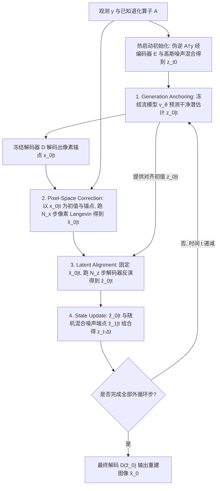

# Hybrid-Domain Posterior Sampling for Inverse Problems via Latent Flow Matching

# First Time

## 1.Title & Authors
论文原标题：Hybrid-Domain Posterior Sampling for Inverse Problems via Latent Flow Matching。
自然中文译法：基于潜空间流匹配的逆问题混合域后验采样。
先拆解标题里的四个核心词，立刻能看清整篇论文的骨架：
- Inverse Problems（逆问题）：已知“拍坏了”的观测图（如糊掉的图、缺了大块像素的图、缩小 12 倍的马赛克图），反推原本清晰的高质量图像。因为退化过程丢了大量信息，同一张坏图可能对应很多张合理原图，单靠“反算”算不回来，必须借用强生成模型的图像先验来脑补合理细节。
- Latent Flow Matching（潜空间流匹配）：本文调用的预训练生成大模型底座（实验用的是 Stable Diffusion 3 Medium）。它不在动辄百万维的像素空间里硬算，而是先用自编码器把图像压到低维潜空间，再用流匹配（Flow Matching）从高斯噪声沿速度场平滑演化出潜变量，最后解码成高清大图。
- Posterior Sampling（后验采样）：同时满足两个要求——既要“像自然界真实的清晰图”（先验），又要“经过已知的模糊/降采样/遮挡后，能跟手里的观测图对得上”（观测似然）。
- Hybrid-Domain（混合域）：标题最核心的主张是“像素空间与潜空间各司其职、交替协作”——在像素空间直接修观测误差，在潜空间用流模型把控整体结构与自然感，并在每一步循环中把两边的结果接通。
作者按原文顺序列出：Hongjie Wu、Yiping Xie、Jiancheng Lv，三人均来自四川大学计算机学院。原文脚注标明 Hongjie Wu 与 Yiping Xie 为共同第一作者（Equal contribution），Jiancheng Lv 为通讯作者（Corresponding author）。从论文参考文献 [40] 与 [41] 可知，Hongjie Wu 与 Jiancheng Lv 团队此前已在 ACM MM 2024 和 ACM MM 2025 连续发表了基于扩散模型的图像恢复后验采样与梯度稳定工作，本篇论文（ACM MM 2026）是同一条研究脉络向潜空间流匹配大模型上的延续与突破。

## 2.Abstract
摘要的逻辑非常利落，像看病一样按“发现症状 → 找到病根 → 开出药方 → 关键辅药 → 疗效结果”五步推进。下面按原文语义单元逐句讲透。
1. 背景与痛点：潜空间流模型（Latent Flow Models）已经彻底改变了高分辨率图像生成，但拿它来做高保真图像逆问题恢复时，却总是撞墙。
   直觉上很好理解：普通文生图只要画得“像一张自然照片”就行；逆问题恢复则苛刻得多——不仅要画得自然，还得把原图的五官轮廓、文字边缘、细密毛发严丝合缝地对上观测图。把强生成模型直接搬来解逆问题，瓶颈正好卡在这第二步。
2. 定位病根（一阶流形盲区）：作者把这一瓶颈追溯到预训练自编码器（VAE）的几何结构缺陷，命名为 First-Order Manifold Blindness（一阶流形盲区）。
   所谓“流形”，就是解码器 $D$ 能画出来的所有自然图像在高维像素空间里铺成的一张曲面；所谓“一阶”，指的是当前潜变量 $\boldsymbol{z}$ 附近做微小挪动时，图像能朝哪些方向变化。如果修好一张图所需的改动方向正好垂直于这张局部曲面，那在潜空间里做一阶梯度下降时，这部分修图指令会彻底“掉线”，根本传不进潜变量。
3. 为什么会出现盲区：自编码器把图像压缩得极狠（比如只保留原图像素自由度的约 2%），导致解码器雅可比矩阵 $J_D$ 的列空间只能覆盖像素空间里极小的一片切面；落在正交补空间里的高频观测残差（精细边缘、纹理误差）在反向传播时直接归零。
   这里最反直觉、也最关键的一点是：“解码器理论上画得出来目标图”和“当前的一阶梯度能带你走到目标图”是两码事。目标图明明就在解码器的能力范围内，但只要眼前的局部一阶梯度“看不见”高频误差方向，优化就会原地打转，修出来的图要么塑料感过平滑，要么细节错位。
4. 提出主方案（HDPS 混合域解耦）：为了绕开这个死胡同，作者提出 Hybrid-Domain Posterior Sampling（HDPS），把“物理测量一致性”和“语义先验建模”彻底拆开处理。
   简单说就是让专业的人干专业的事：观测方程原本就定义在像素空间，那就别硬挤过解码器瓶颈，直接回像素空间修；而流模型擅长把控语义结构和画面自然度，那就留在潜空间负责整体演化。
5. 具体怎么跨空间走：HDPS 跳出潜空间进入像素空间，用 Langevin 动力学直接吸收完整的像素级观测梯度（包括潜空间看不见的正交高频分量），再把修好的结构投影回生成流形。
   Langevin 动力学可以直观理解成“沿着既符合观测又贴近锚点的方向走，再掺一点随机抖动探索合理解”。修完像素之后，还必须把结果送回潜空间，否则下一轮流模型根本不知道你刚才修了什么。
6. 怎么送回潜空间（基于优化的潜变量对齐）：作者没有直接调用编码器把修好的图压回潜空间，而是采用基于优化的潜变量对齐（解码器反演），既过滤掉像素修正带来的伪影，又避免直接编码造成的语义漂移。
   为什么不能直接用编码器 $E$？因为 $E$ 是在干净自然图上训练的，像素空间 Langevin 迭代留下的微小噪点和非高斯伪影会让 $E$“看走眼”，把它编成语义完全跑偏的潜特征。改用解码器反演——从流模型刚预测出的潜变量出发，微调潜变量让解码结果贴近修正图——相当于给修正图套了一层“自然图像滤网”，解码器能画出的真细节留下来，画不出的像素伪影顺手滤掉。
7. 实验结论：在多种逆问题上的实验表明，HDPS 取得了新的最优水平，成功找回了纯潜空间求解器丢掉的高频结构精度。
   结合正文第 5 节看，实验覆盖 FFHQ（人脸）、AFHQ（动物）、DIV2K（自然场景）三个数据集、$768\times 768$ 高分辨率、五种线性退化（随机修补、高斯去模糊、运动去模糊、双三次 12 倍超分、平均池化 12 倍超分），观测加噪 $\sigma_n=0.03$。在修补和两类去模糊上 HDPS 全面领先；在 12 倍平均池化超分上，HDPS 的感知指标 LPIPS 最好，而像素误差指标 PSNR 上 FlowDPS 略高一点点（例如 DIV2K 上 21.08 dB 对 21.05 dB）。
8. 开源说明：作者公开了代码仓库地址，方便复现与核对实现。
把摘要提炼成四个核心要素：

| 要素 | 本文核心内容 |
|---|---|
| 问题 | 潜空间流模型生成能力极强，但反向传播经过低维解码器时会丢失正交补中的高频观测残差（一阶流形盲区），导致纯潜空间逆问题恢复细节糊、易停滞。 |
| 方法 | 提出 HDPS：每步先由潜流预测图像锚点，再切到像素空间用 Langevin 动力学直接修观测误差，接着通过解码器反演把修正对齐回潜变量，并送回下一轮流轨迹。 |
| 结果 | 在 FFHQ、AFHQ、DIV2K 三个数据集、五种线性逆问题上整体表现突出，修补和去模糊大幅领先现有潜流方法（如 FFHQ 运动去模糊提升 2.27 dB），在 12 倍超分上也保持第一或第二名水准。 |
| 意义 | 点破了潜空间逆问题“先验在潜空间、观测在像素空间”的根本错位，给出了一套先解耦、再靠反演对齐闭环耦合的实用推理范式。 |

## 3.Conclusion
原文第 6 节为独立的 Conclusion，共两段：第一段总结核心发现、方法与实验，第二段坦诚列出局限和未来方向。
1. 第一段——问题、方法与效果总账：
   - 理论诊断：明确提出 First-Order Manifold Blindness，指出纯潜空间逆问题求解器抓不住高频观测残差，根源在于解码器雅可比矩阵的秩远低于像素维度（对应正文第 3.2 节 Proposition 3.1 与 Fig1）。
   - 框架总结：HDPS 把物理测量一致性交给像素空间，把语义先验建模留给潜空间，并用基于优化的潜变量对齐把两者串成闭环。读懂 HDPS 的钥匙就是这个跨空间闭环：像素修完不是一锤子买卖的后处理，而是每一步都要反哺给潜状态，持续引导后续生成。
   - 性能概况：在三个数据集、五种线性逆问题上取得强恢复效果，作者概括为“相对最强基线提升超过 2 dB”。对照正文 Table1 可知，这个“超过 2 dB”具体出现在 FFHQ 运动去模糊（HDPS 32.83 dB 对比最强基线 FLAIR 的 30.56 dB，高出 2.27 dB）；其他任务的增益各有不同，例如 FFHQ 随机修补高出 1.88 dB，而 12 倍超分则以小幅优势或指标权衡为主。
2. 第二段——作者亲口承认的两大限制与两个未来方向：
   - 计算开销限制：像素与潜空间的交替内循环（每外循环包含 $N_x$ 步像素更新和 $N_z$ 步潜对齐）会增加推理计算量，尤其是潜对齐需要经解码器求梯度。不过作者在 Table3 展示了在同等质量下，HDPS 的实际耗时反而可以低于或持平现有基线。
   - 表达上限限制：不管像素空间修得多精细，最终成图还是得由解码器 $D$ 输出。如果目标图像里存在连预训练解码器本身都画不出来的极端细节，潜对齐也留不住它。这与摘要完美呼应：HDPS 治的是“本来画得出但一阶梯度走不到”的局部盲区，却突破不了自编码器本身的天花板。
   - 未来方向一（提速）：引入更快的像素空间求解器（如一致性模型 consistency models），压缩像素内循环的时间成本。
   - 未来方向二（拓宽场景）：把这套解耦思想推广到盲逆问题（blind inverse problems），也就是连退化算子 $\mathcal{A}$ 本身都未知的真实场景。
总体看，结论与摘要主线完全一致，并把摘要里较泛的“多种逆问题最优”清晰落到了五种线性逆问题和三个数据集上。

## 4.Analogy
可以把 HDPS 想象成“用游戏手柄遥控一台高精度 3D 打印机来修复一幅破损名画”。
- 潜变量 $\boldsymbol{z}$ 就像手柄上寥寥几个摇杆，解码器 $D$ 就像打印机内部那套聪明的生成系统。虽然摇杆很少（只有原画像素自由度的 2%），但它记住了全世界名画的规律，轻轻推几下就能印出逼真的画作；流模型 $v_\theta$ 则是老画师手把手教你一步步推摇杆的节奏。
- 现在你要修复一幅具体的破损画（观测 $\boldsymbol{y}$），你拿着放大镜在画布上标出“这里眼睫毛糊了、那里衣服条纹歪了”（像素观测梯度）。
- 一阶流形盲区是什么？你盯着画布上的细微瑕疵，想直接微调手里的几个摇杆把它修好。结果发现，摇杆往上下左右稍微一动，整张脸的光影和轮廓会成片跟着变，却偏偏没有任何一个摇杆动作能单独把那根眼睫毛拉直！传回摇杆的调节指令直接变成零，你干瞪眼修不动。
- HDPS 怎么破局？它干脆放下手柄，先拿一支细画笔直接在画布（像素空间）上把眼睫毛和条纹照着观测修清楚（Langevin 像素修正），同时时刻瞄着刚才印出来的底稿别画歪太远（锚点约束）。画完之后，它并不把画布直接塞进扫描仪硬读（直接编码 $E(\hat{\boldsymbol{x}})$，扫描仪一看你手动涂抹的笔触痕迹就会乱识别、把人脸扫变样），而是回到刚才的摇杆位置，一边试推摇杆一边比对打印效果，微调十几下找到最接近你手绘修改稿的摇杆姿势（解码器反演对齐）。这样一来，打印机画得出的清晰条纹被完整继承了下来，手绘留下的杂乱笔触自动被过滤掉，接着老画师继续顺着新的摇杆位置往下画。
- 这个比喻的边界也很明确：如果手绘的某种奇特笔触超出了打印机本身能印出的精细极限，对齐之后还是会丢掉；另外，真实的算法里像素修正带有随机探索噪声，对齐也不是无休止地完美拟合，而是靠“早停”保持与先验的平衡，这些机制都在正文公式里精确展开。

# Second Time

## 1.Notation & Parameters
正文公式看似不少，其实全部围绕四件事转：“观测退化 → 流模型预测 → 像素修正与对齐 → 几何分析”。下表整理了读懂全文主线必需的重点符号，全部保留论文原记号。

| 符号/参数 | 含义与作用 | 关键设定/约束 |
|---|---|---|
| $\boldsymbol{x}$、$\boldsymbol{y}$ | 待恢复的清晰图像信号、拿到的退化观测图像 | $\boldsymbol{x}\in\mathbb{R}^{n}$；由已知算子退化并叠加高斯噪声生成 |
| $\mathcal{A}$、$\mathcal{A}^{\top}$、$\mathcal{A}^{\dagger}$ | 正向退化算子、伴随算子（转置）、伪逆 | 正文主实验均为已知线性算子；$\mathcal{A}^{\top}$ 算观测梯度，$\mathcal{A}^{\dagger}$ 用于热启动初始化 |
| $\boldsymbol{\epsilon}$、$\sigma_y$、$\sigma_n$ | 观测噪声及其标准差（式 (1) 写 $\sigma_y$，实验表写 $\sigma_n$） | $\boldsymbol{\epsilon}\sim\mathcal{N}(0,\sigma_y^2 I)$；主实验 $\sigma_n=0.03$；式 (12) 复用 $\boldsymbol{\epsilon}$ 表示潜空间标准高斯，按语境区分 |
| $E$、$D$、$\mathcal{Z}$ | 预训练 VAE 的编码器、解码器及潜空间 | $E:\mathbb{R}^{n}\to\mathbb{R}^{d}$，$D:\mathbb{R}^{d}\to\mathbb{R}^{n}$，$\mathcal{Z}=\mathbb{R}^{d}$ 且 $d\ll n$；推理全程冻结网络参数 |
| $\boldsymbol{z}_t$、$\boldsymbol{z}_0$、$\boldsymbol{z}_1$ | 时刻 $t$ 的带噪潜状态、干净潜端点、高斯噪声端点 | 流生成方向为时间倒走：$t=1$（纯噪声）$\to t=0$（干净图） |
| $p_0$、$p_1$ | 潜数据分布、标准高斯先验分布 | $p_0=E_{\#}p_{\mathrm{data}}$（数据经编码器推前得到的分布），$p_1=\mathcal{N}(\boldsymbol{0},\boldsymbol{I})$ |
| $v_{\theta}$、$\theta$ | 预训练流模型的速度场网络及参数 | 接收状态、时间与可选条件，输出潜空间速度；推理全程冻结 |
| $c$、$\varnothing$、$\lambda$ | 文本条件、空条件、CFG 引导参数 | 式 (6) 组合系数为 $(1+\lambda)$ 与 $-\lambda$；实验默认 $\lambda=2.0$ |
| $\boldsymbol{z}_{0\mid t}$、$\boldsymbol{x}_{0\mid t}$ | 当前步由流预测出的干净潜估计，及其解码得到的像素锚点 | $\boldsymbol{x}_{0\mid t}=D(\boldsymbol{z}_{0\mid t})$；还没做当前步的像素观测修正 |
| $\hat{\boldsymbol{x}}_{0\mid t}$、$\hat{\boldsymbol{z}}_{0\mid t}$ | 像素 Langevin 修正后的图像、解码器反演对齐后的干净潜估计 | 带帽子表示经过本轮观测修正；二者经有限步优化近似匹配 |
| $\boldsymbol{z}_{1\mid t}$、$\hat{\boldsymbol{z}}_{1\mid t}$ | 当前估计的噪声端点、注入随机扰动后的新噪声端点 | 通过 $\alpha_t=1-\sigma_t$ 与标准高斯 $\boldsymbol{\epsilon}'$ 混合得到 $\hat{\boldsymbol{z}}_{1\mid t}$ |
| $\sigma_t$、$\tau_t$ | 潜轨迹噪声日程、像素锚定先验的松紧尺度 | $\tau_t=\sigma_t/\sqrt{1+\sigma_t^2}$；$t\to 0$ 时 $\tau_t\to 0$，锚定收紧 |
| $N_x$、$N_z$ | 每轮外循环里的像素修正步数、潜变量对齐步数 | 正文默认 $N_x=20$、$N_z=15$；运行时间表单独测试 3 和 15 档 |
| $\eta_x$、$\eta_z$ | 像素 Langevin 步长、潜变量对齐梯度步长 | 控制两个内循环的更新幅度；原文未列出 HDPS 这两个步长的具体数值 |
| $t_0$、$\Delta t$ | 采样起始时间、外循环时间步长 | 热启动默认 $t_0=0.8$，替代从纯噪声 $t=1.0$ 开始 |
| $\mathcal{L}_{\mathrm{FM}}$、$\mathcal{L}_{\mathrm{rec}}$ | 流匹配预训练损失、潜空间观测重建损失 | 前者仅用于预训练背景；后者用于分析纯潜空间优化为何失效 |
| $J_D$、$\mathcal{R}(J_D)$ | 解码器在当前潜点处的雅可比矩阵及其列空间（切空间） | $J_D\in\mathbb{R}^{n\times d}$；列空间代表微调 $\boldsymbol{z}$ 一阶能撬动的像素方向 |
| $\boldsymbol{g}_{\mathrm{pixel}}$、$\boldsymbol{g}_{\parallel}$、$\boldsymbol{g}_{\perp}$ | 像素观测梯度及其在 $\mathcal{R}(J_D)$ 内的切向分量、正交补分量 | Proposition 3.1 证明 $\boldsymbol{g}_{\perp}$ 对潜一阶梯度完全不可见；Theorem 4.1 简记总梯度为 $\boldsymbol{g}$ |
| $\mathcal{H}_D$ | 解码器的 Hessian 张量（二阶曲率） | 仅用于 Theorem 4.1 的理论分析，实际算法无需显式计算 |

两个极易看混的地方提前标出来：一是 $\sigma_y$（观测噪声标准差，是个很小的固定常数如 0.03）和 $\sigma_t$（流轨迹噪声日程，随时间 $t$ 从大变小）作用完全不同；二是符号 $\boldsymbol{\epsilon}$ 在式 (1) 里指像素观测噪声，在式 (12) 里指潜空间标准高斯噪声，看公式时留心上下文即可。

## 2.Introduction
对应原文 Section 1。引言只做了一件事：把整篇论文的问题意识讲得透亮——为什么大家用 SD3、FLUX 这类顶流潜空间流模型做逆问题恢复时，总觉得差一口气？
1. 背景铺垫：图像生成模型从像素空间全面迁移到潜空间（Stable Diffusion 3、SD3.5、FLUX 等），结合 Flow Matching 后，不仅算得快，而且高分辨率生成轨迹更直、画质极强。大家自然想把这些预训练潜流模型（LFM）拿来当逆问题的免费先验。
2. 主流做法的隐含坑点：目前最常见的思路是直接在潜空间里做梯度下降，最小化观测重建损失 $\mathcal{L}(\boldsymbol{z})=\|\mathcal{A}(D(\boldsymbol{z}))-\boldsymbol{y}\|^2$（先解码成图，再套退化算子，再跟观测比差距）。这套做法默认一个前提：像素层面的物理约束能顺顺当当地反向传播过解码器 $D$。
3. 点破核心病根（一阶流形盲区）：这个前提并不成立。潜空间维度 $d$ 远小于像素维度 $n$（常只有约 2% 的自由度），导致解码器雅可比 $J_D\in\mathbb{R}^{n\times d}$ 严重“缺维度”。像素观测梯度里凡是落在 $J_D$ 列空间正交补里的成分——恰恰包含修复图像最关键的高频边缘和纹理误差——在传回潜空间时数学上直接清零。作者将其命名为 First-Order Manifold Blindness（一阶流形盲区）。结合 [Fig1 精读](#fig1) 的实测曲线，纯潜空间梯度很快衰减停滞，修出来的图不是糊成塑料，就是结构错位。
4. 提出底层设计原则：根子在于空间错配——图像先验天然活在潜空间，而测量物理天然定义在像素空间。强行把像素物理硬塞进压缩瓶颈，必然牺牲保真度。因此最自然的设计原则是“让每个空间干自己最擅长的活”：像素空间专管观测一致性，潜空间专管语义先验。
5. 引出 HDPS 与两步关键设计：
   - 第一步，跳进未压缩的像素空间，用 Langevin 动力学直接吃下完整、精准的像素观测梯度，把正交方向上的高频细节全救回来。
   - 第二步，怎么把修好的像素图送回潜空间？作者指出，直接套编码器 $\boldsymbol{z}=E(\boldsymbol{x})$ 会翻车——因为预训练编码器只认干净自然图，遇到像素梯度留下的非高斯伪影，会直接编成语义跑偏的坏潜码（语义漂移）。因此改用“基于优化的潜变量对齐（解码器反演）”，把修好的图平滑投影回生成流形，同时顺带过滤像素伪影。作者在理论部分（Theorem 4.1）进一步指出，先走出流形再投影回来，能隐式借用解码器的非线性曲率绕开一阶盲区。
6. 引言收尾的四项贡献清单，正好对应后文四大块：形式化证明复合反传 $\mathcal{A}\circ D$ 的几何盲区；提出解耦像素与潜空间的 HDPS 算法；证明解码器反演对齐比直接编码强得多（充当流形滤波器）；在五种线性逆问题上验证明显领先的效果。

## 3.Related Work
对应原文 Section 2，按“像素空间派”和“潜空间派”两条路线梳理前人工作，帮我们迅速定位 HDPS 站在哪儿。
1. 像素空间逆问题求解器（Pixel-space algorithms）：
   - 代表方法包括 DPS（用似然梯度引导无条件扩散 score）、DDRM（借退化算子奇异值分解做闭式更新）、$\Pi$GDM（用伪逆改进似然引导）、Plug-and-Play（把物理算子和去噪器嵌进 ADMM 框架）。它们的共同好处是：观测似然就在像素空间，写得干净、算得直接。
   - 与本文渊源最深的是 DAPS：它提出退火式 Langevin 策略，把先验 score 和似然梯度解耦，在每个噪声层级单独用 Langevin 采样修观测。HDPS 直接吸收了这套像素 Langevin 退火思路，但改变了它的定位——在 DAPS 里这是整套像素求解器，而在 HDPS 里它变成嵌入潜空间流轨迹内部的一层“像素修正引擎”。
   - 像素派的致命短板是算力吃紧：高分辨率（如 $768\times 768$）下像素扩散模型训练和推理都极昂贵，语义先验远不如现代潜空间大模型（SD3、FLUX）强。
2. 潜空间逆问题求解器（Latent-space methods）：
   - 扩散时代有 PSLD（优化中间潜变量补数据一致性）和 ReSample（做硬数据一致性优化后再随机重采样回带噪流形）。
   - 流匹配时代涌现了本文的三大直接对手：FlowChef（利用 Rectified Flow 的直线轨迹做免梯度引导）、FlowDPS（推导流版 Tweedie 公式，把似然梯度塞进流 ODE）、FLAIR（用带确定性轨迹调整的免训练变分推断求解）。
   - 潜空间派的共同软肋：它们虽然享受了 SD3、FLUX 的强先验和低算力，但一到做测量一致性时，全都得沿着复合算子 $\mathcal{A}\circ D$ 往回反传梯度。解码器既非线性又高度压缩，导致复合反传病态、高频细节流失。
读完这一节，HDPS 的定位一目了然：它把“像素派的精准物理观测（借鉴 DAPS）”嫁接到“潜空间派的顶配生成先验（SD3 潜流模型）”上，再靠解码器反演把两边焊牢。

## 4.Preliminaries and Motivation
对应原文 Section 3。这一章分两步搭台子：3.1 节先写清逆问题和潜空间流匹配的基础公式（这些都是现成背景，HDPS 推理时不重新训练流模型）；3.2 节亮出全篇的理论大杀器 Proposition 3.1，从线性代数上钉死“为什么纯潜空间优化一定会丢高频细节”。

## 5.Problem Setup and Latent Flow Matching
对应原文 Section 3.1。下面逐条把背景公式讲顺。
1. 观测模型——公式（1）：
$$
\boldsymbol{y}=\mathcal{A}\boldsymbol{x}+\boldsymbol{\epsilon},
\qquad
\boldsymbol{\epsilon}\sim\mathcal{N}(0,\sigma_y^2 I).
$$
这是线性逆问题的标准设定：真实清晰图 $\boldsymbol{x}\in\mathbb{R}^n$ 经过已知的线性退化算子 $\mathcal{A}$（比如模糊卷积、降采样、像素遮罩），再混入均值为 0、各像素独立同方差（标准差 $\sigma_y$）的高斯噪声 $\boldsymbol{\epsilon}$，变成我们手里拿到的观测 $\boldsymbol{y}$。公式（1）是问题建模前提，不是推导结果；它假设各观测维度噪声独立且方差相同。
2. 贝叶斯后验与高斯似然（无编号公式）：
$$
p(\boldsymbol{x}\mid\boldsymbol{y})\propto p(\boldsymbol{y}\mid\boldsymbol{x})p(\boldsymbol{x}),
\qquad
p(\boldsymbol{y}\mid\boldsymbol{x})\propto\exp\!\left(-\frac{1}{2\sigma_y^2}\|\mathcal{A}\boldsymbol{x}-\boldsymbol{y}\|^2\right).
$$
推导非常直白：
- 第一式直接来自贝叶斯定理 $p(\boldsymbol{x}\mid\boldsymbol{y}) = p(\boldsymbol{y}\mid\boldsymbol{x})p(\boldsymbol{x})/p(\boldsymbol{y})$。给定一张待修的观测图 $\boldsymbol{y}$ 时，分母 $p(\boldsymbol{y})$ 是与 $\boldsymbol{x}$ 无关的常数，写成正比号即可。它告诉我们：好恢复结果 = 符合观测（似然 $p(\boldsymbol{y}\mid\boldsymbol{x})$ 高）× 像自然图像（先验 $p(\boldsymbol{x})$ 高）。
- 第二式把式（1）变个形：给定清晰图 $\boldsymbol{x}$ 后，观测误差 $\boldsymbol{y}-\mathcal{A}\boldsymbol{x}=\boldsymbol{\epsilon}\sim\mathcal{N}(0,\sigma_y^2 I)$。直接套多维各向同性高斯分布的概率密度公式，去掉与 $\boldsymbol{x}$ 无关的前置归一化常数，指数部分立刻就是 $-\frac{1}{2\sigma_y^2}\|\mathcal{A}\boldsymbol{x}-\boldsymbol{y}\|^2$。这里要求 $\sigma_y>0$，分母不能为零。
3. 潜空间与端点分布（无编号定义）：
直接对高维像素分布 $p(\boldsymbol{x})$ 建模太费算力，因此借用预训练 VAE 的编码器 $E:\mathbb{R}^n\to\mathbb{R}^d$ 和解码器 $D:\mathbb{R}^d\to\mathbb{R}^n$（$d\ll n$），把生成过程搬到潜空间 $\mathcal{Z}=\mathbb{R}^d$。自然图像分布 $p_{\mathrm{data}}$ 经编码器压进潜空间后形成潜数据分布 $p_0=E_{\#}p_{\mathrm{data}}$（下标 $\#$ 表示“推前分布”，即把数据样本喂给 $E$ 后输出的分布）；另一头是容易采样的标准高斯先验 $p_1=\mathcal{N}(\boldsymbol{0},\boldsymbol{I})$。
4. 流匹配生成 ODE——公式（2）：
$$
\frac{\mathrm{d}\boldsymbol{z}_t}{\mathrm{d}t}=v_{\theta}(\boldsymbol{z}_t,t),
\qquad
\boldsymbol{z}_1\sim p_1.
$$
速度场网络 $v_\theta$ 负责告诉每个时刻 $t$、每个位置 $\boldsymbol{z}_t$ 的点该往哪儿移动、走多快。注意本文的时间方向约定：$t=1$ 是纯高斯噪声，$t=0$ 是干净潜图。所以实际画图生成时，是从 $\boldsymbol{z}_1\sim p_1$ 出发，把式（2）沿时间倒着积分（$t: 1\to 0$）回到干净数据分布 $p_0$，最后经 $D$ 解码成图像。
5. 线性条件插值路径——公式（3）与目标速度（无编号）：
$$
\boldsymbol{z}_t=(1-t)\boldsymbol{z}_0+t\boldsymbol{z}_1,
\qquad
\dot{\boldsymbol{z}}_t=\boldsymbol{z}_1-\boldsymbol{z}_0.
$$
为了让网络 $v_\theta$ 好训练，流匹配在训练时随便抽一对干净潜图 $\boldsymbol{z}_0\sim p_0$ 和纯噪声 $\boldsymbol{z}_1\sim p_1$，在两点之间拉一条笔直的线段（式 3）：$t=0$ 在数据端，$t=1$ 在噪声端。把式（3）对时间 $t$ 求个导，立刻得到恒定的条件目标速度 $\dot{\boldsymbol{z}}_t=\boldsymbol{z}_1-\boldsymbol{z}_0$（方向从干净图指向噪声，所以倒走时间就是从噪声奔向干净图）。
6. 流匹配预训练目标——公式（4）：
$$
\mathcal{L}_{\mathrm{FM}}(\theta)=\mathbb{E}_{t,\boldsymbol{z}_0,\boldsymbol{z}_1}\!\left[\|v_{\theta}(\boldsymbol{z}_t,t)-(\boldsymbol{z}_1-\boldsymbol{z}_0)\|^2\right].
$$
这是预训练流模型用的均方误差回归目标：随机取时刻 $t$ 和端点对，算出插值点 $\boldsymbol{z}_t$，让网络预测的速度 $v_\theta(\boldsymbol{z}_t,t)$ 尽量贴近真实连线速度 $\boldsymbol{z}_1-\boldsymbol{z}_0$。平方损失的最优解会自动把经过同一位置 $\boldsymbol{z}_t$ 的所有可能路径速度取条件平均，从而学出全局边缘速度场。这一步在预训练阶段就已全部完成，HDPS 推理时直接冻结 $\theta$ 调用现成模型。

## 6.Why Latent-Only Optimization Fails
对应原文 Section 3.2。这一节是整篇论文最精彩的诊断部分：用极简的线性代数，一针见血讲清“纯潜空间优化为什么死活修不出高频细节”。
1. 纯潜空间优化的标准公式——公式（5）：
主流潜空间方法用流轨迹（或如 FLAIR 的显式正则 $R(\boldsymbol{z})$）维持生成先验，同时在潜空间里最小化观测重建误差：
$$
\boldsymbol{z}^{*}=\arg\min_{\boldsymbol{z}}\mathcal{L}_{\mathrm{rec}}(\boldsymbol{z}),
\qquad
\mathcal{L}_{\mathrm{rec}}(\boldsymbol{z})=\frac{1}{2}\|\mathcal{A}(D(\boldsymbol{z}))-\boldsymbol{y}\|^2.
$$
系数 $1/2$ 是为了求导时刚好消掉平方带来的 2。它与式（1）的高斯负对数似然只差一个正系数 $1/\sigma_y^2$，单独最小化时极小点完全一样。
2. 链式求导暴露瓶颈（无编号梯度式）：
对 $\mathcal{L}_{\mathrm{rec}}(\boldsymbol{z})$ 关于潜变量 $\boldsymbol{z}$ 求梯度，由复合函数链式法则分两步走：先对解码出的图像 $D(\boldsymbol{z})$ 求导，得到像素空间观测梯度 $\boldsymbol{g}_{\mathrm{pixel}}=\mathcal{A}^{\top}(\mathcal{A}(D(\boldsymbol{z}))-\boldsymbol{y})\in\mathbb{R}^n$；再乘上解码器在当前点 $\boldsymbol{z}$ 的雅可比转置 $J_D^{\top}\in\mathbb{R}^{d\times n}$，把梯度塞回潜空间：
$$
\nabla_{\boldsymbol{z}}\mathcal{L}_{\mathrm{rec}}=J_D^{\top}\mathcal{A}^{\top}\bigl(\mathcal{A}(D(\boldsymbol{z}))-\boldsymbol{y}\bigr)=J_D^{\top}\boldsymbol{g}_{\mathrm{pixel}}.
$$
3. 算一笔惊人的自由度账（无编号维度换算）：
以最常见的潜空间自编码器配置为例（4 个潜通道、宽高各下采样 8 倍）：一张 $H\times W$ 的三通道彩色图，像素维度是 $n=3HW$；压进潜空间后维度骤降至 $d=4(H/8)(W/8)=HW/16$。两者一除，$d=n/48$，潜空间只剩原始像素自由度的约 2.1%！
这意味着解码器雅可比 $J_D\in\mathbb{R}^{n\times d}$ 哪怕满列秩，它的列空间 $\mathcal{R}(J_D)$（也就是微调 $\boldsymbol{z}$ 一阶能改变的所有像素方向）在 $n$ 维像素空间里也只是个薄薄的 2% 低维切面，剩下约 98% 的空间都是它的正交补 $\mathcal{R}(J_D)^{\perp}$。
4. 核心命题——Proposition 3.1（First-Order Manifold Blindness，一阶流形盲区）：
把像素观测梯度 $\boldsymbol{g}_{\mathrm{pixel}}=\mathcal{A}^{\top}(\mathcal{A}(D(\boldsymbol{z}))-\boldsymbol{y})$ 按线性代数的正交直和拆成两截：
$$
\boldsymbol{g}_{\mathrm{pixel}}=\boldsymbol{g}_{\parallel}+\boldsymbol{g}_{\perp},
\qquad
\boldsymbol{g}_{\parallel}\in\mathcal{R}(J_D),
\qquad
\boldsymbol{g}_{\perp}\in\mathcal{R}(J_D)^{\perp}.
$$
- $\boldsymbol{g}_{\parallel}$ 躺在解码器当前的切空间里，是微调 $\boldsymbol{z}$ 立刻能响应的切向误差；
- $\boldsymbol{g}_{\perp}$ 垂直于切空间的每一个基向量，按正交补的定义，它与 $J_D$ 的每一列内积都为零，即 $J_D^{\top}\boldsymbol{g}_{\perp}=\boldsymbol{0}$。
把正交分解代回链式梯度，立刻得到：
$$
\nabla_{\boldsymbol{z}}\mathcal{L}_{\mathrm{rec}}=J_D^{\top}(\boldsymbol{g}_{\parallel}+\boldsymbol{g}_{\perp})=J_D^{\top}\boldsymbol{g}_{\parallel}+J_D^{\top}\boldsymbol{g}_{\perp}=J_D^{\top}\boldsymbol{g}_{\parallel}.
$$
物理含义直白得令人拍案：所有落在正交补里的误差分量 $\boldsymbol{g}_{\perp}$ 在经过 $J_D^{\top}$ 的瞬间就被彻底抹成零，对潜空间的一阶更新完全“隐身”。哪怕真正的清晰原图就在解码器能表示的范围内，只要此时此刻往原图修补细节的方向落在了正交补里，一阶优化器就收不到任何修正信号，只能在原地停滞，结果要么过度平滑、要么细节错位。
顺手厘清两个精确细节：第一，原文口语上把 $J_D^{\top}\boldsymbol{g}_{\parallel}$ 叫作“投影”，严格线性代数里 $J_D^{\top}$ 会同时附带雅可比的缩放与扭曲，并非正交投影矩阵，但“彻底消去 $\boldsymbol{g}_{\perp}$”的结论完全精确；第二，本命题针对的是局部一阶梯度，后续 Theorem 4.1 会进一步讨论非线性的二阶曲率效应。
5. 实证呼应：作者用 [Fig1 精读](#fig1) 展示了四个逆问题轨迹上像素梯度与潜梯度的对比。像素梯度在整个采样过程中平稳清晰、精准贴合人脸残差边缘；而潜梯度剧烈震荡并在后期骤降多个数量级，空间结构模糊成一团。
结论水到渠成：既然观测梯度一过解码器就被“阉割”掉高频正交分量，那就干脆别让它过解码器——直接去像素空间算满秩、稳定的观测修正，潜空间专心负责流先验演化！

## 7.Hybrid-Domain Posterior Sampling
对应原文 Section 4。这一章正式展开 HDPS 框架。先把每个时间步 $t$ 里的“四步闭环”看通透，整篇方法其实只有这一条流水线（原文无编号数据流）：
$$
\boldsymbol{z}_t
\xrightarrow{\mathrm{flow}}\boldsymbol{z}_{0\mid t}
\xrightarrow{D}\boldsymbol{x}_{0\mid t}
\xrightarrow{\mathrm{Langevin}}\hat{\boldsymbol{x}}_{0\mid t}
\xrightarrow{\mathrm{alignment}}\hat{\boldsymbol{z}}_{0\mid t}
\xrightarrow{\mathrm{update}}\boldsymbol{z}_{t-\Delta t}.
$$
用大白话把这四个连续动作串成一句话：
1. 生成锚定（Generation Anchoring）：先问潜空间流模型“按你现在的判断，最终清晰图大概长啥样？”，算出干净潜估计 $\boldsymbol{z}_{0\mid t}$，再用解码器画成像素底稿 $\boldsymbol{x}_{0\mid t}$。
2. 像素修正（Pixel-Space Correction）：拿着底稿 $\boldsymbol{x}_{0\mid t}$ 和真实观测 $\boldsymbol{y}$，在像素空间跑 $N_x$ 步 Langevin 动力学，直接吃下完整的像素观测梯度（把正交高频细节修出来），得到精修图 $\hat{\boldsymbol{x}}_{0\mid t}$。
3. 潜变量对齐（Latent Alignment）：拿着精修图 $\hat{\boldsymbol{x}}_{0\mid t}$，从第 1 步的 $\boldsymbol{z}_{0\mid t}$ 出发，反向优化解码器 $N_z$ 步，把修好的结构“投影”回潜空间得到 $\hat{\boldsymbol{z}}_{0\mid t}$，同时顺手滤掉像素伪影。
4. 状态更新（State Update）：把对齐后的新潜估计 $\hat{\boldsymbol{z}}_{0\mid t}$ 和随机扰动后的噪声端点重新按比例混在一起，推进到下一时刻的带噪潜状态 $\boldsymbol{z}_{t-\Delta t}$。
理解 HDPS 最核心的一点在于“严格闭环反馈”：像素修出来的 $\hat{\boldsymbol{x}}_{0\mid t}$ 经反演变成 $\hat{\boldsymbol{z}}_{0\mid t}$ 后，直接写入下一时刻的潜状态 $\boldsymbol{z}_{t-\Delta t}$。因此每一步像素修正都会立刻改变下一轮流模型的起点与判断，它既不是两条互不搭理的平行支路，也不是采样结束后的表面后处理。对齐目标里虽然没写显式的先验正则项，但生成先验始终通过两处发挥约束力：每次对齐都从流预测 $\boldsymbol{z}_{0\mid t}$ 起步，而且每轮结果都要重新汇入流轨迹往下走。
下面用 Mermaid 流程图把整条推理闭环直观画出来（省略张量维度、CFG 双路前向的展开细节和具体日程数值；流模型与自编码器参数全程冻结，图中迭代更新的均是潜变量或像素图像状态）：

原图对应：[Fig2 精读](#fig2)。完整伪代码对应：[Algorithm1 精读](#algorithm1)。接下来 8 至 13 节把每个模块和公式掰开讲透。

## 8.Generation Anchoring via Flow Prediction
对应原文 Section 4.1。这一步的任务是：站在当前的带噪潜状态 $\boldsymbol{z}_t$，利用流模型一眼“望穿”到干净端点，给后续像素修图立一根可靠的“语义锚桩”。
1. 干净潜估计——公式（6）：
$$
\boldsymbol{z}_{0\mid t}
=\boldsymbol{z}_t-\sigma_t\left[(1+\lambda)v_{\theta}(\boldsymbol{z}_t,t,c)-\lambda v_{\theta}(\boldsymbol{z}_t,t,\varnothing)\right].
$$
这个公式由两部分拼成，拆开看一眼就懂：
- 第一部分：为什么用“当前状态减去日程乘速度”就能估出干净图？回顾式（3）的直线插值 $\boldsymbol{z}_t=(1-t)\boldsymbol{z}_0+t\boldsymbol{z}_1$ 和目标速度 $\dot{\boldsymbol{z}}_t=\boldsymbol{z}_1-\boldsymbol{z}_0$，直接做减法验证：
$$
\boldsymbol{z}_t-t(\boldsymbol{z}_1-\boldsymbol{z}_0)
=(1-t)\boldsymbol{z}_0+t\boldsymbol{z}_1-t\boldsymbol{z}_1+t\boldsymbol{z}_0
=\boldsymbol{z}_0.
$$
完美消掉了噪声端 $\boldsymbol{z}_1$，正好还原出干净端 $\boldsymbol{z}_0$！推理时不知道真实端点速度，就用训练好的网络预测速度 $v_\theta$ 替代，并用一般噪声日程 $\sigma_t$ 替代线性系数 $t$（标准线性日程下 $\sigma_t=t$，若换用非线性日程则需保证速度参数化与之配套）。
- 第二部分：方括号里是经典的无分类器引导（Classifier-Free Guidance, CFG）。把它稍微改写就能看出直觉：
$$
(1+\lambda)v_{\theta}(\boldsymbol{z}_t,t,c)-\lambda v_{\theta}(\boldsymbol{z}_t,t,\varnothing)
=v_{\theta}(\boldsymbol{z}_t,t,c)+\lambda\bigl[v_{\theta}(\boldsymbol{z}_t,t,c)-v_{\theta}(\boldsymbol{z}_t,t,\varnothing)\bigr].
$$
其中 $c$ 是数据集对应的文本提示（如人脸或猫狗描述），$\varnothing$ 是空文本条件。$\lambda=0$ 时退化为普通条件预测；增大 $\lambda$ 会把速度进一步推向更贴合文本语义的方向。实现时要特别留意系数约定：原文实验默认 $\lambda=2.0$，代入式（6）后条件项与无条件项的权重分别是 $3$ 和 $-2$；不少开源代码库把条件项前的总系数写成 guidance scale，复现时应直接按式（6）核对，别搞混差 1 的定义。
2. 解码得到像素锚点（无编号公式）：
$$
\boldsymbol{x}_{0\mid t}=D(\boldsymbol{z}_{0\mid t}).
$$
把流模型预测的干净潜码送进解码器，立刻得到一张看起来自然合理的像素图像 $\boldsymbol{x}_{0\mid t}$。它代表当前这一步“还没看观测、纯凭生成先验猜出来的最佳画稿”，接下来在像素空间修图时，它身兼两职：既是修图的起跑线，又是拽住修图别跑偏的锚点。

## 9.Pixel-Space Correction
对应原文 Section 4.2。这是 HDPS 打破一阶流形盲区的核心战场——直接回到未压缩的像素空间，对图像 $\hat{\boldsymbol{x}}_{0\mid t}$ 动手术。
1. 构造像素空间近似后验——公式（7）：
$$
p(\hat{\boldsymbol{x}}_{0\mid t}\mid\boldsymbol{x}_{0\mid t},\boldsymbol{y})
\propto
\exp\!\left(-\frac{\|\mathcal{A}\hat{\boldsymbol{x}}_{0\mid t}-\boldsymbol{y}\|^2}{2\sigma_y^2}\right)
\cdot
\exp\!\left(-\frac{\|\hat{\boldsymbol{x}}_{0\mid t}-\boldsymbol{x}_{0\mid t}\|^2}{2\tau_t^2}\right).
$$
怎么理解这个近似后验？把它想成两个力量的平衡：
- 左边第一项是式（1）的精确物理观测似然：要求修出来的图 $\hat{\boldsymbol{x}}_{0\mid t}$ 经过退化 $\mathcal{A}$ 后，紧紧贴合观测 $\boldsymbol{y}$，误差按观测噪声方差 $\sigma_y^2$ 衡量。
- 右边第二项是以解码锚点 $\boldsymbol{x}_{0\mid t}$ 为中心、标准差为 $\tau_t$ 的高斯局部先验：因为流模型的完整像素密度没法直接写出解析式，作者干脆围绕当前锚点 $\boldsymbol{x}_{0\mid t}$ 画一个高斯“安全圈”，不让像素修图改得面目全非。
2. 锚定松紧日程（无编号经验公式）：
$$
\tau_t=\frac{\sigma_t}{\sqrt{1+\sigma_t^2}}.
$$
这个经验公式借鉴了先行退火采样工作，直觉极好：
- 在采样前期（噪声大、$\sigma_t$ 大），$\tau_t$ 较大，意味着高斯安全圈画得很宽，放手让像素观测大力修正大块结构和错位；
- 随着采样接近尾声（$t\to 0$、$\sigma_t\to 0$），$\tau_t$ 也趋近 0，锚定绳越收越紧，稳住已经成型的自然结构，只允许温和微调。
3. 推导对数后验梯度与 Langevin 更新——公式（8）：
先对式（7）两边取对数，乘积变相加，其中与 $\hat{\boldsymbol{x}}_{0\mid t}$ 无关的归一化常数求导为零；再直接对 $\hat{\boldsymbol{x}}_{0\mid t}$ 求梯度，利用二次项梯度 $\nabla_{\hat{\boldsymbol{x}}_{0\mid t}}\bigl(\frac{1}{2}\|\mathcal{A}\hat{\boldsymbol{x}}_{0\mid t}-\boldsymbol{y}\|^2\bigr)=\mathcal{A}^{\top}(\mathcal{A}\hat{\boldsymbol{x}}_{0\mid t}-\boldsymbol{y})$，并把负号吸进括号里调换减法顺序，立刻得到：
$$
\nabla_{\hat{\boldsymbol{x}}_{0\mid t}}\log p(\hat{\boldsymbol{x}}_{0\mid t}\mid\boldsymbol{x}_{0\mid t},\boldsymbol{y})
=\frac{\mathcal{A}^{\top}(\boldsymbol{y}-\mathcal{A}\hat{\boldsymbol{x}}_{0\mid t})}{\sigma_y^2}
-\frac{\hat{\boldsymbol{x}}_{0\mid t}-\boldsymbol{x}_{0\mid t}}{\tau_t^2}.
$$
把这个对数后验梯度代入标准的未调整 Langevin 动力学（ULA）离散迭代，就得到正文公式（8）：
$$
\hat{\boldsymbol{x}}_{0\mid t}^{(j+1)}
=\hat{\boldsymbol{x}}_{0\mid t}^{(j)}
+\eta_x\left[
\frac{\mathcal{A}^{\top}(\boldsymbol{y}-\mathcal{A}\hat{\boldsymbol{x}}_{0\mid t}^{(j)})}{\sigma_y^2}
-\frac{\hat{\boldsymbol{x}}_{0\mid t}^{(j)}-\boldsymbol{x}_{0\mid t}}{\tau_t^2}
\right]
+\sqrt{2\eta_x}\,\boldsymbol{\xi}_j.
$$
看懂式（8）就像看一场三方拉锯战：
- 起点与终点：从解码锚点出发 $\hat{\boldsymbol{x}}_{0\mid t}^{(0)}=\boldsymbol{x}_{0\mid t}$，迭代 $j=0,\dots,N_x-1$ 共 $N_x$ 步，把最终结果记为 $\hat{\boldsymbol{x}}_{0\mid t}=\hat{\boldsymbol{x}}_{0\mid t}^{(N_x)}$。注意第 0 步时当前图正好等于锚点，锚定项为零，第一步完全由观测梯度领路。
- 第一拉力（观测项）：$\frac{\mathcal{A}^{\top}(\boldsymbol{y}-\mathcal{A}\hat{\boldsymbol{x}}_{0\mid t}^{(j)})}{\sigma_y^2}$ 直接在像素空间算，完全绕开解码器雅可比 $J_D^{\top}$，所以之前被抹掉的正交高频残差 $\boldsymbol{g}_{\perp}$ 全部原封不动生效！（当然，退化算子 $\mathcal{A}$ 自身零空间里彻底丢掉的信息仍得靠生成先验补全。）
- 第二拉力（锚定项）：$-\frac{\hat{\boldsymbol{x}}_{0\mid t}^{(j)}-\boldsymbol{x}_{0\mid t}}{\tau_t^2}$ 像一根橡皮筋，往流模型给的自然锚点 $\boldsymbol{x}_{0\mid t}$ 回拉，防止图像过度拟合观测噪声 $\sigma_y$。
- 随机探索项：$\sqrt{2\eta_x}\,\boldsymbol{\xi}_j$ 是 Langevin 采样的标准布朗探索噪声（按标准 Langevin 动力学，$\boldsymbol{\xi}_j$ 为各步独立采样的标准高斯噪声，原文在 Appendix D.3 提到其探索作用；另外 Fig2 示意图里把该噪声印成了 $\boldsymbol{\epsilon}_j$，正文统一用 $\boldsymbol{\xi}_j$）。
数值实现上有一个必须处理的边界：式（8）要求 $\sigma_y>0$ 且 $\tau_t>0$。当 $t=0$ 导致 $\sigma_t=\tau_t=0$ 时，锚定项分母为零无法直接除，因此代码实现中必须明确最后一步在非零小时间截止或做数值下限保护。
与 DAPS 的关系：像素退火 Langevin 源自 DAPS，但 HDPS 不拿它当完整求解器，而是把它嵌进潜流每一步当中间修正层，用潜流解码的 $\boldsymbol{x}_{0\mid t}$ 替代像素扩散模型的去噪预测，紧接着通过下一步把成果反馈回潜空间。

## 10.Latent Alignment via Decoder Inversion
对应原文 Section 4.3。像素修正完的图 $\hat{\boldsymbol{x}}_{0\mid t}$ 细节变锐利、观测也贴合了，但因为它是在像素空间“自由发挥”的，难免带有高频噪点或非自然伪影，已经稍微偏离了预训练解码器的自然图像流形。现在最关键的问题来了：怎么把 $\hat{\boldsymbol{x}}_{0\mid t}$ 干净利落地送回潜空间？
1. 为什么直接编码 $\hat{\boldsymbol{z}}=E(\hat{\boldsymbol{x}})$ 会翻车？
看起来最省事的办法就是直接跑一遍编码器 $E$。但作者一语道破隐患：预训练编码器 $E$ 只见过干净自然图像，对像素 Langevin 迭代留下的非高斯噪点极度敏感。把带噪修正图喂给 $E$，它会把这些局部像素伪影误读成语义变化，输出一个彻底跑偏的潜特征，造成严重的语义漂移（semantic drift）。消融实验 [Table2 精读](#table2) 与 [Fig4 精读](#fig4) 证实，这套直接编码做法比解码器反演差了约 3 dB 以上。
2. 解码器反演对齐——公式（9）：
作者改用测试时优化（解码器反演）：冻结解码器 $D$ 的权重，把潜变量初始化为本轮流模型刚预测出的 $\hat{\boldsymbol{z}}_{0\mid t}^{(0)}=\boldsymbol{z}_{0\mid t}$，然后最小化解码结果与精修图之间的像素平方误差 $\|\hat{\boldsymbol{x}}_{0\mid t}-D(\boldsymbol{z})\|^2$，执行 $N_z$ 步梯度下降：
$$
\hat{\boldsymbol{z}}_{0\mid t}^{(k+1)}
=\hat{\boldsymbol{z}}_{0\mid t}^{(k)}
-\eta_z\nabla_{\boldsymbol{z}}\left\|\hat{\boldsymbol{x}}_{0\mid t}-D(\hat{\boldsymbol{z}}_{0\mid t}^{(k)})\right\|^2,
$$
迭代 $N_z$ 步后输出 $\hat{\boldsymbol{z}}_{0\mid t}=\hat{\boldsymbol{z}}_{0\mid t}^{(N_z)}$。把梯度显式展开即得：
$$
\nabla_{\boldsymbol{z}}\left\|\hat{\boldsymbol{x}}_{0\mid t}-D(\boldsymbol{z})\right\|^2
=2J_D^{\top}\bigl(D(\boldsymbol{z})-\hat{\boldsymbol{x}}_{0\mid t}\bigr).
$$
这里没有系数 $1/2$，所以求导后保留系数 2。关键优势有两点：
- 天然的流形滤波器（Manifold Filter）：因为只允许通过调节潜变量让解码器 $D$ 去逼近 $\hat{\boldsymbol{x}}_{0\mid t}$，凡是符合自然图像规律的真实边缘和纹理，解码器能忠实临摹出来；凡是像素空间产生的离谱噪声和伪影，解码器根本画不出来（或者在有限步 $N_z$ 内来不及拟合），于是被自动滤掉！同时从 $\boldsymbol{z}_{0\mid t}$ 起步且只做有限步早停（Appendix D.2），也把解稳稳锚定在流先验附近。
- 梯度更干净：反传只经过解码器 $D$，不再经过复合算子 $\mathcal{A}\circ D$，计算路径更短更轻。
3. 理论解释——Theorem 4.1（Resolution of Manifold Blindness）与完整推导：
刚才有个很自然的问题一定会冒出来：“等一下！解码器反演的梯度里不还是有 $J_D^{\top}$ 吗？那先迈到像素空间再投影回来，凭什么就能绕开一阶流形盲区，把正交分量 $\boldsymbol{g}_{\perp}$ 吃进去？”
Theorem 4.1 就是为了回答这个灵魂拷问！先看几何直觉：
- 想象解码器流形是一张弯曲的曲面（不是平坦的纸）。在起点 $\boldsymbol{z}_{0\mid t}$ 处，你沿切平面平着走，一阶变化绝对垂直于 $\boldsymbol{g}_{\perp}$，一步也够不到正交方向。
- 但因为曲面是弯的（有非零二阶曲率 $\mathcal{H}_D$），当你先迈出曲面到 $\hat{\boldsymbol{x}}_{0\mid t}=\boldsymbol{x}_{0\mid t}-\eta_x\boldsymbol{g}$，再做精确投影 $\hat{\boldsymbol{z}}_{0\mid t}=\arg\min_{\boldsymbol{z}}\|\hat{\boldsymbol{x}}_{0\mid t}-D(\boldsymbol{z})\|^2$ 落回曲面上时，顺着弯曲的曲面滑出了一段距离，落脚点 $D(\hat{\boldsymbol{z}}_{0\mid t})$ 相对起点 $\boldsymbol{x}_{0\mid t}$ 的有效像素位移 $\Delta\boldsymbol{x}=D(\hat{\boldsymbol{z}}_{0\mid t})-\boldsymbol{x}_{0\mid t}$，自然就会在原切平面的法向 $\boldsymbol{g}_{\perp}$ 上拐出一个二阶分量！
下面结合正文式（10）与 Appendix A 式（13）至（18），完整推导一遍。设 $\boldsymbol{x}_{0\mid t}=D(\boldsymbol{z}_{0\mid t})$，像素重建梯度 $\boldsymbol{g}=\nabla_{\boldsymbol{x}}\mathcal{L}_{\mathrm{rec}}(\boldsymbol{x}_{0\mid t})=\boldsymbol{g}_{\parallel}+\boldsymbol{g}_{\perp}$（其中 $\boldsymbol{g}_{\parallel}\in\mathcal{R}(J_D)$，$\boldsymbol{g}_{\perp}\in\mathcal{R}(J_D)^{\perp}$），假设 $D$ 二阶可微、Hessian 张量为 $\mathcal{H}_D$。理论分析考察理想化的单步确定性像素更新 $\hat{\boldsymbol{x}}_{0\mid t}=\boldsymbol{x}_{0\mid t}-\eta_x\boldsymbol{g}$ 与精确投影 $\hat{\boldsymbol{z}}_{0\mid t}=\arg\min_{\boldsymbol{z}}\|\hat{\boldsymbol{x}}_{0\mid t}-D(\boldsymbol{z})\|^2$。
- 第一步（对最优潜解与解码器做二阶泰勒展开，对应 Appendix A 式 13）：
假设最优投影点随步长 $\eta_x$ 存在平滑局部分支，在 $\eta_x=0$ 附近展开到二阶，原文记为：
$$
\hat{\boldsymbol{z}}_{0\mid t}=\boldsymbol{z}_{0\mid t}+\eta_x\boldsymbol{v}+\frac{1}{2}\eta_x^2\boldsymbol{w}+O(\eta_x^3),
$$
其中 $\boldsymbol{v}$ 是一阶潜位移方向，$\boldsymbol{w}$ 是二阶潜位移项。把它代入解码器 $D$ 做二阶泰勒展开（$J_D$ 与 $\mathcal{H}_D$ 均在 $\boldsymbol{z}_{0\mid t}$ 处取值）：
$$
D(\hat{\boldsymbol{z}}_{0\mid t})
=\boldsymbol{x}_{0\mid t}+\eta_x J_D\boldsymbol{v}+\frac{1}{2}\eta_x^2\bigl(J_D\boldsymbol{w}+\boldsymbol{v}^{\top}\mathcal{H}_D\boldsymbol{v}\bigr)+O(\eta_x^3).
$$
看清二阶项里的两个成分：$J_D\boldsymbol{w}$ 仍然躺在切空间 $\mathcal{R}(J_D)$ 里；而 $\boldsymbol{v}^{\top}\mathcal{H}_D\boldsymbol{v}$ 来自解码器本身的弯曲（二阶曲率），它可以伸出切空间之外！
- 第二步（用投影驻点条件解出一阶方向 $\boldsymbol{v}$，对应 Appendix A 式 14–16）：
因为 $\hat{\boldsymbol{z}}_{0\mid t}$ 是投影误差 $\|\hat{\boldsymbol{x}}_{0\mid t}-D(\boldsymbol{z})\|^2$ 的极小点，梯度必为零：
$$
J_D(\hat{\boldsymbol{z}}_{0\mid t})^{\top}\bigl(D(\hat{\boldsymbol{z}}_{0\mid t})-\hat{\boldsymbol{x}}_{0\mid t}\bigr)=\boldsymbol{0}.
$$
把 $\hat{\boldsymbol{x}}_{0\mid t}=\boldsymbol{x}_{0\mid t}-\eta_x\boldsymbol{g}$ 和 $D(\hat{\boldsymbol{z}}_{0\mid t})=\boldsymbol{x}_{0\mid t}+\eta_x J_D\boldsymbol{v}+O(\eta_x^2)$ 代入，因为 $D(\hat{\boldsymbol{z}}_{0\mid t})-\hat{\boldsymbol{x}}_{0\mid t}=\eta_x(J_D\boldsymbol{v}+\boldsymbol{g})+O(\eta_x^2)$ 已是一阶量，外面的 $J_D(\hat{\boldsymbol{z}}_{0\mid t})^{\top}$ 只需取零阶项 $J_D^{\top}$ 即可匹配 $\eta_x$ 的一阶系数：
$$
J_D^{\top}(J_D\boldsymbol{v}+\boldsymbol{g})=\boldsymbol{0}.
$$
把 $\boldsymbol{g}=\boldsymbol{g}_{\parallel}+\boldsymbol{g}_{\perp}$ 代入，利用正交性 $J_D^{\top}\boldsymbol{g}_{\perp}=\boldsymbol{0}$，化简为正规方程：
$$
J_D^{\top}J_D\boldsymbol{v}=-J_D^{\top}\boldsymbol{g}_{\parallel}.
$$
取 Moore–Penrose 伪逆 $\dagger$ 给出最小范数解：
$$
\boldsymbol{v}=-(J_D^{\top}J_D)^{\dagger}J_D^{\top}\boldsymbol{g}_{\parallel}.
$$
- 第三步（把有效位移 $\Delta\boldsymbol{x}$ 投影到正交方向 $\boldsymbol{g}_{\perp}$，对应正文式 10 与 Appendix A 式 17–18）：
将 $\Delta\boldsymbol{x}=D(\hat{\boldsymbol{z}}_{0\mid t})-\boldsymbol{x}_{0\mid t}$ 与 $\boldsymbol{g}_{\perp}$ 做内积。由于 $J_D\boldsymbol{v}$ 和 $J_D\boldsymbol{w}$ 都在 $\mathcal{R}(J_D)$ 里，它们与 $\boldsymbol{g}_{\perp}$ 的内积全都为零，唯一活下来的正是二阶曲率项：
$$
\langle\Delta\boldsymbol{x},\boldsymbol{g}_{\perp}\rangle
=\eta_x\underbrace{\langle J_D\boldsymbol{v},\boldsymbol{g}_{\perp}\rangle}_{=0}
+\frac{1}{2}\eta_x^2\Bigl(\underbrace{\langle J_D\boldsymbol{w},\boldsymbol{g}_{\perp}\rangle}_{=0}+\langle\boldsymbol{v}^{\top}\mathcal{H}_D\boldsymbol{v},\boldsymbol{g}_{\perp}\rangle\Bigr)+O(\eta_x^3)
=\frac{1}{2}\eta_x^2\boldsymbol{v}^{\top}\bigl(\boldsymbol{g}_{\perp}^{\top}\mathcal{H}_D\bigr)\boldsymbol{v}+O(\eta_x^3).
$$
这就是正文公式（10）。其中 $\boldsymbol{g}_{\perp}^{\top}\mathcal{H}_D$ 是把解码器每个像素分量的 Hessian 按 $\boldsymbol{g}_{\perp}$ 加权收缩成的 $d\times d$ 对称矩阵。算法全程从未显式计算庞大的 Hessian 张量，却通过“走出去、投影回来”借到了曲率。
4. 客观审视 Theorem 4.1 的真实边界（三个重要发现）：
把公式推完，立刻能一眼看出原定理和作者解读之间存在的几个实质性缝隙，读论文时心里要有数：
- 第一，二阶项并不总是非零，也不保证方向正确。从 $\boldsymbol{v}=-(J_D^{\top}J_D)^{\dagger}J_D^{\top}\boldsymbol{g}_{\parallel}$ 可以看到：如果某一点恰好 $\boldsymbol{g}_{\parallel}=\boldsymbol{0}$（纯正交误差），那么 $\boldsymbol{v}=\boldsymbol{0}$，二阶项直接清零！而且式（10）没有约束二次型的正负号——理想情况下希望 $\langle\Delta\boldsymbol{x},\boldsymbol{g}_{\perp}\rangle<0$（沿负梯度降误差），但二次型本身可正可负，单靠式（10）不能保证一定朝降损失方向弯曲。
- 第二，作者在定理后宣称“纯潜空间优化在所有阶上都有 $\langle\Delta\boldsymbol{x},\boldsymbol{g}_{\perp}\rangle=0$”，这对一般非线性解码器其实不成立。只要在潜空间沿同样的一阶方向迈出有限步长 $\boldsymbol{z}_{0\mid t}+\eta_x\boldsymbol{v}$，解码后的位移 $D(\boldsymbol{z}_{0\mid t}+\eta_x\boldsymbol{v})-\boldsymbol{x}_{0\mid t}$ 展开到二阶，与 $\boldsymbol{g}_{\perp}$ 的内积同样等于 $\frac{1}{2}\eta_x^2\boldsymbol{v}^{\top}(\boldsymbol{g}_{\perp}^{\top}\mathcal{H}_D)\boldsymbol{v}+O(\eta_x^3)$！因此，Proposition 3.1 的一阶盲区结论坚不可摧，但 HDPS 相对纯潜方法的真正实测优势，主要来自多步像素 Langevin 更新脱离当前切空间邻域、再结合解码器反演与流轨迹闭环，而不是仅凭单步二阶泰勒项独享曲率。
- 第三，推导还隐含了投影分支平滑、解局部唯一以及足以支撑 $O(\eta_x^3)$ 余项的三阶正则性条件（仅有二阶可微不足以自动保证 $O(\eta_x^3)$），且实际算法跑的是带锚定和随机噪声的多步 Langevin 加有限步对齐，而非理论里的单步确定性精确投影。

## 11.State Update
对应原文 Section 4.4。经过对齐，我们拿到了融合观测修正的干净潜估计 $\hat{\boldsymbol{z}}_{0\mid t}$。但流模型的下一步需要的是时刻 $t-\Delta t$ 的带噪潜状态 $\boldsymbol{z}_{t-\Delta t}$，总不能把干净图直接当带噪状态塞回去。这一节做的就是“重新加噪、推进时间”。
1. 给噪声端点注入随机性（无编号公式）：
$$
\hat{\boldsymbol{z}}_{1\mid t}=\alpha_t\boldsymbol{z}_{1\mid t}+\sqrt{1-\alpha_t^2}\,\boldsymbol{\epsilon}',
\qquad
\alpha_t=1-\sigma_t,
\qquad
\boldsymbol{\epsilon}'\sim\mathcal{N}(0,I).
$$
这一步把旧的噪声端点估计 $\boldsymbol{z}_{1\mid t}$ 和新抽的标准高斯噪声 $\boldsymbol{\epsilon}'$ 做了保方差球面混合（因为权重平方和 $\alpha_t^2+(1-\alpha_t^2)=1$，若旧端点服从独立标准高斯，混合后仍保持单位方差）。看系数 $\alpha_t=1-\sigma_t$ 的巧妙节奏：
- 采样早期（$\sigma_t$ 接近 1），$\alpha_t$ 很小，混入大量新噪声 $\boldsymbol{\epsilon}'$，鼓励大胆探索不同合理后验解，避免确定性 ODE 过早塌缩进局部极小；
- 采样后期（$\sigma_t\to 0$），$\alpha_t\to 1$，主要沿用已有噪声端点，稳稳收束细节。
补充一个原文漏写的小细节：正文没有单独写出旧噪声端点 $\boldsymbol{z}_{1\mid t}$ 的定义式。如果按流匹配的线性端点插值 $\boldsymbol{z}_t=(1-\sigma_t)\boldsymbol{z}_{0\mid t}+\sigma_t\boldsymbol{z}_{1\mid t}$ 反解（$\sigma_t>0$），并代入式（6）的 $\boldsymbol{z}_{0\mid t}$，会得到非常整洁的等价表达式：
$$
\boldsymbol{z}_{1\mid t}
=\frac{\boldsymbol{z}_t-(1-\sigma_t)\boldsymbol{z}_{0\mid t}}{\sigma_t}
=\boldsymbol{z}_t+(1-\sigma_t)\left[(1+\lambda)v_{\theta}(\boldsymbol{z}_t,t,c)-\lambda v_{\theta}(\boldsymbol{z}_t,t,\varnothing)\right].
$$
这正是 Flow Matching / FlowDPS 中的标准噪声端点估计公式（具体复现时需与开源代码核对一致）。
2. 推进到下一时刻的带噪潜状态——公式（11）：
$$
\boldsymbol{z}_{t-\Delta t}
=(1-\sigma_{t-\Delta t})\hat{\boldsymbol{z}}_{0\mid t}+\sigma_{t-\Delta t}\hat{\boldsymbol{z}}_{1\mid t}.
$$
形式上直接复用了式（3）的线性插值：用刚修好的干净潜端 $\hat{\boldsymbol{z}}_{0\mid t}$ 搭配刚扰动过的新噪声端 $\hat{\boldsymbol{z}}_{1\mid t}$，按下一时刻的噪声水平 $\sigma_{t-\Delta t}$ 重新拌匀。下一轮循环里，流模型一读到 $\boldsymbol{z}_{t-\Delta t}$，就已经把本轮像素修正的成果全部吸收进去了；走到最后 $\sigma_{t-\Delta t}=0$ 时，式（11）只保留修正后的干净潜端。

## 12.Initialization Strategy
对应原文 Section 4.5。HDPS 还有一个非常实用的工程设计：千万别从纯噪声 $t=1.0$ 硬起步！
为什么？在 $t\to 1$（零信噪比区域），流模型面对一团纯噪声根本猜不出像样的物体轮廓，解码出来的锚点 $\boldsymbol{x}_{0\mid t}$ 是一团混乱的几何乱码。拿这种乱码当像素 Langevin 的锚点、再去做解码器反演，前面十几步全是在瞎折腾，甚至会种下后面洗不掉的顽固伪影（直观视觉对比见 [Fig5 精读](#fig5)）。
因此作者提出 SNR 感知的混合噪声热启动（warm-start），直接从中间时刻 $t_0<1$（默认 $t_0=0.8$）出发——公式（12）：
$$
\boldsymbol{z}_{t_0}
=\sigma_{t_0}\boldsymbol{\epsilon}+(1-\sigma_{t_0})E(\mathcal{A}^{\dagger}\boldsymbol{y}),
\qquad
\boldsymbol{\epsilon}\sim\mathcal{N}(0,I).
$$
操作非常简单直观：
1. 先用低成本的伪逆 $\mathcal{A}^{\dagger}\boldsymbol{y}$ 把观测图粗略拉回像素空间（例如对降采样图做个粗插值，或对掩码图填零/基础回填），拿到一张虽然模糊但整体布局靠谱的草图；
2. 用编码器 $E$ 把草图压进潜空间；
3. 按起始噪声水平 $\sigma_{t_0}$ 混入潜空间标准高斯噪声 $\boldsymbol{\epsilon}$，作为第一步的潜状态 $\boldsymbol{z}_{t_0}$。
这里抓准一个权衡：$t_0$ 太靠近 1，起步太乱；$t_0$ 太靠近 0（比如 0.5），混入的噪声太少，流模型施展不开生成先验、脑补不出自然纹理（对应 [Table2 精读](#table2) 中约 +0.4 dB 的 PSNR 提升，以及 Appendix C.3 的扫描结果，证明 $t_0=0.8$ 是失真与感知之间的最佳折中点）。

## 13.Computational Analysis
对应原文 Section 4.6。听起来 HDPS 每一步又是像素迭代又是解码器反演，会不会慢得离谱？作者在这里算了一笔计算账：
- 每轮外循环的三大开销：（1）CFG 的两次流网络 $v_\theta$ 前向传播（所有潜流基线都要做）；（2）$N_x$ 步像素 Langevin 更新——完全不碰神经网络，只算轻量级的物理算子 $\mathcal{A}$ 与 $\mathcal{A}^{\top}$；（3）$N_z$ 步潜变量对齐——只对解码器 $D$ 做反向传播。此外还有锚点解码和最终解码。
- 为什么反而比传统潜空间方法更快？像 FlowDPS 这样的纯潜空间求解器，每一步数据一致性梯度都要打穿沉重的复合算子 $\mathcal{A}\circ D$ 的完整计算图；而 HDPS 把它拆成了“超轻量的纯像素物理步”+“更短的纯解码器反传步”。单张 RTX 4090 的实测结果（[Table3 精读](#table3) 及 Appendix C.1 的 Table5）表明，在相同的潜优化步数下，HDPS 的总耗时（$x$ 步 + $z$ 步）竟然比 FlowDPS 算复合梯度还要短！

## 14.Figure & Table
正文共有 6 张图、3 张表，合计 9 项，下面严格按正文实际出现顺序逐项精读。

#### Fig1:
位置与目的：位于第 3.2 节，用来给“一阶流形盲区”提供直观的实测证据——看看在真实去噪轨迹上，像素梯度 $\boldsymbol{g}_{\mathrm{pixel}}$ 和潜梯度 $\boldsymbol{g}_{\mathrm{latent}}$ 到底表现得多不一样。
图由左右两个面板组成：
- 面板（a）Gradient norm evolution（梯度范数演化曲线）：四张子图分别对应 Random Inpainting、Gaussian Deblur、Motion Deblur、SR Bicubic $\times 12$。横轴是 Denoising Step（0 到 50 步），纵轴是对数尺度的 Gradient Norm（注意四张子图纵轴量级不同，要逐张看）。蓝色实线代表像素梯度 $\boldsymbol{g}_{\mathrm{pixel}}$，红色虚线代表潜梯度 $\boldsymbol{g}_{\mathrm{latent}}$。
  趋势非常鲜明：四个任务里，蓝色像素梯度全程平稳温和地缓降，始终保持健康量级；而红色潜梯度在采样后期全部出现断崖式暴跌——随机修补里从初始值一路掉下约 5 个数量级并在末段跌穿蓝线，高斯去模糊、运动去模糊和 12 倍超分里红线在 40–50 步同样剧烈俯冲（运动去模糊末段甚至掉到 $10^{-8}$ 量级）。
- 面板（b）Gradient visualization（梯度空间可视化）：三行对应采样进度 NFE $=10, 25, 40$；四列依次为输入退化图（模糊人脸）、Residual（当前残差图）、$\boldsymbol{g}_{\mathrm{pixel}}$ 和 $\boldsymbol{g}_{\mathrm{latent}}$。对照着看最震撼：像素梯度 $\boldsymbol{g}_{\mathrm{pixel}}$ 里眼睛、鼻梁、嘴唇和头发丝的边缘清清楚楚，和 Residual 精准对齐；而潜梯度 $\boldsymbol{g}_{\mathrm{latent}}$ 过了压缩解码器之后糊成粗糙的纹理噪声块，精细空间方向几乎荡然无存。
与正文联系及边界：Proposition 3.1 从数学上证明了正交分量被清零，Fig1 则在真实采样中印证了“潜梯度后期衰减且丢细节、像素梯度稳定且保结构”。由于两者身处不同维度空间，范数大小本身受坐标尺度影响，且原文未说明低维潜梯度可视化成像素尺寸图的具体投影/归一化方式，因此该图定位为强有力的经验动机，与严格数学证明互补。

#### Fig2:
这是全篇最重要的一张正文图，因为它把整套 HDPS 的双域分工、四步流水线和跨空间反馈闭环一图讲透，回看方法时只要顺着图里的四个彩色箭头走一圈，整篇论文就串起来了。
画面分层与读法：上半部分浅橙底色代表 Latent Space（潜空间），下半部分浅蓝底色代表 Pixel Space（像素空间）。左侧画了观测输入 $\boldsymbol{y}$（带噪模糊人脸图），右侧画了最终输出 $D(\hat{\boldsymbol{z}}_0)$（清晰恢复人脸）。上方一排圆圈展示外循环状态推进（图里用离散示意记法写起点 $\boldsymbol{z}_T$ 和下一步 $\boldsymbol{z}_{t-1}$，正文对应公式分别写热启动起点 $\boldsymbol{z}_{t_0}$ 和连续时间步 $\boldsymbol{z}_{t-\Delta t}$）。
顺着四个彩色箭头看完整闭环：
- 蓝色箭头（Generation Anchoring）：从当前潜状态 $\boldsymbol{z}_t$ 经流模型估出干净潜码 $\boldsymbol{z}_{0\mid t}$，再经 $D(\boldsymbol{z}_{0\mid t})$ 下潜到像素空间，得到人脸锚点 $\boldsymbol{x}_{0\mid t}$。
- 绿色箭头（Pixel-Space Correction）：在像素空间跑 Langevin 更新，图里写出 $\hat{\boldsymbol{x}}_{0\mid t}^{(j+1)}\leftarrow\hat{\boldsymbol{x}}_{0\mid t}^{(j)}+\eta_x\nabla_{\hat{\boldsymbol{x}}_{0\mid t}}\log p(\hat{\boldsymbol{x}}_{0\mid t}^{(j)}\mid\boldsymbol{y},\boldsymbol{x}_{0\mid t})+\sqrt{2\eta_x}\,\boldsymbol{\epsilon}_j$（将式 7 对数梯度代入即正文式 8；图里随机噪声写 $\boldsymbol{\epsilon}_j$，正文写 $\boldsymbol{\xi}_j$），输出明显更清晰的精修人脸 $\hat{\boldsymbol{x}}_{0\mid t}$。
- 橙色箭头（Latent Alignment）：把 $\hat{\boldsymbol{x}}_{0\mid t}$ 拉回潜空间——图里明明白白画的是解码器反演迭代式 $\hat{\boldsymbol{z}}_{0\mid t}^{(k+1)}\leftarrow\hat{\boldsymbol{z}}_{0\mid t}^{(k)}-\eta_z\nabla_{\boldsymbol{z}_{0\mid t}}\|\hat{\boldsymbol{x}}_{0\mid t}-D(\hat{\boldsymbol{z}}_{0\mid t}^{(k)})\|^2$（对应式 9），而不是拿编码器 $E$ 硬编码，这正是 HDPS 滤除伪影的关键。
- 黄色箭头（State Update）：回到潜空间后，按 $\boldsymbol{z}_{t-1}\leftarrow(1-\sigma_{t-1})\hat{\boldsymbol{z}}_{0\mid t}+\sigma_{t-1}\hat{\boldsymbol{z}}_{1\mid t}$（对应式 11）混入随机扰动后的噪声端点，进入下一轮循环，直至最后解码输出 $D(\hat{\boldsymbol{z}}_0)$。
回看重点：紧盯“$\boldsymbol{x}_{0\mid t}\to\hat{\boldsymbol{x}}_{0\mid t}\to\hat{\boldsymbol{z}}_{0\mid t}\to\boldsymbol{z}_{t-\Delta t}$”这个 U 形回路，像素空间修好的高频信息正是靠这条路持续喂回生成轨迹。

#### Table1:
位置与评测协议：位于第 5.2 节，是全篇的核心定量成绩单。横向比较 5 种线性逆问题（随机修补掩码 30%–70%、高斯模糊核 61/标准差 3.0、运动模糊核 61/强度 0.5、双三次 12 倍超分、平均池化 12 倍超分），纵向分三个 $768\times 768$ 数据集块：FFHQ 1k（1,000 张验证图）、AFHQ 1k（1,000 张验证图）、DIV2K 0.8k（800 张原训练集图，仅作推理评测不用于训练）。所有观测统一加高斯噪声 $\sigma_n=0.03$；所有对比方法（LatentDAPS、ReSample、FlowChef、FlowDPS、FLAIR、HDPS）统一采用预训练 Stable Diffusion 3 Medium 骨干、数据集文本提示与 CFG scale 2.0。指标为越高越好的 PSNR、SSIM，以及越低越好的 LPIPS；粗体第一、下划线第二。
逐块读懂核心战绩与权衡：
- 随机修补与两类去模糊（三个数据集全面横扫）：在 FFHQ、AFHQ、DIV2K 的 Random Inpainting、Gaussian Deblur、Motion Deblur 共 9 组任务里，HDPS 包揽全部 27 项指标第一名！增益非常扎实：FFHQ 运动去模糊 PSNR 达 32.83 dB，甩开第二名 FLAIR（30.56 dB）整整 2.27 dB，LPIPS 从 0.032 降到 0.025；FFHQ 随机修补 34.62 dB 对比 FLAIR 32.74 dB（+1.88 dB），LPIPS 压低 30%（0.020 降至 0.014）；AFHQ 修补和运动去模糊分别领先 FLAIR +1.37 dB 和 +1.72 dB；DIV2K 通用场景上同样全线领跑（例如高斯去模糊 23.46 dB 对比 FLAIR 22.26 dB）。
- 双三次 12 倍超分（SR x12 Bicubic）：HDPS 在三个数据集上均拿下 PSNR 和 SSIM 双料第一；AFHQ 上连 LPIPS 也排第一（0.170），而在 FFHQ（0.154 对 FlowDPS 0.152）和 DIV2K（0.250 对 FlowDPS 0.246）上 LPIPS 仅微弱落后 FlowDPS 排第二。
- 平均池化 12 倍超分（SR x12 Avgpool）：出现清晰的“感知 vs 像素误差”权衡——三个数据集上 HDPS 的 LPIPS 全部拿第一（画面更清晰自然，如 FFHQ 0.146 对 FlowDPS 0.158），而 FlowDPS 的 PSNR 和 SSIM 略高一筹（如 FFHQ 27.11 对 26.99 dB，DIV2K 21.08 对 21.05 dB）。
总结与边界：Table1 扎实证明了 HDPS 在强信息损失和高频恢复任务上的领先优势，且泛化到了人脸以外的动物和通用自然场景。同时注意，本表统一了生成骨干但未统一各方法的内循环耗时（等时间效率比较见 Table3），且未报告跨随机种子的方差，像 0.03 dB 或 0.002 LPIPS 级别的极微差距应按基本打平理解。

#### Fig3:
位置与目的：位于第 5.2 节，通过高清局部放大图直观展示各方法在细节纹理和伪影控制上的肉眼差距。七列从左到右依次为 Input、Resample、FlowChef、FlowDPS、FLAIR、Ours（HDPS）、Reference（真值参考），右上角标出该单张样例的 LPIPS 值，图下方带彩色边框的放大块对应原图同名框区域。一个小细节：图题写“五种逆问题”，但实际版面放了三行代表任务：
- 第一行 Random Inpainting（德牧犬面部）：放大框对准狗眼和草丛毛发。FlowChef（LPIPS 0.475）与 FlowDPS（0.290）的毛发糊成一片、失去层次；Resample（0.137）残留颗粒噪点；FLAIR（0.030）已较清晰，而 HDPS（0.018）的眼部高光和根根分明的毛发最贴近参考真值。
- 第二行 SR x12 Avgpool（摩天轮与蓝天）：粉色框看纯净蓝天背景，黄色框看摩天轮吊舱与细支架。FlowChef（0.376）在天空里冒出严重的蛛网状伪影、支架碎裂；Resample（0.269）带粗糙颗粒；FlowDPS（0.204）与 FLAIR（0.247）的吊舱偏糊；HDPS（0.139）既保持了干净天空，又还原出利落的支架几何与吊舱轮廓。
- 第三行 Gaussian Deblur（女性人脸）：粉色框看背景竖条纹窗帘，黄色框看耳朵与珍珠耳环。Resample（0.289）满脸网格噪点；FlowChef（0.229）和 FlowDPS（0.235）皮肤偏“塑料感”且把背景窗帘条纹彻底抹平；FLAIR（0.085）恢复出条纹，HDPS（0.059）的条纹锐度、发丝与耳饰光泽最接近真值。
结论与边界：定性视觉效果与 Table1 高度一致，清晰展现出纯潜空间方法的过平滑短板以及 HDPS 在高频纹理和几何边缘上的优势。

#### Fig4:
位置与目的：位于第 5.3 节，可视化消融对比三种推理路线。左右两大组分别对应 Random Inpainting（儿童笑脸）与 Gaussian Deblur（戴眼镜男士），每组内（a）Measurement 退化观测、（b）Reference 真值参考、（c）Latent-Only 纯潜优化、（d）Pixel + Encoder 像素修正加直接编码、（e）Ours 完整 HDPS。
逐组看清三种策略的典型毛病与改进：
- 左侧随机修补（放大嘴部牙齿与帽子纹理）：（c）Latent-Only 细节模糊、牙齿与唇形有失真；（d）Pixel + Encoder 补出了一些清晰度，但嘴唇与牙齿细节发生微妙走样；（e）HDPS 完整还原出最贴近参考的牙齿形态和织物边缘。
- 右侧高斯去模糊（放大背景字母“ors”和眼镜眼部）：（c）Latent-Only 不仅背景字母模糊，整张脸还出现明显的偏红/色调失真和伪影（作者归因于过非线性解码器反传放大了曲率噪声）；（d）Pixel + Encoder 轮廓清晰了许多，但字母边缘发毛、眼部神态略偏离参考（编码器对像素伪影敏感导致语义漂移）；（e）HDPS 的字母笔划、镜框反光和眼神都最忠实于真值。
与正文联系：与下方的 Table2 一图一表相互印证，直观体现了“像素解耦”和“解码器反演对齐”缺一不可。

#### Table2:
位置与目的：位于第 5.3–5.4 节，在 FFHQ 的 Inpainting 和 Gaussian Deblur 两项任务上，定量拆解 HDPS 三大组件的各自贡献。共四行变体：Latent-Only（复合反传 $\mathcal{A}\circ D$）、Pixel + Encoder（像素 Langevin 后直接 $\boldsymbol{z}=E(\hat{\boldsymbol{x}})$）、HDPS w/o Init（用解码器反演对齐，但从纯噪声 $t_0=1.0$ 起步）、HDPS Full（完整方案，含 $t_0=0.8$ 热启动）。
沿着四行自上而下读出三条硬核结论：
- 像素解耦有效，但直接编码有隐患（Latent-Only $\to$ Pixel + Encoder）：修补 PSNR 从 27.19 跳升到 30.86 dB（+3.67 dB），去模糊从 25.98 升到 27.04 dB，LPIPS 大幅下降。但去模糊的 SSIM 反而从 0.781 跌至 0.619，说明像素修正产生的伪影被直接编码器放大，破坏了局部结构一致性。
- 解码器反演对齐是最大功臣（Pixel + Encoder $\to$ HDPS w/o Init / Full）：仅仅把直接编码换成解码器反演（还不加启动优化），修补 PSNR 就再暴涨 +2.99 dB（30.86 $\to$ 33.85 dB），去模糊暴涨 +2.64 dB（27.04 $\to$ 29.68 dB），去模糊 SSIM 一举拉回 0.796、LPIPS 砍半以上（0.152 $\to$ 0.068）！如果拿 Full 和 Pixel + Encoder 比，修补增益就是正文提到的 +3.38 dB（约 +3.4 dB），注意这 3.38 dB 里既包含反演对齐（+2.99 dB）也包含热启动（+0.39 dB）。
- 热启动稳步锦上添花（HDPS w/o Init $\to$ HDPS Full）：加入 $t_0=0.8$ 热启动后，修补 PSNR 再涨 +0.39 dB（33.85 $\to$ 34.24 dB），去模糊再涨 +0.47 dB（29.68 $\to$ 30.15 dB），SSIM 和 LPIPS 同步变好，与正文第 5.4 节“约 +0.4 dB”吻合。
两个需要留心的数值核对点：第一，正文说 Latent-Only 得分最差，但在去模糊 SSIM 这一单项上 Pixel + Encoder（0.619）低于 Latent-Only（0.781）；第二，Table2 里 Full 的 FFHQ 修补 PSNR 是 34.24 dB，与 Table1 的 34.62 dB 略有出入（推测消融子集规模或微调设置略有不同，原文未明说，不直接跨表混比）。

#### Fig5:
位置与目的：位于第 5.4 节，展示固定 50 NFE 下，纯噪声起点（$t_0=1.0$）与混合噪声热启动（$t_0=0.8$）在去噪轨迹上的演进差异。横向列为中间解码图像 $D(\boldsymbol{z}_{0\mid t})$ 在 NFE $=1, 10, 20, 30, 40$ 的状态及最终 Result（带局部放大框）；纵向展示两个人物样例，每人上下两行对照 `Starting at t=1` 与 `Starting at t=0.8`。
对比一眼见分晓：
- 从 $t=1$ 起步时，NFE $=1$ 阶段解码出来的是完全没有五官结构的灰糊噪声块，NFE $=10$ 才勉强拼出扭曲轮廓；前期在混乱锚点上强行做像素修正种下了隐患，最终 Result 的局部放大框里仍能看到头发纠结、嘴角和背景边缘的残留伪影。
- 从 $t=0.8$ 热启动时，依靠式（12）注入的粗伪逆信息，在 NFE $=1$ 的第一步就已经立住了清晰准确的人脸布局，随后 50 步全程都在稳步精雕细琢，最终放大的发丝与五官干净利落。
与正文联系：直接解释了式（12）的动机——跨过 $t>0.8$ 的零信噪比混乱区，让像素修正从第一步起就在靠谱的几何邻域里干活。

#### Table3:
位置与目的：位于第 5.5 节，在 FFHQ 高斯去模糊上、单张 RTX 4090 实测墙钟耗时（秒）与恢复质量（PSNR），回答“HDPS 到底划不划算”。表里用蓝色和红色标出两档内循环预算：低预算 $N_z=3$（蓝）与高预算 $N_z=15$（红），HDPS 行特意注明 `3 (+3)` 和 `15 (+15)`（括号内是额外像素步数 $N_x$）。注意表题写 NFE $=50$，但 FlowChef 列实际为 100 NFE，其余方法均为 50 NFE。
读出三个极其亮眼的效率对比：
- 同潜步数下，HDPS 竟然更快且画质完胜：低预算 $N_z=3$ 时，HDPS 加了 3 步像素更新总共只用 6.21 s，反倒比 FlowDPS 的 6.86 s 快 0.65 s，PSNR 高出 2.23 dB（28.82 对 26.59 dB）；高预算 $N_z=15$ 时，HDPS 耗时 15.46 s 同样快于 FlowDPS 的 16.95 s，PSNR 暴涨 3.62 dB（30.18 对 26.56 dB）。
- 盲目加潜步数治不了盲区：FlowDPS 把潜步数从 3 翻 5 倍加到 15，时间涨到近 2.5 倍（16.95 s），PSNR 却原地踏步甚至微跌（26.59 $\to$ 26.56 dB）！而 HDPS 只跑 3 步潜对齐（6.21 s）就拿到 28.82 dB，用五分之一的潜梯度步数反超 FlowDPS 15 步 2.26 dB，连 22.13 s 的 FLAIR（28.33 dB）也被超越。
- 与其他基线位置：ReSample（25.25 s, 22.47 dB）和 FlowChef（10.27 s, 25.14 dB）在速度和画质上均被 HDPS 全面拉开。
使用边界：本表里的 HDPS 测试了 $N_x=N_z=3$ 和 $15$ 两档，而主实验默认是 $N_x=20, N_z=15$，实际默认配置的耗时应结合 Appendix C.1 估算。

#### Fig6:
位置与目的：位于第 5.6 节，扫描两个核心内循环步数 $N_x$ 与 $N_z$（候选值均为 5, 10, 15, 20, 30, 40），帮我们看清“内循环是不是跑得越多越好”。上下两面板分别是（a）像素步数 $N_x$ 和（b）潜对齐步数 $N_z$，每面板包含 Random Inpainting 和 Gaussian Deblur 两幅双轴折线图：蓝色实线为 PSNR（左轴，越高越好），红色虚线为 LPIPS（右轴，越低越好）。注意左右纵轴范围截断较窄，视觉波动被放大，读数时看具体刻度。
精准读出四条曲线的真实规律：
- 面板（a）像素步数 $N_x$：
  - Random Inpainting：随着 $N_x$ 从 5 增至 20，PSNR 从 ~33.69 快速涨至 ~34.24 dB，LPIPS 从 ~0.021 迅速降到 ~0.0135 并趋于平缓；超过 20 后（30、40 步）LPIPS 几乎不再下降，PSNR 保持高位小幅波动（40 步略至 ~34.32 dB）。
  - Gaussian Deblur：PSNR 呈清晰的先升后降倒 U 形，在 $N_x=15$–$20$ 达到峰值（~30.15–30.16 dB），超过 20 步后回落到 ~30.10 dB；LPIPS 则持续缓缓改善至 ~0.064。这里体现了像素迭代过多会过锐化、放大观测噪声而拖累 PSNR。
- 面板（b）潜对齐步数 $N_z$：
  - Random Inpainting：PSNR 在 $N_z=15$ 达到尖锐峰值（~34.24 dB），之后一路跌回 ~33.15 dB；而 LPIPS 在 5 到 40 步全程单调改善（~0.028 降至 ~0.0095），呈现出清晰的失真—感知权衡。
  - Gaussian Deblur：两项指标同步走出最佳区间——PSNR 在 $N_z=10$–$15$ 最高（~30.15–30.20 dB），LPIPS 在 $N_z=15$ 最低（~0.0655）；超过 15 步后 PSNR 骤降至 ~29.46 dB，LPIPS 反弹变差至 ~0.077。
核心启发：潜对齐绝不是迭代越久越好！过长的 $N_z$ 会让解码器强行去拟合像素修正里残存的噪声伪影，破坏原本的“流形滤波 + 早停”效果。综合四张曲线的平衡点，作者选定 $N_x=20, N_z=15$ 为默认配置。
## 15.Algorithms
正文只有一个算法框，即完整的 HDPS 推理流程。全程冻结预训练流模型与自编码器，所有循环都只更新潜变量与图像状态。

#### Algorithm1:
原题名为 Hybrid-Domain Posterior Sampling，排在第 3.2 节末尾，每一步的计算式由第 4 节逐节给出。
- 输入与输出：
  - 算法框列出的输入：退化观测 $\boldsymbol{y}$、已知线性退化算子 $\mathcal{A}$、预训练流模型 $v_\theta$、预训练自编码器 $(E,D)$、噪声与锚定日程 $\sigma_t,\tau_t$、起始时间 $t_0$、时间步长 $\Delta t$、像素步数 $N_x$、潜对齐步数 $N_z$。执行内部公式时还实际需要正文提到的步长 $\eta_x,\eta_z$、观测噪声标准差 $\sigma_y$、文本条件 $c$ 和 CFG 参数 $\lambda$。
  - 输出：最终重建图像 $\hat{\boldsymbol{x}}_0$。
- 第 1 步——热启动初始化（循环前执行一次）：
  按式（12）计算 $\boldsymbol{z}_{t_0}\leftarrow\sigma_{t_0}\boldsymbol{\epsilon}+(1-\sigma_{t_0})E(\mathcal{A}^{\dagger}\boldsymbol{y})$。先对观测求伪逆拿到粗图、编码进潜空间，再按起始噪声水平混合标准高斯噪声 $\boldsymbol{\epsilon}$，直接绕过零信噪比混乱区。
- 第 2 步——时间递减外循环（`for` $t=t_0, t_0-\Delta t, \dots, 0$ `do`）：
  按固定步长倒推时间，无分支判断、无自适应早停，每轮严格串行跑完四个子块：
  1. `// 1. Generation Anchoring`：把当前带噪潜状态 $\boldsymbol{z}_t$ 送进流模型 $v_\theta$，按式（6）结合 CFG 算出干净潜估计 $\boldsymbol{z}_{0\mid t}$，再调用解码器算像素锚点 $\boldsymbol{x}_{0\mid t}\leftarrow D(\boldsymbol{z}_{0\mid t})$。$\boldsymbol{z}_{0\mid t}$ 留给第 3 步当对齐起点，$\boldsymbol{x}_{0\mid t}$ 留给第 2 步当修图起点和锚点。
  2. `// 2. Pixel-Space Correction`：设初值 $\hat{\boldsymbol{x}}_{0\mid t}^{(0)}=\boldsymbol{x}_{0\mid t}$，按式（8）跑 $N_x$ 次像素 Langevin 迭代。每次用 $\mathcal{A}$ 与 $\mathcal{A}^{\top}$ 算像素观测拉力、减去偏离 $\boldsymbol{x}_{0\mid t}$ 的锚定拉力，并加随机噪声 $\sqrt{2\eta_x}\,\boldsymbol{\xi}_j$，得到精修图像 $\hat{\boldsymbol{x}}_{0\mid t}=\hat{\boldsymbol{x}}_{0\mid t}^{(N_x)}$。此步不碰神经网络。
  3. `// 3. Latent Alignment`：固定精修图像 $\hat{\boldsymbol{x}}_{0\mid t}$，以第 1 步保存的 $\boldsymbol{z}_{0\mid t}$ 为起点，按式（9）跑 $N_z$ 次梯度下降最小化 $\|\hat{\boldsymbol{x}}_{0\mid t}-D(\hat{\boldsymbol{z}}_{0\mid t}^{(k)})\|^2$。梯度只经冻结解码器 $D$ 反传更新潜变量，输出对齐后的干净潜码 $\hat{\boldsymbol{z}}_{0\mid t}=\hat{\boldsymbol{z}}_{0\mid t}^{(N_z)}$。
  4. `// 4. State Update`：先按 $\hat{\boldsymbol{z}}_{1\mid t}=\alpha_t\boldsymbol{z}_{1\mid t}+\sqrt{1-\alpha_t^2}\,\boldsymbol{\epsilon}'$ 对噪声端点做随机混合，再按式（11）组合成下一时刻的带噪潜状态 $\boldsymbol{z}_{t-\Delta t}=(1-\sigma_{t-\Delta t})\hat{\boldsymbol{z}}_{0\mid t}+\sigma_{t-\Delta t}\hat{\boldsymbol{z}}_{1\mid t}$，交给下一轮循环。
- 第 3 步——循环结束返回：
  执行 `return` $\hat{\boldsymbol{x}}_0=D(\hat{\boldsymbol{z}}_0)$，把最终得到的干净潜变量 $\hat{\boldsymbol{z}}_0$ 解码输出为重建图像。
- 复现时必须补全的几处代码约定：
  1. 终点越界与除零保护：伪代码把 $t=0$ 写进了 `for` 循环，但循环体里既要求算 $t-\Delta t$（在 $t=0$ 时会变成负时间），又要在式（8）里除以 $\tau_t^2$（当 $\sigma_0=0$ 时 $\tau_0=0$ 会除零），同时循环内符号为 $\hat{\boldsymbol{z}}_{0\mid t}$ 而返回行写 $\hat{\boldsymbol{z}}_0$。实际写代码时应将外循环停在最后一个大于 0 的时间步，或者在末步跳过加噪直接把最终对齐结果赋给 $\hat{\boldsymbol{z}}_0$。
  2. 隐含细节核对：正文未单独列出 $\boldsymbol{z}_{1\mid t}$ 的反解式、时间日程 $\sigma_t$ 与 $t$ 的精确函数，以及 HDPS 的两个步长 $\eta_x,\eta_z$ 数值，复现时需以官方代码库为准。
## 16.Experiments
对应原文 Section 5。以下对正文实验章节及全部附录（Appendix A–E）做结构化速读，把每节“验证什么问题、怎么设实验、拿到什么结论”拎清楚；已详解的正文图表直接附跳转链接。

## 17.Setup
对应原文 Section 5.1。评测覆盖五种典型线性退化——随机修补（遮蔽 30%–70% 像素）、高斯去模糊（核 61，$\sigma=3.0$）、运动去模糊（核 61，强度 0.5）、双三次与平均池化 12 倍超分——并统一施加 $\sigma_n=0.03$ 高斯观测噪声。数据集选了人脸 FFHQ（1,000 张验证图）、动物 AFHQ（1,000 张验证图）和通用场景 DIV2K（800 张图），全部缩放到 $768\times 768$ 高分辨率。所有方法共用预训练 Stable Diffusion 3 Medium 骨干、数据集相关文本提示和 CFG scale 2.0，用 PSNR/SSIM 衡量像素与结构保真度、LPIPS 衡量感知自然度。协议聚焦已知线性算子加合成高斯噪声，详细设置见 [Table1 精读](#table1)。

## 18.Main Results
对应原文 Section 5.2。定量成绩（[Table1 精读](#table1)）和视觉放大对比（[Fig3 精读](#fig3)）共同证实：在随机修补和两类去模糊上，HDPS 跨三个数据集全面夺冠，PSNR 相对次优基线（FLAIR）高出 1.37 至 2.27 dB、LPIPS 最高压低 30%；在极度病态的 12 倍超分上，HDPS 在感知质量（LPIPS）上整体领先（平均池化全第一），像素误差指标（PSNR/SSIM）在双三次超分上全部第一、在平均池化超分上紧随 FlowDPS 位列第二。视觉上，HDPS 彻底摆脱了纯潜空间方法的“塑料感过平滑”与几何断裂，恢复出毛发、窗帘竖纹、摩天轮支架等精细高频结构。

## 19.Ablation: Decoupling and Alignment Strategy
对应原文 Section 5.3。在 FFHQ 上对比三种核心推理路线：纯潜优化（Latent-Only）、像素修正加直接编码（Pixel + Encoder）、完整 HDPS（Pixel + Alignment）。定量（[Table2 精读](#table2)）和视觉（[Fig4 精读](#fig4)）给出清晰的因果递进：单加像素修正配直接编码已经大幅提高修补 PSNR，但编码器对像素伪影敏感，导致语义漂移和去模糊 SSIM 下滑；换成解码器反演对齐后，不仅消除漂移，还再额外撬动近 +3 dB 的性能飞跃，印证了优化对齐作为“流形滤波器”的关键价值。

## 20.Ablation: Initialization
对应原文 Section 5.4。固定 50 NFE 预算，比较纯噪声起点（$t_0=1.0$）与热启动（$t_0=0.8$）。轨迹可视化（[Fig5 精读](#fig5)）直观揭示：在 $t>0.8$ 的极端高噪声区，流模型解码不出像样轮廓，前期像素修正只能对着混乱锚点盲目乱改；从 $t_0=0.8$ 起步则让模型从第 1 步就站在正确结构上精修，在 [Table2 精读](#table2) 上稳定贡献约 +0.4 dB 的 PSNR 提升。起点扫描细节放在 Appendix C.3。

## 21.Runtime Analysis
对应原文 Section 5.5。在单张 RTX 4090、FFHQ 高斯去模糊上联合比对墙钟时间与 PSNR（[Table3 精读](#table3)）。核心发现打破了“双域交替必然更慢”的直觉：首先，HDPS 仅用 3 步潜对齐（6.21 s）就达到 28.82 dB，完胜跑 15 步的 FlowDPS（16.95 s, 26.56 dB），说明治好流形盲区比在潜空间里死磕迭代步数划算得多；其次，同为 3 步或 15 步潜迭代时，HDPS 加上像素步的总时间反而低于 FlowDPS 的复合算子反传，更细的单项耗时拆解见 Appendix C.1。

## 22.Hyperparameter Sensitivity
对应原文 Section 5.6。系统扫描像素步数 $N_x$ 与潜对齐步数 $N_z$（[Fig6 精读](#fig6)）。像素侧 $N_x$ 过大（超过 20）会在去模糊上因过锐化和噪声累积导致 PSNR 回落；潜对齐侧 $N_z$ 超过 15 后会过度拟合带噪的中间像素图，使修补 PSNR 急跌、去模糊 PSNR 与 LPIPS 双双恶化。这一现象直接支持了“有限步早停”的机制，并确立了 $N_x=20, N_z=15$ 的默认超参。

## 23.Proof of Theorem 4.1
对应原文 Appendix A（式 13 至式 18）。给出了正文 Theorem 4.1 的完整泰勒展开证明：对精确投影解 $\hat{\boldsymbol{z}}_{0\mid t}(\eta_x)$ 展开到二阶，代入解码器展开与投影一阶驻点条件，解出最小范数切向一阶方向 $\boldsymbol{v}=-(J_D^{\top}J_D)^{\dagger}J_D^{\top}\boldsymbol{g}_{\parallel}$，最后与正交梯度 $\boldsymbol{g}_{\perp}$ 做内积消去所有切空间项，留下二阶曲率项 $\frac{1}{2}\eta_x^2\boldsymbol{v}^{\top}(\boldsymbol{g}_{\perp}^{\top}\mathcal{H}_D)\boldsymbol{v}+O(\eta_x^3)$。全部推导步骤与边界剖析已完整融入上文第 10 节。

## 24.Implementation Details
对应原文 Appendix B，集中列出 HDPS 与所有对比基线的运行参数，方便复现与核查对比公平性。

## 25.HDPS Configurations
对应原文 Appendix B.1。Table4 汇总了 HDPS 的默认配置：NFE $=50$、起始时间 $t_0=0.8$、像素步数 $N_x=20$、对齐步数 $N_z=15$、CFG scale $\lambda=2.0$、观测噪声 $\sigma_n=0.03$（表中未列出 $\eta_x,\eta_z$ 与具体 $\sigma_t$ 日程）。文本条件按数据集设定：FFHQ 用 “a photo of a closed face”（原文如此拼写），AFHQ 用 “a photo of a closed face of a dog” 或 “a photo of a closed face of a cat”，DIV2K 使用 DAPE 模型自动生成描述。

## 26.Comparison Methods
对应原文 Appendix B.2。所有基线统一用预训练 Stable Diffusion 3.0 骨干和固定引导强度 2.0，具体优化超参按各方法原论文设定：
- LatentDAPS：50 NFE，观测权重 $\beta_y=1\times 10^{-4}$，15 步 Langevin、步长 $\eta=1\times 10^{-4}$。
- ReSample：50 NFE，跳步尺寸 1，30 步优化；超分取 $\gamma=0.5,\eta=10$，其余任务取 $\gamma=1,\eta=1$。
- FlowChef：100 NFE，数据一致性步长 0.5。
- FlowDPS：默认对比用 50 NFE、3 次梯度步、步长 15（Table3 另加了 15 步高预算档）。
- FLAIR：沿用原论文正则权重，15 次数据一致性梯度步；超分步长 $\eta=12$，其余任务 $\eta=0.1$。

## 27.Additional Experimental Results
对应原文 Appendix C，通过三项补充实验把“为什么更快、残差怎么收敛、起点为什么选 0.8”讲得更透。

## 28.Detailed Runtime Analysis
对应原文 Appendix C.1。Table5 在 NFE $=50$ 下，对比迭代次数 1、3、15 三档时，FlowDPS 复合算子 $\mathcal{A}\circ D$ 的反传耗时，与 HDPS 单算 $z$ 优化、单算 $x$ 优化、联合算 $z+x$ 优化的耗时。核心数字非常直观（以 15 步为例）：FlowDPS 复合梯度耗时 12.6074 s，而 HDPS 的像素 $x$ 优化只占 1.1148 s，潜对齐 $z$ 优化 10.5765 s，两者联合实测 11.6242 s，全档位均快于 FlowDPS！像素步极轻、主成本在解码器反传，拆分计算图带来了实打实的加速。（注意表中单独计时之和略大于联合计时，应以实测联合耗时为准。）

## 29.Convergence Analysis
对应原文 Appendix C.2。Fig8 追踪了整个 50 步采样轨迹上两种观测残差：潜解码误差 $\|\boldsymbol{y}-\mathcal{A}D(\boldsymbol{z}_{0\mid t})\|_2$（左图）和像素修正后误差 $\|\boldsymbol{y}-\mathcal{A}(\hat{\boldsymbol{x}}_{0\mid t})\|_2$（右图），对比四条曲线：
- Latent-Only（蓝实线）：残差一直卡在高位几乎不动，直观印证一阶盲区导致的优化停滞。
- Pixel + Encoder（紫虚线）：前期下降，但 35 步之后两条残差线竟然双双掉头反弹上升！作者一针见血解释原因：预训练编码器 $E$ 在后期把精修出来的高频细节当成异常噪声强行抹回平滑先验流形，等于白修了。
- Starting at $t=1$（绿点划线）：起步残差极高且剧烈锯齿震荡，虽然最终也能追近较低残差，但收敛慢得多。
- Pixel + Alignment（红点线，完整 HDPS）：起步低、一路平滑稳降到最低终值。
补充核对：正文文字用“单调收敛且低多个数量级”概括了趋势，看图实际曲线仍有小幅局部抖动，且右图纵轴范围大约是 $5\times 10^1$ 到 $10^2$（约两倍差距而非多个数量级），实际以图中刻度为准。

## 30.Initialization Parameter Sweep
对应原文 Appendix C.3。Fig7 用柱状图扫描了 $t_0\in\{0.5, 0.6, 0.7, 0.8, 0.9, 1.0\}$ 对 PSNR 与 LPIPS 的影响，直观看一眼就能明白为什么选 $t_0=0.8$：
- 左图 PSNR：$t_0$ 在 0.5 到 0.8 之间一直稳在 ~27.9–28.0 dB 高台，一跨过 0.8 立刻断崖下跌（0.9 掉到 ~27.28 dB，1.0 掉到 ~26.51 dB）。
- 右图 LPIPS：$t_0=0.5$ 时高达 ~0.171（画面发僵、缺乏自然生成细节），随 $t_0$ 增大一路降到 $0.8$（~0.146）和 $0.9$（~0.145）的谷底，到 $1.0$ 又反弹变差（~0.159）。
把两张柱状图叠在一起，$t_0=0.8$ 恰好站在“PSNR 还没坠崖、LPIPS 已经触底”的黄金拐点上！

## 31.Further Analysis
对应原文 Appendix D，补充了四个审稿人最关心的深层问题：和像素扩散采样器比如何？有限步对齐到底为什么有效？后验多样性够不够？能不能做非线性/真实退化？

## 32.Comparison with Pixel-Space Samplers
对应原文 Appendix D.1。Table6 在 FFHQ 子集、$256\times 256$ 分辨率、$\sigma_n=0.05$ 下，把 HDPS 与像素空间扩散采样器 DPS、DAPS 做了横向对照（由于像素扩散和潜流大模型分属不同先验家族，作者明确这是受控低分辨率参照，而非同等先验容量的比赛）。结果互有胜负：随机修补上 HDPS 拿下 PSNR（30.65 对 DAPS 30.13 dB）和 SSIM（0.869 对 0.799）第一，DAPS 的 LPIPS 更低（0.108 对 0.131）；运动去模糊上 DAPS 的 PSNR（31.15 对 30.37 dB）和 LPIPS（0.103 对 0.140）领先，HDPS 的 SSIM 更高（0.856 对 0.838）。这说明 HDPS 在低分辨率下已能与专用像素采样器掰手腕，同时把高分辨率潜流先验的优势带到了 $768\times 768$。

## 33.Explanation about Anchoring and Early Stopping
对应原文 Appendix D.2。这一小节澄清了一个很聪明的疑问：“既然解码器优化久了能拟合像素伪影（Fig6b 所示），那岂不是说明解码器本来就能表达那些高频，和前面的盲区矛盾了吗？”
作者给出了极其清楚的区分：
- 一阶流形盲区说的是“当前局部一阶梯度够不着”（可达性问题）；而潜对齐跑太久拟合伪影，说的是“解码器容量够大、硬逼着它也能凑出噪声”（表达能力问题），两者毫不矛盾。
- 实际运行中，从流预测 $\boldsymbol{z}_{0\mid t}$ 初始化并在 $N_z$ 步早停，本质上是在“流先验锚点 $\boldsymbol{z}_{0\mid t}$”和“带噪精修目标 $\hat{\boldsymbol{x}}_{0\mid t}$”之间做隐式正则折中——前十几步先把大块有效结构修正吃进去，趁着解码器还没开始死磕高频伪影时果断收手。

## 34.Posterior Diversity
对应原文 Appendix D.3。分析 HDPS 如何在保真度与后验多样性之间权衡：算法在两处保留了随机性——像素 Langevin 的 $\boldsymbol{\xi}_j$（式 8）和回到潜轨迹时的独立高斯扰动 $\boldsymbol{\epsilon}'$（式 11）；而确定性的解码器反演会收紧一部分样本发散度，因此 $N_z$ 与状态噪声日程共同调节“保真度—多样性”天平。作者坦诚指出，本文实验聚焦单样本的重建保真度与感知质量，多样本两两差异、条件不确定性图与概率校准留待未来系统评测。

## 35.Extension to Nonlinear and Real-World Degradations
对应原文 Appendix D.4。说明混合域框架并不限于线性算子：只要已知正向退化模型 $\mathcal{A}(\boldsymbol{x})$ 可微且服从高斯观测噪声，把式（8）里的线性伴随 $\mathcal{A}^{\top}$ 换成正向算子的雅可比转置 $J_{\mathcal{A}}(\boldsymbol{x})^{\top}$ 即可，得到式（19）：
$$
\nabla_{\boldsymbol{x}}\log p(\boldsymbol{y}\mid\boldsymbol{x})=\frac{J_{\mathcal{A}}(\boldsymbol{x})^{\top}(\boldsymbol{y}-\mathcal{A}(\boldsymbol{x}))}{\sigma_y^2},
$$
潜对齐与流状态更新完全照搬不动。若物理算子不可微但有配对数据或模拟器，可用可微神经代理模型 $\widetilde{\mathcal{A}}$ 提供近似梯度。至于真实世界里的盲逆问题（算子、参数和噪声分布全都未知），仅靠可微性远远不够，需要交替估计退化模型与图像，作者明确将其归为未来扩展方向。

## 36.Additional Qualitative Results
对应原文 Appendix E（Figs 9–13）。补充了五整页、每页 9 张大图的高清视觉对比，列顺序与 Fig3 相同（Input、ReSample、FlowChef、FlowDPS、FLAIR、Ours、Reference），观测噪声均为 $\sigma_y=0.03$：
- Fig9（随机修补）：涵盖牧羊犬、斑点狗、人像、鹈鹕、熊猫与泳池风景，HDPS 恢复的斑点、毛发与建筑细节自然且无过平滑。
- Fig10（高斯去模糊）：涵盖彩色番茄、飞鸟、骏马、宠物与人脸，在锐度和自然纹理之间保持稳健平衡。
- Fig11（运动去模糊）：涵盖人脸、狗、木质教堂、鳄鱼与陆龟，强方向性模糊下的屋檐几何与鳞片纹理恢复尤为突出。
- Fig12 与 Fig13（双三次与平均池化 12 倍超分）：涵盖摩天大楼、瀑布、人像、老虎、火烈鸟与背景文字，HDPS 在保持结构忠实于真值的同时生成了最干净的细节纹理。

# Overall Review

- 主要贡献： 全篇最硬核的贡献有两点，一条线串起“问题诊断”与“解法闭环”。第一，用 Proposition 3.1 把潜空间逆问题“修不出高频细节”的顽疾精准定性为“一阶流形盲区”：压缩解码器的低维雅可比转置 $J_D^{\top}$ 会把正交补里的高频像素观测梯度直接清零，即使目标图本身在解码器表达能力之内，局部一阶优化也会停滞。第二，提出 HDPS 混合域交替框架（[Fig2 精读](#fig2)、[Algorithm1 精读](#algorithm1)）：把测量一致性搬回未压缩像素空间用 Langevin 动力学直接修，再用有限步解码器反演把修正无缝对齐回潜空间流轨迹，形成“先验引导 → 像素精修 → 反演过滤 → 轨迹反馈”的完整闭环。
- 技术优点： 设计极度干净且直击要害。第一，职责切分极合理：像素空间保留了全秩、稳定的物理观测梯度，潜空间保留了 SD3 级别的强语义先验，两边取长补短。第二，用“从流预测出发的有限步解码器反演”取代直接编码，堪称神来之笔——既彻底根除了编码器的语义漂移，又借助解码器流形和早停机制顺手滤掉像素 Langevin 伪影，消融实验贡献了近 3 dB 增益（[Table2 精读](#table2)）。第三，计算拆分带来反直觉加速：把沉重的复合反传 $\mathcal{A}\circ D$ 拆成轻量像素步和短路径解码器反传，在 RTX 4090 上实现了同潜步数更快、少 5 倍潜步数反而画质高 2.26 dB 的高效表现（[Table3 精读](#table3)）。第四，在三个 $768\times 768$ 数据集的修补和去模糊任务上大幅领先现有潜流方法（最高 +2.27 dB），跨人脸、动物与通用场景稳健有效（[Table1 精读](#table1)）。
- 潜在不足： 既有作者明确坦承的边界，也有精读核查发现的理论与复现缺口。第一，性能天花板受预训练解码器 $D$ 的表达能力封顶，像素空间修得再好，解码器画不出来的极端细节仍会丢失；同时双内循环（$N_x, N_z$）仍带来额外计算开销。第二，Theorem 4.1 的二阶曲率解释不如 Proposition 3.1 扎实：当切向梯度 $\boldsymbol{g}_{\parallel}=\boldsymbol{0}$ 时二阶项也会消失，二次型符号未保证必然下降误差，而且纯潜空间有限步位移同样具有相同的二阶曲率项，因此“纯潜更新所有阶均盲”的强说法并不成立。第三，实验仅覆盖已知线性退化与合成高斯噪声，真实盲退化与非线性场景尚未实证；后验多样本多样性与不确定性校准也未定量评测（Appendix D.3 明确留作未来工作）；12 倍平均池化超分的 PSNR/SSIM 略低于 FlowDPS。第四，论文遗漏了部分复现细节，包括 HDPS 的内循环步长 $\eta_x,\eta_z$、完整 $\sigma_t$ 日程、$\boldsymbol{z}_{1\mid t}$ 显式定义以及 Algorithm 1 在 $t=0$ 处的终点除零保护。
- 相关工作定位： HDPS 处在“像素空间退火采样（DAPS）”与“潜空间流匹配逆问题求解（FlowDPS、FLAIR）”的交汇点。它没有像 FlowDPS 和 FLAIR 那样在潜空间里绞尽脑汁绕着复合算子 $\mathcal{A}\circ D$ 设计更好的梯度近似或变分轨迹，而是干脆把观测修正搬回像素空间（借鉴 DAPS 的退火 Langevin），再通过解码器反演焊回潜流轨迹。与同期的 FLAIR 对比阅读时，最核心的分水岭正是“观测梯度在哪里算（潜空间复合反传 vs 像素空间解耦）”以及“先验和观测靠什么耦合（变分正则 + 确定性重加噪 vs 锚定 Langevin + 解码器反演对齐）”。
- 启发与延伸： 对做生成式逆问题研究的最大启发是：不要只盯着生成先验够不够强，更要顺着计算图检查观测梯度在跨域传递时有没有被瓶颈层“截胡”。值得延伸的几个实用方向包括：给像素内循环和潜对齐步数设计自适应早停或更快求解器（如结合一致性模型或闭式近端步）以进一步降延迟；系统评测多样本后验多样性与不确定性校准；将混合域解耦扩展到真实相机模糊、未知噪声和非线性物理成像场景；从理论上补充多步像素修正结合有限步反演的收敛与误差下降条件，补齐 Theorem 4.1 的理论缺口。
- 适合谁读： 非常适合已经熟悉 Flow Matching 基础、高斯观测模型和基本线性代数（雅可比、正交补），正在研究或工程落地高分辨率图像恢复（去模糊、超分、修补）与扩散/流模型后验采样的同学。想快速上手写代码或跑实验的读者，直接看符号表、第 7–12 节配合 [Fig2 精读](#fig2) 和 [Algorithm1 精读](#algorithm1) 就能吃透整套流水线；做方法研究或对比 FLAIR、FlowDPS 找改进点的读者，重点研读第 6 节的一阶盲区诊断、第 10 节的解码器反演与理论边界剖析，以及 [Table2 精读](#table2) 和 Appendix C–D 的实验分析。
