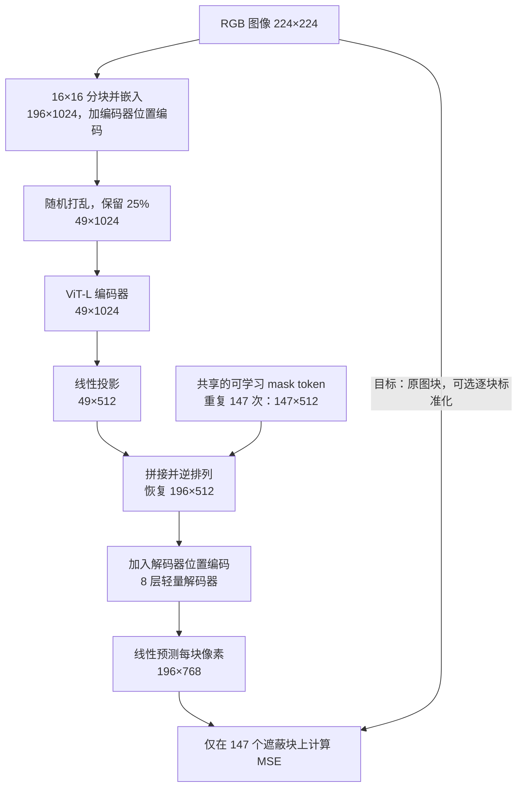

%% learning-vault-navigation:v1 %%
> [!abstract]- 笔记导航
> 目录：[[Paper/README|论文阅读 · 索引]]
> 相关：[[Paper/AN IMAGE IS WORTH 16X16 WORDS/ViT|ViT · 视觉 Transformer]] · [[Paper/BERT Pre-training of Deep Bidirectional Transformers for/BERT|BERT · 语言表示预训练]]

# Masked Autoencoders Are Scalable Vision Learners

# First Time

## 1.Abstract
- **问题：** 如何从图像本身学习可迁移的表征，并让视觉自监督预训练有效利用大模型？
- **动机：** 图像空间冗余高，低遮蔽比例容易靠局部信息补全；让大编码器处理缺失位置也浪费计算。
- **方法：** 随机遮蔽约 75% 图块，大编码器仅处理可见部分，小解码器补入 mask tokens 后预测像素。
- **结果：** ViT-H/14 经 ImageNet-1K 自监督预训练及有监督微调，在 448×448 下达到 87.8% Top-1；224×224 下为 86.9%。检测、分割等任务也有迁移收益。
- **意义：** 简单的像素重建目标，配合恰当的架构和任务难度，能够支持大规模视觉表征学习。

## 2.Conclusion
原文将讨论与结论合并为第 6 节（p8–9）；本次已完整阅读，包括 Broader impacts。
作者观察到模型扩展带来的收益，并展望视觉自监督沿着类似 NLP 的方向发展。合理的整体重建暗示模型学到视觉概念；“丰富隐藏表征导致这一现象”是作者假设，尚无严格机制证明。作者也指出模型可能继承数据偏差，并生成原图不存在的内容。

## 3.Figure & Table
按原文出现顺序列出，共 **11 图、13 编号表、1 无编号表**。ft 为端到端微调；lin 为冻结编码器的线性探测。

#### Fig1:
- （p1）：核心架构。高遮蔽、仅可见块进入编码器、晚加入 mask tokens、轻量解码器共同作用。
#### Fig2:
- （p2）：ImageNet 的 80% 遮蔽重建；可见块未参与损失，输出没有覆盖回真实可见像素。
#### Fig3:
- （p2）：同一 ImageNet 预训练模型重建 COCO 图像；支持定性跨数据集迁移，细节可能偏离原图。
#### Fig4:
- （p3）：训练遮蔽率 75%，展示 75/85/95% 遮蔽下重建；可推断整体结构，细节仍不确定。
#### Fig5:
- （p4）：lin 在 75% 达峰；ft 在 60% 达 85.0%，75% 为 84.9%。75% 是有效折中。
#### Table14:
- 原文无编号，导读补号；（p4）：ViT-L：原始从头训练 76.5%，改进基线 82.5%，MAE 84.9%；总训练预算不同。
#### Table1:
- a–f（p5）：解码器深度/宽度、编码器 mask、目标、增强、遮蔽方式六组消融。默认 800 轮、原始像素；去掉编码器 mask 的 lin 为 73.5%，包含时为 59.6%；逐块标准化像素的 ft 为 85.4%。
#### Table2:
- （p5）：800 轮、128 TPU-v3 核、75% 遮蔽，相对编码器含 mask 的配置，8 层解码器的 L/H 分别快 2.8/3.5 倍；H 基线耗时由 10 轮估计。
#### Fig6:
- （p6）：比较 random/block/grid；重建更清晰或损失更低，不保证表征更好。block 示例遮蔽率为 50%。
#### Fig7:
- （p6）：100→1600 轮，ft 82.3→85.1%，lin 57.3→75.1%；收益限于已测试范围。
#### Table3:
- （p7）：1600 轮、标准化像素；MAE B/L/H 在 224 分辨率为 83.6/85.9/86.9%，H448 为 87.8%；“最佳”对应论文当时的比较范围。
#### Fig8:
- （p7）：B→L→H 时 MAE 的收益优于 ImageNet-1K 监督基线；尚不足以建立普遍缩放定律。
#### Fig9:
- （p7）：MAE 的 lin 低于 MoCo v3（73.5/77.6%），微调最后一个 block 后反超（81.0/79.9%）；冻结表征并非唯一评价方式。
#### Table4:
- （p8）：COCO，L 的 box AP 相比监督预训练提高 4.0 点；与 BEiT 同为 53.3。
#### Table5:
- （p8）：ADE20K，L 达 53.6 mIoU，比监督预训练高 3.7 点，比 BEiT 高 0.3 点。
#### Table6:
- （p8）：iNaturalist、Places 分类迁移；Places205 需 H448 才超过表中历史结果，系统比较条件不完全相同。
#### Table7:
- （p8）：标准化像素与 dVAE 目标结果接近；“统计不显著”为作者陈述，表中未给出完整检验信息。
#### Table8:
- （p11）：预训练配置：AdamW、batch 4096、基础 LR 1.5e-4；按 batch/256 缩放后实际 LR 为 0.0024。
#### Table9:
- （p11）：微调配置：AdamW、batch 1024、分层学习率衰减 0.75；B 100 轮，L/H 50 轮。
#### Table10:
- （p11）：lin 配置：冻结编码器，LARS、batch 16384、90 轮；分类头前使用无仿射参数的 BN。
#### Table11:
- （p12）：监督从头训练配置含较强增强和 EMA；B 300 轮，L/H 200 轮，需留意强基线与预算。
#### Table12:
- （p12）：MAE B/L/H 的 lin 为 68.0/75.8/76.6%；L 仍低于 MoCo v3 的 77.6%，与图 9 的配方不同。
#### Table13:
- （p12）：大模型鲁棒性收益较强；B 在 IN-C/R/Sketch 落后对应监督基线。IN-C 是越低越好的错误指标，H448 的 36.8 劣于 H224 的 33.8。
#### Fig10:
- （p13）：95 组 ImageNet 随机重建样例，75% 遮蔽；展示定性表现，未给汇总成功率。
#### Fig11:
- （p14）：95 组 COCO 样例，同样 75% 遮蔽、ImageNet 预训练；轮廓可恢复，文字、纹理等细节可能失真。
# Second Time

## 1.Introduction
视觉与语言的差异影响预训练设计：ViT 便于按图块处理；图像局部冗余要求更高遮蔽比例；像素重建与语义识别的目标不同，适合让解码器承担重建细节。

## 2.Related Work
定位于自动编码器、遮蔽图像建模、自监督学习和视觉 Transformer 的交汇处。相对 BEiT，MAE 使用像素目标，省去外部离散 tokenizer；相对 MoCo 等方法，学习信号来自缺失像素预测。遮蔽重建本身已有历史，本文贡献在于有效且高效的组合设计。

## 3.Approach
**输入→处理→输出：** 图像分块并嵌入，加入编码器位置编码；随机打乱、保留可见块；编码后投影宽度，补齐共享的可学习 mask token；逆排列恢复位置，加入解码器位置编码；预测每块像素。
仅遮蔽块参与损失，但梯度通过解码器更新编码器。标准化目标按每块像素的均值和标准差处理，与输入标准化、LayerNorm 不同。重建损失为 $\mathcal L=\frac{1}{|M|}\sum_{i\in M}\operatorname{MSE}(\hat{x}_i,x_i)$，这里 $M$ 是遮蔽块集合，$x_i$ 为原始或逐块标准化后的像素向量；MSE 对块内像素取均值。这是说明性公式，原文未编号。
下图以单张 RGB 224×224、ViT-L/16、75% 遮蔽为例；省略 batch 维和辅助 class token，位置编码保留各图块原始空间位置。

**实现与迁移：** 打乱、截取、拼接、逆排列即可完成遮蔽，无需专用稀疏算子。下游任务移除解码器，将完整图像送入编码器和任务头；线性探测冻结编码器，微调则更新部分或全部编码器。自监督预训练不需要人工标签，分类微调仍使用标签。

# Overall Review

- **核心贡献：** 将高比例随机遮蔽与仅可见块编码、小解码器结合；验证直接像素重建可以支持大模型扩展和多任务迁移。
- **优势：** 方法简洁；消融、耗时、不同模型规模和迁移实验形成较完整证据链，标准化像素避免外部 tokenizer。
- **不足：** lin 不占优；小模型鲁棒性存在反例；1600 轮训练成本仍高；跨方法数据/预算不完全匹配，小差异缺少完整不确定性报告。重建语义机制尚为假设。
- **与已有工作的关系：** 延续自动编码器与遮蔽预测思路，用架构和任务难度适配视觉；BEiT、MoCo 分别提供遮蔽建模和表征评价的对照。
- **启发与延伸（待验证设想）：** 固定总训练 FLOPs 比较遮蔽比例，或检验重建质量与下游收益的相关性；目前仅是实验问题。
- **适合读者：** 已了解 ViT、自注意力、反向传播与 MSE，希望学习自监督预训练和实验消融设计的读者。完成阅读不等同于实现或复现成功。
